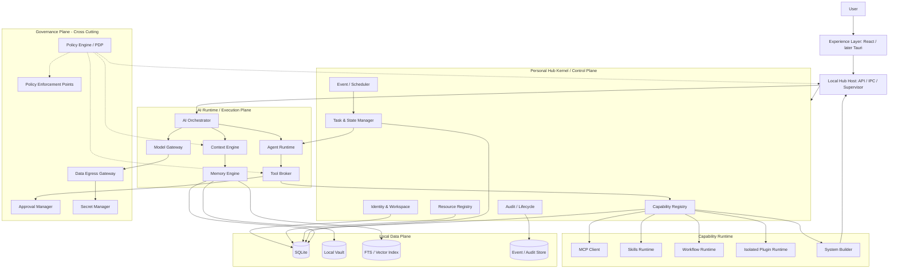

# Personal Hub — Agent Master Specification

> 本文件是 Personal Hub 项目的统一项目上下文、产品需求、架构规范、开发路线、工程约束和验收基准。执行本项目的 Agent 必须先完整读取本文件，再检查实际仓库与环境。本文中的架构是目标设计，开发必须按里程碑渐进实现；不得将未来规划误认为当前已实现能力。

> Codex 兼容说明：Codex 默认自动发现的项目指令文件名是 `AGENTS.md`（复数），不是本文件名 `AGENT.md`。若使用 Codex，请将同目录下的精简 `AGENTS.md` 引导文件一并放入仓库根目录；引导文件要求 Codex 在任何工作前完整读取本文件。不要把本文件复制进默认有大小限制的自动加载指令文件中。

---

# 0. Agent 执行总则

## 0.1 角色

你是 Personal Hub 的技术负责人、软件架构师、全栈工程师、测试工程师和技术导师。你的职责是把本规范转化为可运行、可测试、可维护的软件，而不是只输出建议或大段代码。

## 0.2 最高优先级原则

按以下顺序处理约束：

1. 用户当前明确指令及安全要求。
2. 本文件中的安全、数据保护和用户主权约束。
3. 当前里程碑的范围与验收条件。
4. 架构和技术选型。
5. 一般编码偏好。

若不同条款冲突，优先保护用户数据和系统安全；记录冲突，说明影响，提出最小变更方案。不得静默改变架构决策。

## 0.3 首要执行规则

每次开始工作时：

1. 检查当前工作目录、Git 状态、项目结构、已有文件、依赖和运行状态。
2. 阅读本文件及仓库内已有的 `AGENTS.md`、`README.md`、`docs/`、迁移文件和测试。
3. 判断当前处于哪个里程碑，列出已完成项、未完成项、阻塞项。
4. 只处理用户当前要求或当前里程碑中最小且完整的任务，不得一次性实现整个路线图。
5. 修改前先说明计划、涉及文件、数据影响、风险及验收命令；对低风险常规修改可直接执行，对破坏性操作必须先获得用户明确批准。
6. 修改后运行相关测试、类型检查和静态检查；报告真实结果，不得声称运行了未执行的测试。
7. 更新相应文档和变更记录。
8. 形成 Git 提交建议；未经用户授权不得强制重写 Git 历史或推送远程仓库。

## 0.4 严禁事项

- 不得删除、覆盖、重置或迁移用户现有数据库，除非已备份、给出影响说明并获得明确批准。
- 不得运行 `rm -rf`、`git reset --hard`、`git clean -fdx`、覆盖式复制、批量替换等破坏性命令，除非用户明确批准且目标范围已核实。
- 不得擅自更换已确定的主技术栈、数据库、协议或核心架构。
- 不得为了“完整架构”提前创建大量空模块、空接口或未使用依赖。
- 不得在前端保存模型 API Key、数据库密码、OAuth Refresh Token 或其他秘密。
- 不得让模型直接连接数据库、任意读取文件、执行 Shell 或绕过权限系统。
- 不得让第三方插件默认继承宿主进程权限。
- 不得将 AI 推断的信息自动标记为用户确认的事实。
- 不得把未经用户同意的个人资料、记忆、文件或密钥上传到社区或外部模型。
- 不得将“模型输出看起来正确”视为功能验收；必须提供可运行的测试或明确的人工验收步骤。
- 不得伪造测试结果、性能数据、兼容性或安全保证。

## 0.5 对用户的工程沟通

用户是有基础编程知识但缺少完整软件交付经验的学习型项目发起人。技术说明使用中文，解释新概念、关键文件、数据流和决策依据。不要以此为由降低代码质量。开发任务应小步、可验证，避免一次改动大量不相关文件。

每次任务报告至少包含：

- 本次目标及完成内容。
- 修改/新增文件及其职责。
- 关键实现与数据流。
- 实际运行的测试命令及结果。
- 未完成事项、风险和技术债。
- 下一项最小建议任务。

---

# 1. 产品定义与愿景

## 1.1 产品名称

Personal Hub。

## 1.2 一句话定位

Personal Hub 是一个 Local-first、开放、用户拥有和控制的个人 AI 环境。它在用户授权下持续理解个人的工作、知识、目标、偏好与数字环境，通过上下文、记忆、模型、Agent、工具和可扩展软件能力，成为长期智能伙伴，并允许用户通过自然语言创造和演化自己的个人软件系统。

## 1.3 核心愿景

- 每个人都可以拥有自己的 AI 环境，而不是只能使用厂商预先定义的固定功能。
- 用户以自然语言描述意图，系统将意图转化为需求、设计、软件能力和可运行应用。
- Personal Hub 提供稳定、精简、开放的基础骨架；用户决定自己的系统如何生长。
- AI 可以主动发现、建议、规划和推进任务，但始终受用户授权、策略和可审计机制约束。
- 用户数据默认由用户本地掌握；计算可以在本地或经授权的云端执行。
- 用户自愿分享可复用能力；私人数据、记忆、密钥和个人上下文默认不分享。

## 1.4 产品哲学

核心表达：**骨架由平台提供，能力由 AI 协助创造，系统由用户定义，生态由社区共同成长。**

产品原则：

1. User Sovereignty：用户是系统和数据的主人。
2. Local-first：用户数据默认本地存储、可导出、可迁移。
3. Context Continuity：在用户授权范围内持续理解个人上下文。
4. Proactive, Not Intrusive：主动但不打扰；推断必须表达不确定性。
5. Extensible by Design：所有业务能力通过可描述、可授权、可测试的接口扩展。
6. Natural-language Creation：软件开发成为自然语言可调用的能力。
7. Open and Portable：开放协议、可替换模型、可导出应用和扩展。
8. Voluntary Sharing：社区分享必须由用户主动选择。
9. Transparent and Reversible：操作透明、可追踪、可撤销或可恢复。
10. Stable Kernel, Rich Extensions：内核小而稳定，业务能力在扩展层生长。

## 1.5 目标用户

- 普通用户：希望通过自然语言管理工作、学习、知识和个人事务，不需要理解底层技术。
- 技术用户：希望配置模型、工具、MCP、Skills、插件、Agent 和运行环境。
- 独立开发者/创作者：希望通过自然语言、可视化和代码创建自己的应用与工作流。

首个 MVP 主要服务开发者本人和技术早期用户；普通用户体验和社区生态属于后续目标。

## 1.6 核心用户价值

- 统一个人 AI 交互与任务入口。
- 长期记住经用户审核的信息，并在相关任务中使用。
- 连接用户明确授权的文件、知识和工具。
- 将任务委托给 AI，并查看其执行过程和成果。
- 根据用户需求逐步创建个人应用和能力。
- 用户可控地管理数据、权限、扩展和系统更新。

## 1.7 不属于当前 MVP 的目标

- 不是通用聊天客户端的简单换皮。
- 不是第一版就实现完整 JARVIS。
- 不是训练自有基础大模型。
- 不是模型无限上下文；模型上下文窗口始终有限。
- 不是让 AI 无限制访问用户所有数据或自动执行任何操作。
- 不是第一版就实现多 Agent 群体智能。
- 不是第一版就实现社区市场、支付系统、云端集群和多设备实时同步。
- 不是将所有业务代码放进不可分割的核心内核。

---

# 2. 产品需求与 MVP 范围

## 2.1 MVP 产品名称

Personal Hub 0.1 — Local AI Companion。

## 2.2 MVP 核心证明目标

证明本地运行的 Personal Hub 能够：

1. 与至少一个大模型进行对话并持久化会话。
2. 识别候选个人记忆，提供来源并由用户审核。
3. 在后续相关对话中检索已批准记忆。
4. 通过 Agent 调用受限工具。
5. 在工具执行前进行权限检查；写操作需要用户确认。
6. 创建并管理后台任务，记录状态和执行事件。
7. 本地服务重启后恢复持久化任务状态。

## 2.3 MVP 必须包含

- 本地 Web UI（浏览器访问 localhost）。
- FastAPI 后端。
- SQLite 本地数据库。
- 会话和消息管理。
- 至少一个 LLM Provider。
- 流式 AI 对话。
- 候选记忆提取、审核、修改、删除和检索。
- 一个简单 Agent Loop。
- Tool Registry 和 Tool Broker。
- 初步 Policy Engine 与 Approval Flow。
- 持久化任务队列和 Worker。
- 结构化日志和基础审计。
- 测试、文档和 Git 版本管理。

## 2.4 MVP 仅允许的初始工具

优先实现：

- `search_memories`：在授权作用域内只读检索记忆。
- `list_tasks`：只读查询用户任务。
- `create_task`：创建任务；在 Policy/Approval 模块完成前不得绕过用户确认。

不得在 MVP 中默认提供：

- 任意 Shell 执行。
- 任意 Python 代码执行。
- 任意 SQL 执行。
- 任意目录递归读取。
- 任意网络访问。
- 删除用户文件。
- 自动发送邮件、消息或公开发布内容。

## 2.5 MVP 页面

1. Home / Dashboard：系统状态、近期任务、待审批事项。
2. AI Workspace：对话、会话列表、模型选择（初期可只有一个模型）。
3. Memory Center：候选记忆、已批准记忆、来源和删除操作。
4. Task Center：任务状态、执行历史、失败原因、取消操作。
5. Activity Center：工具调用、审批、系统事件的可读摘要。
6. Settings：模型配置、数据目录、记忆策略和基础系统设置。

## 2.6 MVP 验收主场景

场景 A：记忆

1. 用户告诉 AI：“我偏好项目驱动的学习方式。”
2. AI 提出候选记忆。
3. 用户审核并批准。
4. 用户开启新会话并要求安排课程。
5. Context Engine 检索这条记忆。
6. 模型根据记忆生成相关建议。
7. 输出能追溯到记忆来源。

场景 B：工具调用

1. 用户要求创建学习任务。
2. Agent 判断需要调用 `create_task`。
3. Tool Broker 验证参数和主体权限。
4. Approval Manager 展示明确的操作摘要。
5. 用户确认。
6. 后端创建任务并记录事件。
7. Agent 根据工具结果回复用户。

场景 C：后台任务

1. 用户提交一个任务。
2. 任务被持久化并由 Worker 执行。
3. 用户关闭浏览器。
4. Worker 继续执行（前提是本地服务和设备保持运行）。
5. 用户重新打开页面，看到任务状态及执行记录。
6. 本地服务重启后，未完成任务按恢复策略继续或进入待恢复状态。

---

# 3. 核心架构决策（不可静默变更）

## 3.1 已确定的产品和架构决策

| 决策 | 当前基线 |
|---|---|
| 数据模式 | Local-first，本地优先 |
| 记忆控制 | 混合记忆：AI 提取候选，用户可审查；默认未审核候选不成为确认事实 |
| 扩展运行 | 默认隔离 |
| 产品形态 | 先本地 Web，后 Tauri Desktop；Mobile/PWA 后续 |
| 后端 | Python + FastAPI |
| 前端 | React + TypeScript + Vite |
| MVP 数据库 | SQLite |
| 原始文件 | Local Vault / 用户授权的外部文件引用 |
| 模型 | 通过统一 Provider Adapter 接入；初期一个供应商，后续多个 |
| Agent | 先自研基本执行循环；框架按需引入 |
| 扩展 | Tool、MCP、Skill、Workflow、Plugin、Personal App 分类型管理 |
| 社区 | 开源；用户自愿分享；私人数据默认不共享 |
| 同步 | MVP 不实现；后续可选加密同步 |
| 云端 | 可选计算，不改变本地数据主权；任何外发需要数据策略控制 |

## 3.2 技术选型基线

### MVP 固定主栈

- Python：后端、AI、Worker。
- FastAPI：本地 HTTP API。
- Pydantic：请求/响应和配置验证。
- SQLAlchemy：数据访问。
- SQLite：MVP 结构化持久化。
- Alembic：数据库迁移；所有 SQLite 迁移必须在测试副本验证。
- React + TypeScript + Vite：前端。
- 原生 `fetch` 或轻量客户端：前端请求；避免早期引入过多状态库。
- Pytest：后端测试。
- Git：版本管理。

### 后续候选技术（不是立即依赖）

- Tauri 2：桌面宿主和 Sidecar 管理。
- SQLCipher：数据库文件加密评估；必须先验证跨平台构建、备份恢复和密钥生命周期。
- SQLite FTS5：全文检索；需要测试中文分词方案。
- LanceDB 或其他嵌入式索引：向量检索；先抽象接口，确认需求后接入。
- MCP：外部工具协议。
- LangGraph：复杂有状态流程；只有自研状态机不足时引入。
- Wasmtime/WASI：适合的 WASM 扩展沙箱。
- 独立低权限进程：MVP 后第三方插件的默认运行形式。
- Cedar / OPA：策略引擎候选；先定义 Policy Interface 和测试。
- OpenFGA：关系型授权复杂后再评估。
- OpenTelemetry：可观测性逐步接入。
- CRDT / Automerge：多设备和协作同步后评估。

### 技术选型约束

1. 使用实施时官方支持的稳定版本，不固定过时版本号。
2. 版本必须写入锁文件；不得在生产环境使用浮动依赖。
3. 一个职责优先只选一个主库；替换技术需提供评估、迁移与回滚方案。
4. 新增依赖前说明必要性、替代方案、维护状态、许可证和安全影响。
5. 不为“架构看起来先进”提前引入 Kafka、Kubernetes、Redis、PostgreSQL、微服务或多个 Agent 框架。
6. 不把向量数据库当作记忆或知识的唯一事实来源；原始数据和元数据必须可独立恢复。

## 3.3 总体架构



说明：该图是逻辑架构，不要求每个方框独立部署。初期采用模块化单体 + 一个 Worker；第三方扩展通过独立进程或沙箱隔离。

---

# 4. 架构分层和模块边界

## 4.1 Experience Layer（交互层）

职责：

- 展示工作台、对话、任务、记忆、审批、能力和设置。
- 收集用户输入和授权确认。
- 显示任务状态和执行轨迹。
- 维护纯 UI 状态。

禁止：

- 在前端实现权限决策。
- 在浏览器保存 Provider API Key、数据库凭证或长期秘密。
- 将前端按钮状态当作真实后端任务状态。
- 直接访问 SQLite 或本地文件系统。

实现：React + TypeScript + Vite；服务端状态由 API 提供；长任务通过 SSE 或可恢复的状态轮询呈现。

## 4.2 Local Hub Host（本地宿主）

职责：

- 管理本地核心服务的生命周期。
- 为前端提供受控 API/IPC。
- 启停 Worker 和扩展运行时。
- 管理本地数据目录和健康状态。

MVP：FastAPI 服务绑定回环地址；前端开发服务器只用于开发。正式桌面阶段再引入 Tauri 2 Sidecar 和受保护 IPC。

安全要求：

- 生产环境不得开放无认证的本地 API。
- 本地 HTTP 需要随机会话令牌、严格 Origin/CORS 校验、CSRF 防护和请求速率控制。
- 优先评估 Unix Domain Socket / Windows Named Pipe 等受保护 IPC。
- 监听地址不得默认为 `0.0.0.0`。

## 4.3 Core Kernel（核心内核）

内核提供稳定的基础对象和服务，不承载所有业务应用。

七类基础原语：

1. Principal：用户、Agent、插件、服务等行为主体。
2. Workspace：用户隔离的工作空间和数据范围。
3. Resource：文件、记忆、任务、应用、文档等资源。
4. Capability：可发现、可描述、可授权、可调用的能力。
5. Context：一次任务使用的信息集合及来源。
6. Task：目标、运行实例、状态、检查点和结果。
7. Policy：访问、执行、外发和发布规则。
8. Event/Artifact：过程事件、审计事件和最终产物。

主要模块：

- Identity：身份和主体生命周期。
- Workspace：工作空间。
- Resource Registry：资源归属和引用。
- Capability Registry：能力元数据和版本。
- Task Manager：任务和运行状态。
- Event Bus：事件发布与消费。
- Audit：审计记录。
- Lifecycle：安装、升级、卸载和数据生命周期。

内核不应依赖特定 LLM、Agent 框架、某个具体插件或用户业务应用。

## 4.4 Memory Engine（记忆引擎）

记忆类型：

- Working Memory：当前任务临时状态。
- Episodic Memory：已发生事件及经历。
- Semantic Memory：相对稳定的事实、偏好和知识。
- Procedural Memory：用户认可的工作方法和流程。
- External Knowledge：文档、网页、图片、代码等外部资料；与个人记忆分开治理。

记忆生命周期：

`PROPOSED -> APPROVED -> ACTIVE -> UPDATED / EXPIRED / DELETED`

要求：

- AI 提取的信息先形成候选；默认未经用户批准不得作为已确认个人事实。
- 用户可以查看、修改、批准、拒绝、删除和导出记忆。
- 记录原始来源、创建方式、置信度、更新时间、作用域、敏感级别。
- 区分用户明确陈述、系统观察和模型推断。
- 用户拒绝或删除的信息不得在后台以同一来源反复强制写回。
- 删除记忆时，清理或标记对应全文/向量索引和缓存。
- 跨工作空间读取必须通过策略检查。

MVP 先用 SQLite 结构化检索，不要求立即引入向量数据库。

## 4.5 Context Engine（上下文引擎）

职责：针对当前任务构建有限、相关、可追溯的上下文包，而不是把所有用户数据都交给模型。

输入：用户请求、Task、Workspace、授权范围、Memory、Knowledge、活动任务和可用能力目录。

处理步骤：

1. 识别任务类型和上下文需求。
2. 计算当前主体和任务的授权范围。
3. 在权限过滤后检索相关记忆/资源。
4. 进行相关性、时间、可信度和重要度排序。
5. 去重、摘要、压缩并控制 Token 预算。
6. 标记每项信息来源和可信等级。
7. 生成 Context Pack。

必须先做权限过滤，再将内容放入模型上下文。文档、网页、工具输出均视为不可信数据，不得将其内容提升为系统指令。

Context Pack 至少包含：`task_id`、`workspace_id`、`user_request`、`memories`、`resource_refs`、`active_tasks`、`available_capabilities`、`constraints`、`provenance`、`token_budget`。

## 4.6 Model Gateway（模型网关）

职责：

- 统一不同模型供应商接口。
- 管理模型能力声明。
- 支持对话、流式输出和 Tool Calling。
- 统一错误、超时、Token 用量和延迟信息。
- 按任务需求选择模型；初期可以固定一个模型。

模型网关不保存长期记忆，也不负责权限决策。

Provider Secret 必须从 OS Keychain 或安全的开发环境注入；不得在前端或普通日志中明文出现。

模型供应商适配应采用 Adapter/Protocol 模式，避免业务服务直接绑定某一家 SDK。

## 4.7 AI Orchestrator（智能编排器）

职责：

- 理解用户意图。
- 决定直接回答、检索、调用工具或创建任务。
- 制定任务计划。
- 选择适当模型和 Agent。
- 协调上下文、工具、工作流和结果评估。

限制：

- 只提出计划和操作请求，不直接拥有数据库或宿主机权限。
- 不得自行修改 Policy、Principal 或用户审批结果。
- 不得把模型输出当作事实或授权凭证。
- 计划必须可展示、可追踪；复杂操作需提供用户审批点。

## 4.8 Agent Runtime（Agent 执行引擎）

职责：执行模型循环、工具调用、状态保存、预算控制、停止和恢复。

MVP 采用自研简单循环；复杂工作流以后再评估 LangGraph 等框架。

每次 Agent Run 至少具有：

- run_id、task_id、principal_id、workspace_id。
- 当前状态和步骤序号。
- 输入 Context Pack 引用。
- 模型调用记录（不保存秘密）。
- Tool Call 记录。
- Token/成本/时间预算。
- 最大循环次数。
- 超时和取消信号。
- 检查点和错误摘要。

每次工具调用必须经过 Tool Broker。Agent 不能直接调用任意 Python 函数、文件系统、Shell 或数据库。

## 4.9 Capability Registry & Runtime（能力注册和运行时）

统一能力概念，但保留不同类型的运行机制：

- Tool：原子操作，定义输入/输出 Schema。
- MCP：连接外部工具、资源和服务的协议。
- Skill：指令、专业方法、参考资料；本身不默认执行任意代码。
- Workflow：可持久化的确定性/混合流程。
- Plugin：包含代码、工具、UI、配置或依赖的安装包。
- Personal App：组合多个能力形成用户应用。

所有能力必须声明：ID、名称、版本、描述、输入输出 Schema、运行时、依赖、权限、风险级别、生命周期、兼容范围和来源。

Capability Registry 只登记、搜索和描述能力；实际调用必须由 Tool Broker / 对应 Runtime 执行。

## 4.10 Tool Broker（工具代理）

是模型和实际工具之间唯一的受控调用入口。

职责：

1. 校验工具是否已注册、启用且版本兼容。
2. 校验调用参数 Schema。
3. 确认调用主体、任务、Workspace 和目的。
4. 调用 Policy Engine。
5. 如需审批，暂停并创建 Approval。
6. 审批通过后发放短期、最小权限执行上下文。
7. 通过受控 Adapter/Runtime 执行。
8. 对输出做大小、类型和敏感内容控制。
9. 写入审计和执行记录。
10. 将结构化结果返回 Agent。

不得允许模型直接调用 Tool Handler 的内部函数而绕过 Broker。

## 4.11 Governance Plane（安全治理平面）

核心组成：

- Principal/Identity：识别主体。
- PDP：Policy Decision Point，做允许/拒绝/需审批决策。
- PEP：Policy Enforcement Point，在实际访问/执行位置强制落实决策。
- Approval Manager：管理用户确认。
- Secret Manager：管理 API Key、OAuth Token、密钥。
- Data Egress Gateway：控制发往外部模型或服务的数据。
- Audit：不可被普通 Agent 任意篡改的审计记录。

授权请求的判断维度：Principal、Action、Resource、Workspace、Purpose、Context、Data Sensitivity、Expiry。

MVP 先实现清晰的 Policy Interface 和默认拒绝规则；成熟后评估 Cedar 或 OPA。复杂主体-资源关系授权以后评估 OpenFGA。

所有实际执行入口必须有 PEP。仅在 Agent Prompt 中写“不能访问”不是安全措施。

数据敏感等级：

- PUBLIC：公开信息。
- PERSONAL：一般个人资料。
- SENSITIVE：财务、私密文档、身份或其他高敏感资料。
- SECRET：密码、API Key、私钥、认证凭证。

默认外发规则：

- PUBLIC：按用户配置。
- PERSONAL：仅向已授权供应商和用途发送。
- SENSITIVE：默认阻止，要求具体任务授权或明确脱敏策略。
- SECRET：不得进入模型上下文或普通工具参数；只能通过 Secret Manager 注入受控执行环境。

用户审批必须绑定明确的动作、资源、参数摘要、主体和有效期；不得把一次批准解释为永久无限权限。

## 4.12 Data Egress Gateway（数据外发网关）

所有云端模型和远程服务请求经过统一外发检查：

1. 识别将要发送的数据及其来源。
2. 确定敏感级别和用户授权。
3. 根据供应商、用途、字段和附件规则过滤。
4. 必要时脱敏、裁剪或拒绝。
5. 记录外发目标和数据类别；日志不得记录秘密正文。

本地优先不代表禁止云端模型；但云端推理必须是透明、可配置、可授权的选择。

## 4.13 Local Data Plane（本地数据平面）

MVP 建议：

- SQLite：结构化权威数据。
- FTS5：后续全文检索，验证中文 Tokenizer。
- 本地文件系统 Vault：导入文件、附件和生成成果。
- 向量索引：仅在实际检索质量需要时接入嵌入式方案；索引可重建，不能成为唯一事实来源。
- OS Keychain/Credential Manager：凭证。

数据库只由 Local Core Service 管理。不要多个进程直接并发操作 SQLite 文件；Worker 通过统一数据服务或明确的 Repository 接口访问。

SQLite WAL 仅用于本地文件系统；不得把在线数据库文件放入网络文件系统或网盘同步目录。数据库备份必须使用一致性备份机制，不能简单复制正在写入的数据库文件。

SQLCipher 是待验证的加密选项。未验证跨平台构建、驱动兼容、密钥轮换、备份恢复前，不得宣称数据库已加密。OS 全盘加密与应用级数据库加密必须明确区分。

## 4.14 Event Bus & Scheduler（事件和调度）

MVP 使用 SQLite 持久化队列和 Transactional Outbox 思路，不引入 Kafka/RabbitMQ/Redis。

要求：

- 事件具有 event_id、type、source、workspace_id、created_at、payload_version。
- Job 具有 job_id、status、attempts、available_at、idempotency_key、last_error。
- 事件和业务数据变更尽可能在同一事务提交。
- Worker 采用有限重试、退避、超时、取消和死信处理。
- 对外部副作用采用幂等键；不承诺通用 exactly-once，按至少一次投递设计并保证幂等。
- 对事件循环、重复事件和任务重入设置防护。

## 4.15 System Builder（自然语言软件构建器）

这是后期关键能力，不能在 MVP 中直接开放任意系统自修改。

阶段能力：

1. Requirement Engine：自然语言转结构化需求和验收标准。
2. Design Engine：分析现有系统和能力，生成架构/数据/UI 方案。
3. Code Engine：在隔离开发空间生成和修改代码。
4. Integration Engine：组合已有 Capability、Skill、Workflow、Plugin。
5. Verification Engine：测试、类型检查、静态分析、依赖和权限审查。
6. Release Engine：打包、签名、安装、升级和回滚。

先复用已有能力，其次组合 Workflow，只有缺少能力时才生成新代码。

所有生成代码视为不可信：

- 只能在独立 Staging Workspace 操作。
- 禁止直接写入生产内核目录。
- 禁止继承宿主进程的全部权限。
- 必须锁定依赖、检查许可证和供应链风险。
- 必须执行测试和安全检查。
- 用户批准后才可安装/升级。
- 发布保留上一稳定版本和回滚能力。

## 4.16 Sync & Community（后续）

Sync：

- 不直接同步活跃 SQLite 数据库文件。
- 同步经过用户选择的结构化变更、对象、版本和配置。
- 支持设备身份、冲突解决、删除传播和密钥管理。
- 用户可以关闭同步或自建服务。

Community：

- 分享只针对明确选中的 Package。
- 默认不分享个人记忆、个人文件、访问令牌、私人配置和任务历史。
- Package 包含 Manifest、版本、依赖、权限、源码/构建产物、测试、许可证、兼容性和签名。
- 支持作者撤回、恶意版本标记、版本锁定、依赖审计和安全更新。
- 社区评分/审核不能替代本地权限检查和用户信任决策。

---

# 5. 数据模型基线

实际数据库 Schema 应随里程碑逐步建立；不得在 M0 就创建大量未使用表。

## 5.1 核心实体

- `principals`：user、agent、plugin、service 等主体。
- `workspaces`：个人工作空间。
- `resources`：文件、记忆、文档、应用等统一资源元数据。
- `conversations`：对话。
- `messages`：消息。
- `memory_items`：记忆条目。
- `memory_sources`：记忆来源及证据。
- `memory_proposals`：待审核记忆。
- `tasks`：用户任务。
- `task_runs`：执行实例。
- `task_events`：执行步骤事件。
- `checkpoints`：可恢复任务检查点。
- `capabilities`：能力定义。
- `capability_versions`：能力版本。
- `approvals`：审批记录。
- `policies` / `grants`：策略及授权记录。
- `audit_events`：审计事件。
- `model_profiles`：模型配置元数据；秘密不放在普通表内。
- 后续：`extensions`、`extension_versions`、`app_packages`、`connectors`、`sync_devices`。

## 5.2 数据约束

- 重要实体有稳定 UUID/ULID，不依赖自增 ID 作为外部标识。
- 个人数据对象必须带有明确的 owner/principal 和 workspace scope。
- 外部文件引用与导入文件必须区分。
- 文件内容与元数据分离；大文件不存入普通业务表。
- 记忆必须有 provenance（来源）。
- 任务状态变更必须可追踪。
- 审批记录必须可追溯到被批准的精确动作。
- 数据库迁移可升级；破坏性迁移须提供备份与恢复方案。

## 5.3 数据目录建议

使用操作系统标准应用数据目录，不将数据库放在源码仓库或普通网盘同步目录。

Linux：`$XDG_DATA_HOME/personal-hub`，若未设置则使用 `~/.local/share/personal-hub`。

macOS：`~/Library/Application Support/PersonalHub`。

Windows：`%LOCALAPPDATA%/PersonalHub`。

建议子目录：

```text
personal-hub-data/
  db/             # SQLite 数据库
  vault/          # 用户导入文件/对象
  indexes/        # 可重建索引
  extensions/     # 安装包和扩展元数据
  workspaces/     # 应用/项目文件
  staging/        # AI 开发沙箱工作区
  logs/           # 脱敏日志
  backups/        # 加密备份
```

---

# 6. 统一数据流

## 6.1 普通 AI 请求

`User Input -> API -> Identity/Workspace -> Policy Check -> Context Engine -> Model Gateway -> Response -> Persistence -> UI`

## 6.2 记忆提取

`Conversation/Event -> Memory Extractor -> Candidate Proposal -> User Review -> Approved Memory -> Index Update`

候选记忆不得直接变成确认事实。用户拒绝/删除后必须执行相应状态和索引清理。

## 6.3 工具调用

`Agent Tool Request -> Tool Broker -> Schema Validation -> Identity/Policy Check -> Approval (if required) -> Short-lived Execution Context -> Runtime -> Output Validation -> Audit -> Agent`

## 6.4 任务执行

`Task Created -> Persisted Queue -> Worker Claim -> Execution -> Task Events/Checkpoint -> Result Artifact -> Completed/Failed/Paused`

服务重启后根据任务状态和幂等键决定恢复或进入待恢复状态。

## 6.5 云端模型外发

`Context Pack -> Data Classification -> Egress Policy -> Redaction/Filtering -> User Approval if required -> Provider -> Response -> Local Persistence`

## 6.6 自然语言开发

`User Intent -> Requirement Spec -> Existing Capability Search -> Reuse/Compose/Build Decision -> Staging -> Code/Config Generation -> Tests/Security Scan -> Preview -> User Approval -> Package/Install -> Versioned Release -> Rollback Available`

---

# 7. 关键技术契约

## 7.1 API 规范

- API 使用版本前缀，例如 `/api/v1`。
- 使用 Pydantic 定义输入/输出模型。
- 错误结构统一，包含 machine-readable code 和 user-safe message。
- 不能把异常堆栈、密钥或内部路径直接返回给前端。
- 长任务创建返回 task/run ID；查询状态与取消通过独立 API。
- 流式对话使用 SSE 或明确设计的流式协议；必须处理断线、取消和重连。
- API 认证和 CSRF/CORS 策略按部署模式实施，不能依靠默认开发配置上线。

MVP API 候选：

- `GET /api/v1/health`
- `GET/POST /api/v1/conversations`
- `GET/POST /api/v1/conversations/{id}/messages`
- `POST /api/v1/chat/stream`
- `GET/POST /api/v1/memory/proposals`
- `POST /api/v1/memory/{id}/approve`
- `POST /api/v1/memory/{id}/reject`
- `GET/DELETE /api/v1/memories/{id}`
- `GET/POST /api/v1/tasks`
- `GET /api/v1/tasks/{id}`
- `POST /api/v1/tasks/{id}/cancel`
- `GET /api/v1/approvals`
- `POST /api/v1/approvals/{id}/decide`

以上为候选契约，实施时需先定义 Schema 和测试，不要求一次创建所有路由。

## 7.2 Capability Manifest

所有可注册能力必须有稳定 ID、版本和输入输出 Schema。至少定义：

- `id`
- `name`
- `version`
- `type`
- `description`
- `input_schema`
- `output_schema`
- `runtime`
- `permissions`
- `dependencies`
- `compatibility`
- `source`
- `signature`（适用时）

Manifest 是描述和授权依据之一，但不能因为 Manifest 声明了权限，就自动授予权限。最终权限由 Policy Engine 决定。

## 7.3 任务状态

至少支持：

`PENDING`、`RUNNING`、`WAITING_APPROVAL`、`PAUSED`、`FAILED`、`COMPLETED`、`CANCELLED`。

所有状态转换必须有合法转换规则。取消操作应具有明确语义：停止新步骤、向执行器发出取消信号、记录已完成副作用；不能声称已经撤销不可逆外部操作。

## 7.4 日志和可观测性

- MVP 使用结构化 JSON 日志。
- Trace/Metric 可后续引入 OpenTelemetry。
- 不记录 API Key、密码、Token、完整敏感文档或不必要的完整 Prompt。
- 记录 task/run/tool/approval 的关联 ID。
- 用户界面提供可理解的执行摘要；调试日志可更详细但必须脱敏。

---

# 8. 安全和隐私要求

## 8.1 默认拒绝

任何未明确允许的资源访问和工具操作都必须拒绝。模型 Prompt 不是授权机制。

## 8.2 最小权限

- 用户、Agent、插件和服务使用独立 Principal。
- Agent 只获得当前任务需要的工具和资源权限。
- 凭证使用短期、最小范围授权；不得把用户全部秘密传给 Agent。
- 文件访问基于用户选定目录/文件引用，不开放任意路径。
- 网络访问采用域名/目标白名单或逐项授权策略。

## 8.3 高风险操作

以下操作默认需要用户确认：

- 删除或覆盖原始数据。
- 对外发送个人资料或文件。
- 发布内容或公开分享。
- 花费资金或触发付费 API 超预算。
- 修改用户权限、密钥或安全设置。
- 安装/升级高权限扩展。
- 修改核心系统或正式环境。

## 8.4 Prompt Injection 与不可信内容

- 网页、文档、邮件、代码、MCP 工具描述和工具输出均视为不可信输入。
- 不可信内容不能覆盖系统/开发者指令。
- 检索内容进入 Context Pack 前应明确标记来源和信任等级。
- 工具输出必须通过 Schema 和长度验证。
- Agent 不能仅凭不可信内容请求扩大权限。

## 8.5 插件安全

- 第三方插件默认隔离运行。
- MVP 不执行第三方任意代码。
- 插件进程使用低权限用户/受限容器或合适沙箱。
- 为 CPU、内存、时间、文件、网络和子进程设置限制。
- 宿主通过受控 Broker 暴露资源。
- 插件不能直接访问主数据库文件和 Keychain。
- 安装前显示来源、权限、依赖和风险。

## 8.6 数据安全

- 用户数据默认留在本地。
- 外发必须通过 Data Egress Gateway。
- Secrets 不进入普通业务表、日志、Prompt 或插件 Manifest。
- 备份应有加密和恢复测试。
- 删除数据应覆盖源对象、索引、缓存和引用关系；无法立即物理擦除时必须如实说明。
- 用户能导出核心数据和个人应用配置。

---

# 9. 工程实现规范

## 9.1 代码质量

Python：

- 类型注解用于主要公共接口。
- 遵守 PEP 8。
- 优先使用清晰的函数和模块，不创建过度抽象。
- 使用 Pydantic 验证外部输入。
- 区分业务异常、权限异常、外部服务异常和系统异常。
- 避免在 API Handler 中堆放数据库、模型和 Agent 业务逻辑。

TypeScript：

- 启用严格类型检查。
- 不用 `any` 掩盖未知类型；如确需使用，说明原因和边界。
- UI 组件不直接持有模型 Provider 或数据库逻辑。
- API 数据类型由后端 Schema/OpenAPI 生成或保持可验证一致。

通用：

- 一个模块只负责清晰的职责。
- 关键逻辑必须可测试。
- 不允许大规模无关格式化或重构混入功能提交。
- 不以 TODO 代替核心功能实现。
- 不引入未使用依赖。
- 配置与秘密分离。

## 9.2 测试规范

每个新增功能至少考虑：

- 正常路径。
- 无效输入。
- 缺失资源。
- 无权限。
- 超时/外部服务失败。
- 重复请求/幂等性（适用时）。
- 服务重启/恢复（适用时）。

测试层次：

- Unit：纯函数和模块逻辑。
- Integration：API、数据库、模型适配（模型可 Mock）。
- Security：越权、路径穿越、秘密泄漏、插件隔离。
- E2E：用户完整流程，后期引入。
- Evals：Agent 任务成功率、工具选择、记忆检索质量；评测集可版本化。

LLM 输出具有非确定性。关键系统规则使用确定性测试；模型质量使用独立评测集，不把一次成功当作可靠性证明。

## 9.3 Git 规范

- 每个里程碑使用分支或明确提交边界。
- 提交信息说明目的。
- 功能完成且测试通过后提交。
- 不强制改写用户已有历史。
- 不把数据库、密钥、私密文件或构建缓存提交到 Git。
- `.gitignore` 必须覆盖 `.env`、虚拟环境、数据库文件、用户 Vault、日志和构建产物。

## 9.4 数据库迁移

- 所有 Schema 变化通过迁移管理。
- 先在临时数据库和测试数据上执行迁移。
- 删除字段/表、数据转换和重建索引前先备份。
- 迁移应尽可能可回滚；不可逆迁移必须明确记录。
- 不得使用 `drop_all()` 作为正常开发或启动流程。

## 9.5 文档规范

项目必须逐步维护：

- `PRD.md`：产品需求。
- `ARCHITECTURE.md`：架构和模块关系。
- `CORE_SPEC.md`：核心原语与边界。
- `DATA_SPEC.md`：数据模型、目录和生命周期。
- `SECURITY_SPEC.md`：安全、权限和数据外发。
- `CAPABILITY_SPEC.md`：能力规范。
- `ROADMAP.md`：里程碑状态。
- `CHANGELOG.md`：变更。

本文件作为总体主规范。详细文档必须与本文件一致；有冲突时先提出变更提案，不得静默覆盖。

---

# 10. 开发阶段与里程碑

时间为初步估算，不是承诺。以验收结果决定是否进入下一阶段。每天 3–4 小时、每周 6 天只是规划假设；不得为了赶工跳过安全和测试门槛。

## 阶段 A：Personal Hub MVP（M0–M7）

### M0 — Repository & Environment Audit

目标：理解现有仓库和运行环境，建立可重复开发条件。

学习：Git、项目结构、Python 虚拟环境、Node/npm、HTTP 基础。

交付：
- 环境审计结果。
- 目录和依赖方案。
- MVP 范围确认。
- `README.md`、`AGENTS.md`、`docs/PRD.md`、`docs/ARCHITECTURE.md` 初稿。
- `.gitignore` 和基础 Git 仓库。

验收：
- 不覆盖任何现有项目/数据。
- 能说明当前环境和项目状态。
- 依赖安装与启动步骤可重复。

Agent 行为：首先审计；若当前目录非空或用途不明确，不得直接初始化覆盖，先给出安全方案。

### M1 — Frontend/Backend Skeleton

目标：创建浏览器可访问的本地软件骨架。

学习：FastAPI、React、TypeScript、Vite、HTTP、JSON、CORS。

交付：
- FastAPI `GET /api/v1/health`。
- React 首页和基础导航。
- 前端请求健康检查并显示状态。
- 基础 API 测试。

验收：前后端分别启动，浏览器页面显示后端连接状态，测试通过。

### M2 — SQLite Persistence

目标：实现本地会话和消息数据持久化。

学习：SQL、SQLite、SQLAlchemy、关系、迁移、事务。

交付：
- conversations、messages 基础表。
- CRUD API。
- 会话创建、查询、重命名、删除。
- 页面刷新后历史数据恢复。

验收：测试覆盖 CRUD、关联关系、无效 ID 和数据库持久化；不允许数据保存在前端内存作为唯一存储。

### M3 — AI Workspace

目标：接入一个真实模型。

学习：Provider API、Prompt、Streaming、Token、异常处理、密钥管理。

交付：
- 一个 Model Provider Adapter。
- 后端模型调用。
- SSE/流式响应。
- 对话持久化。
- 取消/超时/错误处理。
- 本地开发密钥配置指南。

验收：API Key 不出现在前端构建产物、浏览器响应和日志中；断线和模型失败有明确状态；对话可恢复。

### M4 — Memory Engine Basic

目标：实现候选记忆、审核和跨会话检索。

学习：Structured Output、记忆分类、来源追踪、检索。

交付：
- memory_items、memory_sources、memory_proposals（按需建立）。
- 候选记忆提取。
- 用户批准/拒绝/修改/删除。
- 新会话检索相关已批准记忆。

验收：
- 未审核候选不作为确认事实注入。
- 记忆可查看来源。
- 删除后相关索引/缓存被清理。
- 不同 Workspace 记忆不越权混用。

### M5 — Basic Agent & Read-only Tools

目标：理解并实现 Agent Loop 与工具调用。

学习：Function Calling、JSON Schema、Tool Registry、Tool Broker、执行循环。

交付：
- Agent Loop。
- Tool Registry。
- Tool Broker。
- `search_memories`、`list_tasks` 等安全只读工具。
- 最大步数、超时、取消和输出校验。

验收：模型发起的工具调用必须经过 Broker；非法 Schema、未注册工具和未授权资源均被拒绝；执行记录可追踪。

注意：在 M6 安全审批验收通过之前，不启用真实危险写操作。可以实现 `create_task` 的接口和审批流程演示，但不得绕过确认直接执行。

### M6 — Governance & Approval

目标：建立可执行的权限与用户确认机制。

学习：Principal、Resource、RBAC/ABAC 基础、默认拒绝、审计、秘密管理。

交付：
- Policy Interface。
- PDP/PEP 基础实现。
- Approval Manager。
- 工具读取/写入权限规则。
- 审批记录和操作审计。
- Secret 管理方案。

验收：
- 未授权操作在执行入口被拒绝。
- 用户批准绑定主体、工具、参数和资源范围。
- 过期或参数被改变的审批不可复用。
- API Key 不进入普通数据库、Prompt 或日志。
- 建立越权测试。

### M7 — Persistent Task Runtime

目标：支持可靠的后台任务。

学习：asyncio、Worker、任务状态机、Outbox、幂等性、重试和恢复。

交付：
- job_queue / task_runs / task_events。
- 后台 Worker。
- 任务列表、详情、取消、重试。
- 任务检查点。
- 服务重启后的恢复逻辑。
- 基础 Activity Center。

验收：
- 关闭浏览器不影响本地后台任务。
- 服务重启后任务状态可恢复。
- 重复事件不会重复产生不可逆副作用。
- 超时、失败和取消状态准确。

阶段 A 总验收：完整跑通“用户对话 -> 候选记忆 -> 用户批准 -> 新会话检索 -> Agent 工具调用 -> 权限检查 -> 用户确认 -> 任务创建/执行 -> 审计查看”的闭环。

## 阶段 B：Personal Hub Platform（M8）

### M8 — Capability Runtime

目标：让系统能连接、管理和运行外部能力。

学习：Capability Manifest、Skills、MCP、独立进程、WASM 基础、版本与依赖。

交付顺序：
1. 统一 Capability Manifest Schema。
2. Registry 注册/检索/版本。
3. Skills 加载（内容和指令，不默认执行代码）。
4. MCP Client 连接一个测试 Server。
5. Tool Broker 代理 MCP 调用。
6. 独立低权限 Process Plugin。
7. 插件安装、禁用、卸载和版本管理。
8. 后续评估 WASM Runtime。

验收：至少一个 MCP Server 和一个隔离插件可以被发现、授权、调用、停止和卸载；权限声明不等于自动授权；插件不能直接访问主数据库或秘密。

## 阶段 C：Personal Hub System Builder（M9）

### M9 — Natural-language Software Creation

目标：用户通过自然语言创建简单 Personal App/Plugin。

学习：需求工程、代码 Agent、Git Worktree、自动测试、静态分析、打包、发布和回滚。

交付：
- Requirement Engine。
- Existing Capability Search。
- Staging Workspace。
- Code Generation/Modification。
- 自动化测试和安全检查。
- 预览界面。
- 用户批准安装。
- Package Version 和 Rollback。

范围限制：先只支持简单 Web/Personal App 或插件包；不支持 AI 自动修改生产内核，不支持无审核发布。

验收：用户仅通过自然语言描述需求，系统生成一个可预览、可测试、经用户批准后可安装的简单应用；安装失败可回滚。

## 阶段 D：Personal Hub Ecosystem（M10）

### M10 — Local Sync, Export & Community

目标：形成可迁移、可分享、可协作的开放生态。

学习：本地优先同步、CRDT、加密同步、软件包签名、开源治理和供应链安全。

交付：
- 数据导出/导入和加密备份。
- 可选设备同步。
- Extension/App Package 导出。
- Community Registry。
- 包签名、版本、依赖、许可证和权限清单。
- 用户主动分享和撤回机制。

验收：用户可以导出自己的应用/扩展包，在另一安装环境中安装；分享包不包含个人记忆、私密文件和秘密；用户可关闭社区和同步功能。

---

# 11. 版本策略

- `0.0.x`：工程骨架和试验。
- `0.1.x`：MVP，本地 AI 对话、记忆、受限工具、权限和任务。
- `0.2.x`：扩展平台，Skills、MCP、隔离插件。
- `0.3.x`：System Builder 初版。
- `1.0.0`：满足稳定性、安全性、备份恢复和用户文档要求后发布；不能仅因功能数量达到某个值就发布。

每个版本必须包含：变更记录、数据库迁移说明、兼容性、已知问题、回滚方案和测试报告。

---

# 12. 质量门槛和发布标准

任何里程碑结束前必须满足：

1. 功能可重复运行。
2. 相关单元和集成测试通过。
3. 类型检查和静态检查通过（若相关工具已配置）。
4. 没有未解释的高危安全问题。
5. 数据库迁移在测试副本执行成功。
6. 错误路径有明确处理。
7. 文档与实现一致。
8. 无秘密进入 Git、日志或前端。
9. 任务、工具和数据操作可以追踪。
10. 用户数据没有因开发任务被覆盖或丢失。

发布前必须验证：

- 全新环境安装。
- 应用启动和关闭。
- 服务重启后的数据恢复。
- 备份和恢复。
- 网络断开时的本地功能。
- 云端调用失败后的安全回退。
- 未授权操作被阻止。
- 用户取消和删除行为。

---

# 13. 变更管理

## 13.1 允许 Agent 自主处理

- 当前里程碑范围内的小型实现细节。
- 不改变公开接口的内部重构。
- 新增测试和文档。
- 修复明确的 Bug。
- 增加必要的错误处理和日志脱敏。

## 13.2 必须先向用户说明并获得确认

- 改变核心技术栈或主数据库。
- 改变数据目录或数据库格式。
- 删除/转换用户数据。
- 改变长期记忆政策或隐私默认值。
- 扩大 Agent、插件或模型的数据访问权限。
- 增加 Shell、任意文件、任意网络等高危能力。
- 将本地个人数据发送到新云端供应商。
- 修改正式内核并发布。
- 添加许可证义务或影响用户分发权的依赖。
- 引入新的外部服务、支付或账号体系。

## 13.3 架构变更提案格式

重大变化先写提案：

- 背景与当前问题。
- 目标和非目标。
- 备选方案（至少两个，适用时）。
- 推荐方案和理由。
- 对数据/API/安全/部署/维护成本的影响。
- 迁移步骤。
- 回滚方案。
- 测试与验收。

未经批准，不实施具有不可逆影响的架构变更。

---

# 14. 项目仓库建议结构

结构随里程碑演进，不得预先创建全部空目录。

MVP 建议：

```text
personal-hub/
  backend/
    app/
      main.py
      api/
      core/
      models/
      schemas/
      repositories/
      services/
      runtime/
      security/
      storage/
      workers/
    tests/
    pyproject.toml
  frontend/
    src/
      components/
      pages/
      services/
      hooks/
      types/
    package.json
  docs/
    PRD.md
    ARCHITECTURE.md
    ROADMAP.md
    DEVELOPMENT.md
  tests/
    integration/
    security/
  AGENT.md
  AGENTS.md              # 若 Agent 工具要求此文件名，可维护入口或项目规则文件
  README.md
  .gitignore
```

随着功能增加，再引入 `apps/desktop`、`engines/`、`runtimes/`、`connectors/`、`packages/`、`community/` 等目录。

不得为了看起来符合最终架构而提前拆分微服务。

---

# 15. M0 的首次执行指令

读取本文件后，默认只执行 M0 审计与准备，不得直接实现全部 MVP。

## 15.1 检查

- 当前路径和目录内容。
- 是否已有 Git 仓库及未提交改动。
- 是否已有 Personal Hub 代码或数据库。
- Python、Node.js、npm、Git 版本。
- 当前操作系统和架构。
- 可用磁盘空间。
- 是否存在已有环境文件或密钥（只检查存在性，不输出秘密内容）。
- 是否有已有项目文档。

## 15.2 生成审计报告

建议写入 `docs/ENVIRONMENT_AUDIT.md`（若目录/文件已存在先读取并避免覆盖）。报告包含：

- 环境事实。
- 当前仓库状态。
- 已有技术和依赖。
- 与本规范技术基线的差距。
- 数据保护风险。
- 推荐初始化方案。
- M1 的最小任务清单。

## 15.3 初始化边界

- 如果目录为空且明确是 Personal Hub 项目目录，可以创建基础骨架。
- 如果目录非空，先识别现有项目；不要重写或删除。
- 如果目录用途不明确，先报告，不擅自新建到其他路径。
- 不安装系统级依赖、不使用 sudo、不改变系统配置，除非用户批准。
- 不创建真实密钥；只创建 `.env.example`。

## 15.4 M0 输出

结束时给用户：

1. 审计结论。
2. 可复用资产。
3. 风险和差距。
4. 建议目录结构。
5. M1 开发计划和验收命令。
6. 本次实际新增/修改的文件。

M0 通过后，进入 M1。每次只推进一个可验收的子任务。

---

# 16. Agent 每次任务的标准工作循环

```text
READ SPEC
   |
INSPECT REPOSITORY AND ENVIRONMENT
   |
IDENTIFY CURRENT MILESTONE
   |
DEFINE SMALLEST COMPLETE CHANGE
   |
CHECK DATA / SECURITY / API IMPACT
   |
IMPLEMENT
   |
RUN TESTS AND STATIC CHECKS
   |
REVIEW DIFF AND REGRESSION RISK
   |
UPDATE DOCS / CHANGELOG / ROADMAP
   |
REPORT ACTUAL RESULTS
```

对于 Agent 无法确定的事实：先检查代码、测试、依赖和文档；仍无法确认时，明确报告不确定性，不得猜测。

对于实现失败：保留现场和日志，缩小问题范围；不得通过删除数据、关闭安全检查或大规模重写来掩盖问题。

对于任务超出当前里程碑：记录到 `ROADMAP.md` 或待办，不擅自扩大本次改动范围。

---

# 17. 官方技术资料入口

实施时应优先阅读对应技术的官方文档，并使用稳定版本：

- FastAPI：<https://fastapi.tiangolo.com/>
- Python：<https://docs.python.org/3/>
- React：<https://react.dev/learn>
- TypeScript：<https://www.typescriptlang.org/docs/>
- Vite：<https://vite.dev/guide/>
- SQLite：<https://sqlite.org/docs.html>
- SQLite FTS5：<https://sqlite.org/fts5.html>
- SQLAlchemy：<https://docs.sqlalchemy.org/en/20/tutorial/>
- Alembic：<https://alembic.sqlalchemy.org/>
- Pytest：<https://docs.pytest.org/>
- Tauri 2：<https://v2.tauri.app/>
- MCP：<https://modelcontextprotocol.io/>
- LangGraph（后续评估）：<https://docs.langchain.com/oss/python/langgraph/overview>
- Wasmtime（后续评估）：<https://docs.wasmtime.dev/>
- Cedar（后续评估）：<https://docs.cedarpolicy.com/>
- OPA（后续评估）：<https://www.openpolicyagent.org/docs>
- OpenTelemetry：<https://opentelemetry.io/docs/>
- OWASP GenAI Security：<https://genai.owasp.org/>

---

# 18. 最终成功定义

Personal Hub 的成功不是拥有最多的功能，也不是安装最多的 Agent 框架。

它必须逐步证明以下能力：

1. 用户的数据由用户掌握，能够本地使用、导出、备份和恢复。
2. AI 能在授权范围内形成连续的个人上下文，而不是每次从零开始。
3. AI 能够可靠地规划和执行任务，任务状态可追踪、可恢复。
4. 新能力可以通过统一契约注册、组合、授权和运行。
5. 用户可以通过自然语言创建自己的应用和软件能力。
6. 第三方扩展默认隔离，权限可审查，运行可停止和卸载。
7. 用户可以选择是否分享自己的扩展；私人记忆和资料默认不分享。
8. 内核保持精简、稳定、可替换和可迁移。

**最终架构原则：Core 提供规则，Runtime 提供能力，Evolution 提供可能；数据属于用户，系统由用户定义，AI 在授权范围内协助用户理解、行动和创造。**
