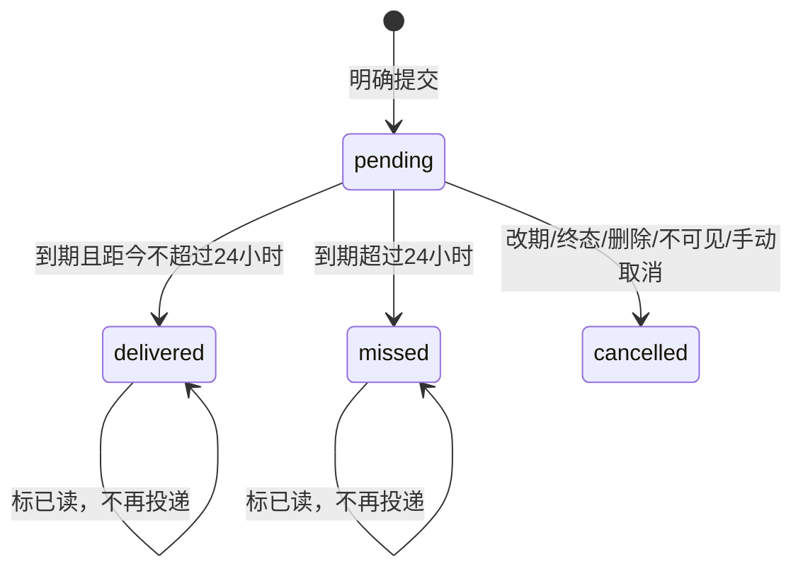

# 日程与一次性站内提醒 API

日程/提醒首次交付v0.3.0 / P1-02；当前v0.7 schema=`0005_ordinary_tags`（该模块字段/行为未变，JSON schema_revision同步更新）。所有接口要求本机会话；非GET同时校验Origin与X-CSRF-Token。UUID、DTO字段白名单、错误脱敏、短事务、版本冲突沿用[Task API](API_TASKS.md)。仅personal，未开放private写入。日期与时间不得混用。

## 1. 日程接口

| 接口 | 输入 / 结果 |
| --- | --- |
| GET /api/v1/events | 必填start_date、end_date（YYYY-MM-DD）；timezone默认Asia/Shanghai；scope=calendar/trash；limit1..100默认100、offset0..1000000；返回items/total/limit/offset |
| GET /api/v1/events/{UUID} | 当前普通、未删除日程；不可见404 EVENT_NOT_FOUND |
| POST /api/v1/events | EventCreate + 必需UUID Idempotency-Key；201首次、200重放 |
| PUT /api/v1/events/{UUID} | 完整可编辑事实 + expected_version整数>=1；task_id省略保留；冲突409 VERSION_CONFLICT |
| POST /api/v1/events/{UUID}/trash | expected_version；软删除并取消pending提醒 |
| POST /api/v1/events/{UUID}/restore | expected_version；恢复但不重启旧提醒 |
| GET /api/v1/events/export | JSON附件；含普通回收站/活动，不含private或隐藏Task身份 |

EventCreate/PUT字段：title（trim后1..500）、description（null/<=20000）、is_all_day（严格bool）、start_at/end_at（带offset ISO时间/null）、start_date/end_date（ISO日期/null）、timezone（IANA，默认Asia/Shanghai）、location（null/<=1000）、status（scheduled默认/completed/cancelled）、task_id（UUID/null）。PUT另需expected_version；未提供的非task_id字段按DTO默认值处理，因此客户端应提交完整表单。

全天：start_date/end_date必填，end_date>start_date，两个at必须null。定时：start_at/end_at必填且end>start，两个date必须null。入库统一UTC六位小数Z，禁止混合格式排序；无offset拒绝。全部半开区间[start,end)，单日全天end为次日。UI结束日期显示“含当天”，提交时加一天。

calendar查询：日期跨度1..62天；定时事件与viewer timezone的本地午夜窗口按UTC求重叠，全天日期直接重叠，不把全天转成UTC漂移。结束恰等窗口开始不计入。completed/cancelled保留且标明；trash查询在通过日期/时区合法性检查后列出所有普通已删除日程，不限时间。稳定排序、分页，total可大于当前页条数。

Event→Task为可空强FK，一项日程最多一个Task、Task可关联多项日程。写关联时目标须普通且未删除；完成日程不改变Task，完成Task也不取消独立Event。目标隐藏/删除后DTO中的task_id与linked_task均null；省略task_id编辑保留原关联，显式null清除，显式UUID重新校验。前端选择器分页，不把前50项称为全部任务。

创建幂等键与Task/Reminder共用命名空间；同key不同操作/规范化payload返回409。软删除结果重放不新建、不复活。Resource/Event/Activity/操作结果同事务；无变化PUT不增版本。改变任何时间事实/时区或进入completed/cancelled，同事务取消pending；恢复/重开需主动新建提醒。

## 2. 提醒接口

| 接口 | 输入 / 结果 |
| --- | --- |
| POST /api/v1/reminders | resource_id UUID、expected_resource_version>=1、remind_at带offset时间 + UUID Idempotency-Key；201/200 |
| GET /api/v1/reminders | scope=inbox默认/pending/history；可选resource_id；limit1..100默认50、offset0..1000000 |
| POST /api/v1/reminders/{UUID}/cancel | expected_version；仅pending可取消，已cancelled重试安全返回 |
| POST /api/v1/reminders/{UUID}/ack | expected_version；仅delivered/missed可标已读；已读重复请求安全返回，不再增版本 |
| GET /api/v1/reminders/export | 全部普通资源提醒JSON附件，含回收站关联，不含private/密钥/内部投递键 |

目标仅未删除的普通todo/doing Task或scheduled Event。目标版本变化409；不可用409 REMINDER_TARGET_UNAVAILABLE。允许显式过去时刻，由Worker按24小时规则分类；页面默认约10分钟后。不自动从截止日推导提醒，不暗中修改其他提醒时间。可为同一资源显式建立多条一次性提醒；没有任意重复规则。

DTO：id/resource_id/title/kind/remind_at/status/delivered_at/acknowledged_at/created_at/updated_at/version；内部delivery_key不返回。inbox=delivered或missed且未读；pending仅待触发；history包含全部可见状态。列表/详情变更均过滤资源当前隐私与软删除，未知和不可见统一404 REMINDER_NOT_FOUND。导出单独允许普通软删除，仍过滤private。

## 3. 投递语义

Worker约5秒一次；每次最多检查500条pending，单一BEGIN IMMEDIATE事务。提醒本身就是持久收件箱记录，没有第二张易重复的通知表。恰24h仍delivered；超过24h才missed。delivered_at表示事务写入收件箱的时间，**不表示用户已看到**；acknowledged_at单独表示已读。并发tick/重启只推进pending，不增加重复记录，不宣称浏览器弹窗恰好一次。GET无处理副作用。

Task截止日/精确截止/时区实际变化、done/cancelled、资源删除取消pending；只改标题或提交相同日期不取消。Event改期/时区/终态/删除同理。已delivered/missed的历史不撤回；资源删除/隐藏时历史访问立即过滤。恢复不rearm。

独立flock仅允许一个进程处理；第二个为standby，不抢锁。system.reminders=starting/running/standby/degraded/disabled。缺库/旧revision/故障进入degraded并后续重试，绝不建库或迁移。PERSONAL_HUB_REMINDERS=0可停用处理器，事实保留；GET不会兜底执行。正常停机等待在途线程事务结束后释放所有权。服务未运行、机器关机/休眠时不保证实时；恢复由真实UTC时钟判断，不自动修正系统时间跳变。

## 4. 导出与限制

Task/Event/Reminder为三个format_version=1 JSON附件，schema_revision都为0005_ordinary_tags；SQLite完整备份才覆盖三者及操作历史的一致性。尚无JSON导入。普通资料是本地明文，不保存真实私密日记。没有系统通知、桌面守护服务、RRULE、CalDAV或云同步。
