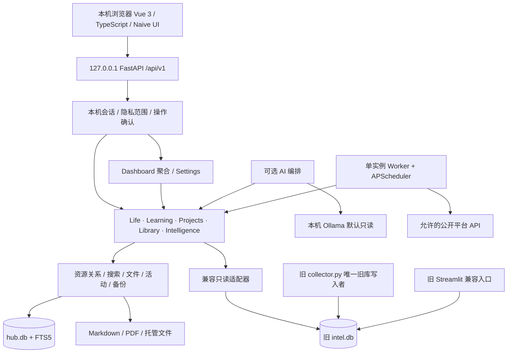
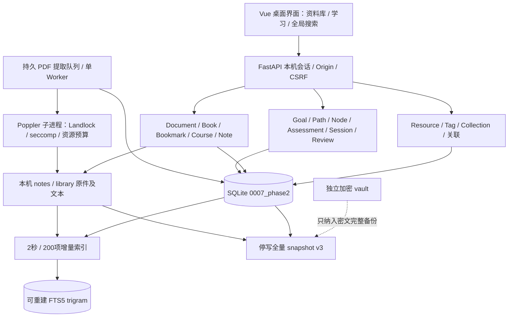
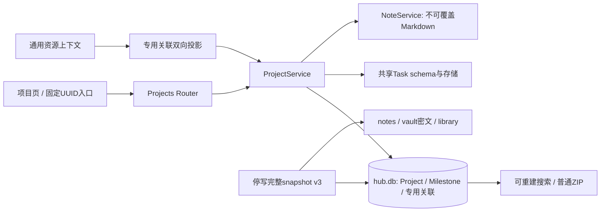
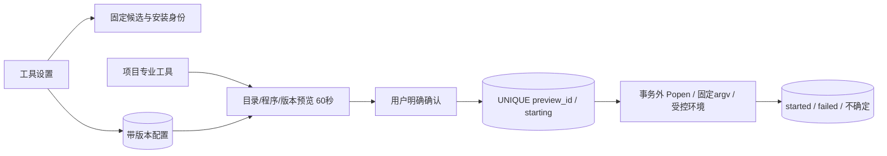

# Personal Hub 技术架构

> 当前版本 v0.12.0（2026-11-12）：财务、运动、多源情报与可选 API 助手已实现，功能验收后才进入页面美化。音乐取消；本地模型部署取消；社区/自修改Agent冻结。最新契约见 [ADR-0012](ADR_0012_FUNCTIONAL_COMPLETION.md) 与 [API_V012](API_V012.md)，优先于下文历史规划。API真实服务未配置/未联网验收，向量RAG门禁未通过，不标为已完成。


> **当前实现 v0.11.0 / P3-03**：食谱与食材、每周三餐、采购建议预览确认、独立可编辑购物清单、手工库存盘点及默认隐藏的今日三餐已实现；schema=0010_diet。见[ADR-0011](ADR_0011_DIET.md)、[饮食API](API_DIET.md)、[本版验收](releases/v0.11.0.md)与[HANDOFF](../HANDOFF.md)。347项自动检查及构建通过，活动升级/完整恢复证据见交接；本版真实浏览器专项待本人。以下旧版本章节为历史，当前以末尾v0.11契约为准，功能优先、外观包装后置。

版本 0.11.0｜2026-11-12｜模块化单体、两库隔离，无新依赖/联网食谱/云AI。

## 1. 工程审查结论

| 当前文件/组件 | 已核实能力 | 复用与迁移方式 |
| --- | --- | --- |
| `app.py`（193 行） | Streamlit 展示、筛选、趋势、采集状态；启动调用 `init_db()` | Phase 1 保留旧入口；Vue 逐步接管界面，不扩成生活管理大文件 |
| `collector.py`（449 行） | GitHub 搜索+刷新、稳定 ID、锁、有限重试、进度、短事务、退出码 | 原样保留至 Phase 4；先适配结果，再提取 Collector 契约，回归通过才切换写入目标 |
| `db.py`（130 行） | SQLite 版本 2、Backup API、增量迁移、索引/触发器/外键检查 | 旧库继续由旧实现管理；新 hub.db 用 Alembic，禁止两个迁移器管理同一批表 |
| `analytics.py`（79 行） | 最新/基线快照选择、微秒边界、周增长质量、字面筛选 | 作为可信算法基线及兼容读适配；后期移植成服务，保留边界测试 |
| `descriptions.py`（151 行） | 中文简介缓存、原文变化失效、Google 翻译、独立凭据会话 | 仅处理公开仓库元数据；未来增加联网开关，不复用于私密笔记/PDF |
| `config.py` | 固定根目录 `.env`；进程变量优先；DB_PATH 相对项目根目录 | 保留旧优先级；新配置命名空间独立，不重新解释旧 DB_PATH |
| `tests/` | 51 个隔离测试，迁移/数据质量/重试/界面等 | 保留为回归基线，不能因迁移前端而丢失算法和数据保护测试 |

本次实查未发现财务等系统；没有可用的 Git 仓库元数据（`git status` 失败），不能声称有提交历史或已建立版本管理。`.git` 是受限占位目录；不要删除或初始化覆盖。生产数据库审查仅以 `mode=ro`、`query_only` 读取，没有调用 `init_db()`。

## 2. 架构决定

采用模块化单体：一个 Python 业务后端、一份新主库、一个轻量后台任务进程与 Vue 桌面 Web UI。后台进程是同一代码库的运行角色，不是微服务。初期无需 Docker、Redis、Celery、Kubernetes、消息中间件或 PostgreSQL。



图中的旧 Streamlit 启动仍有初始化写行为；“兼容只读适配器”自身必须只读，不能以导入 `app.py` 的方式复用页面。新业务库暂不包含旧采集器运行日志；跨库不设伪外键。

## 3. 技术选型与边界

| 层 | 设计选择 | 理由 / 不使用的复杂度 |
| --- | --- | --- |
| 前端 | Vue 3 + TypeScript + Vite；Vue Router；按需 Pinia | 适合组件布局、日历、编辑和长期交互；表单局部状态留组件，避免全部全局化 |
| UI | Naive UI 为设计基线 | TS 支持、明暗主题、适中密度；不同时引入 Element Plus。若 Phase 0 原型遇阻才通过 ADR 更换 |
| 后端 | FastAPI + Pydantic | API 契约、校验、OpenAPI；现有 Python 能力复用，前后端职责清晰 |
| ORM/迁移 | SQLAlchemy 2 同步 Session + Alembic | SQLite 同步足够；显式事务与升级链，不上异步 ORM 复杂度；版本在引入阶段锁定而非现在升级 |
| 数据 | SQLite WAL + FK + FTS5 | 单人本机低维护；文件仍在本地；本机 SQLite 3.45.1 且 FTS5 可用。中文分词需独立验证 |
| 文件 | 本地托管目录+SHA-256+Markdown | 可独立导出、原件保留、可重建索引；不把 PDF 二进制塞数据库 |
| 任务 | 单实例 Worker + SQLite 持久任务表；Phase 1 使用 APScheduler 轻量调度 | 可恢复的业务状态以 DB 为准，调度器只触发；API 不启动第二个 scheduler |
| PDF | PyMuPDF 子进程提取 | 本地快速提取；限制内存/时间，坏 PDF 不拖垮 API。引入前核实版本、许可证与未来分发条件 |
| AI | Ollama，可选；RAG 后置 | 无云前提、断开不影响业务；不先引入 LangChain/向量服务 |
| 部署 | Ubuntu venv + 本机进程；稳定后 user systemd | 运维少；生产构建后 FastAPI 提供 Vue 静态文件，同源；开发 Vite 代理到 API |

Phase0已建立独立backend/.venv、Python哈希锁文件、npm锁文件与本地运行说明；Python3.11.9/Node24.22.2工具链自动验证通过，前端Vue3/TypeScript/Naive UI生产构建通过。旧requirements与venv未修改。真实HTTP与浏览器验收因执行沙箱禁止loopback绑定尚未完成；安装依赖和ASGI通过不等于完成迁移。详见OPERATIONS与ADR-0001。

## 4. 模块内部约束

每模块按 `router.py / schemas.py / service.py / models.py / repository.py` 分层；简单模块可以先合并 repository 到 service，出现真实重复才抽象。Router 校验请求和会话；Service 执行业务、隐私、事务；Repository 负责参数化查询。ORM model 不直接作为外部响应，防止泄露路径、Token 和私密字段。

模块只能通过公开 Service 访问其他模块；Core 不依赖业务模块；Dashboard 读聚合服务；AI 不持 ORM Session 或任意文件句柄。跨模块操作在同一 SQLite 数据库可以共用 Unit of Work，不引入事件总线。业务变更、Activity 和索引待办同事务提交；耗时提取/联网操作移出事务。

## 5. 两库过渡与旧数据安全

**决定 A-01：先新增 hub.db，保留 intel.db 原路径与现有版本体系。** 不直接给旧库的仓库记录增加全部生活字段，不让旧 `init_db()` 管理新表。

1. Phase 0 建清单、备份、恢复演练、版本/完整性基线，不修改生产结构。
2. Phase 1～3：新库保存个人资源与生活业务；旧采集器独占旧库采集任务，旧 UI 可并存。Intelligence 新页面先只读摘要/旧入口。新库 `legacy_repo_links` 记录旧实例 UUID+repo_id→Resource；旧库重命名仓库不改变本地映射。实例 UUID 在新配置登记，路径不是永久身份。列表以DTO只读展示，只有收藏/关联时按需注册兼容Resource，无需在Phase1复制全部仓库。
3. 兼容读取使用独立只读连接和 DTO；不允许浏览器写任意 DB_PATH；不通过 ORM 自动创建/升级旧表。绑定旧资源的关系只写 hub.db。备份为每库分别生成一致性快照；需要整体一致时暂停两个写入者。
4. Phase 4：在离线副本演练转换，建立新 Source/Item/Snapshot/Run 表及显式映射。切换前停 cron/systemd/旧 Collector 和旧 UI，确认无锁持有与在途写入，再做最终 Backup API 快照、增量导入和逐行对照。
5. 使用 GitHub ID 作为来源身份，保留旧 repo/snapshot/run ID 于映射；github_id 为空不编造，冲突进入人工核对队列。旧快照的 `run_id=NULL` 保持未知；原始 JSON 未保存则标记 unavailable_legacy；旧状态/计数原样留档，不重新推断。
6. 验证全部旧表字段值与行数、映射、关系、快照时间/指标、增长结果和外键。通过后将新 Collector 作为唯一写入者；旧 intel.db 保留只读历史副本，旧 UI 改为只读兼容或停用，不能继续自动迁移归档库。
7. 不双写。回退须暂停新采集并保留新库与新快照导出，再恢复匹配旧程序和备份；重放方案需验证，不靠“降版本代码”硬读新库。

旧 `PRAGMA user_version=2` 与新 `alembic_version` 分属不同库，禁止 `alembic stamp` 旧库或用 `create_all()` 掩盖迁移缺失。Production 升级是独立维护操作，API 发现版本不匹配应只读或拒绝启动并提示，不能页面访问自动迁移。

## 6. API 契约与关键流程

统一 `/api/v1`；UUID 作为路由 ID；UTC RFC3339 时间；业务时区作为设置传入；分页默认 50、最大 200，稳定排序加 ID；大列表用游标。响应只返回需要的字段。错误格式：`{code,message,details,request_id}`，详情不含凭据/原始 HTTP 异常。400/422 校验、404 不存在或不可见、409 编辑冲突、413 超限、503 可选服务不可用。

| API 组（阶段） | 代表端点 | 契约要点 |
| --- | --- | --- |
| Core（1） | `GET /dashboard?date=`、`GET /search?q=&scope=`、`GET /resources/{id}/relations` | 搜索范围先过滤后摘要/统计；不因聚合暴露私密关联 |
| Life（1） | `POST /tasks`、`PATCH /tasks/{id}`、`GET /events?start_date=&end_date=&timezone=` | PATCH 提交 `expected_version`；冲突 409；已完成状态更改幂等 |
| Notes（1） | `POST /notes`、`PUT /notes/{id}/content` | Markdown 原文，版本/内容哈希校验；不接受任意绝对写路径 |
| Library（2） | `POST /imports/pdf`、`GET /jobs/{id}`、`POST /documents/{id}/bookmarks` | multipart 上传；202 返回任务；批处理逐文件状态 |
| Learning（2） | `/learning-paths`、`/knowledge-nodes/{id}/assessments` | 掌握验收必须附证据引用或明确人工结论 |
| Projects（3）/文件启动（2起） | `/projects`、`POST /launches/preview`、`POST /launches/{id}/confirm` | 后端创建短期确认票据；确认参数不可由前端篡改 |
| Intelligence（4） | `/intelligence/items`、`/collector-runs`、`/subscriptions` | 启动 Collector 是显式请求，不由列表 GET 触发 |
| AI（4） | `/ai/queries`、`/ai/drafts/{id}/apply` | 显式资源范围、只读默认、引用、写入版本检查 |
| Settings（0/1） | `/backups`、`/exports`、`/restores/preview` | 危险操作预览/确认，不能 GET 触发写入 |

对上传/批量导入/启动任务支持 `Idempotency-Key`，服务端将键+请求哈希+结果存在 `operation_requests`；同键不同内容返回 409。普通编辑使用版本并发控制即可。API 超时不等于业务失败，前端先查 operation/job 再重试。

### 6.1 文件导入与修改

上传写入本地 staging（限制大小与类型）→计算 SHA-256→查有效 Blob→创建 pending 导入/业务资源→原子 rename 到内容寻址目录→短事务登记 ready 与提取任务。文件/SQLite 不存在跨介质原子事务，使用 operation journal/状态机恢复：崩溃后识别暂存、已移动未登记文件、待索引记录，重试或隔离，禁止靠后台清理直接删除未知文件。

以下明文Markdown流程仅适用于普通笔记；私密日记/树洞按独立vault规则处理，不写notes/revisions/FTS明文。

Note修改（v0.4已细化）：先校验版本与旧SHA，在file_operations持久记录prepared；以新修订UUID写同目录暂存、fsync、无覆盖link，再同事务提交Note指针/Revision/Activity/幂等/committed。所有旧修订保留；中断只留下未引用文件，不replace旧正文。外部修改当前/历史文件报冲突，用户复制内容另建普通笔记，不自动导入。新资源链接用 `hub://resource/UUID`，双向链接是解析得出的关系，可重建。

### 6.2 搜索

FTS 是可重建投影，不是内容权威。`search_documents`→FTS5；普通个人与 private 分别分区查询（最小版本可完全不索引 private）。英文使用 unicode61；中文连续词优先验证 trigram，1～2 字查询和不支持 trigram 的环境采用受控 LIKE 子串回退。SQL 参数绑定并转义 LIKE 通配符；FTS 用户输入构造成字面短语，不直接执行任意查询语法。

结果融合仅在允许范围内进行，显示资源类型、命中片段和来源；分页/计数/补全也不能包含被排除资料。用户删除/修改隐私后立即阻止旧投影返回，再异步更新索引。离线重建时原文件仍可访问；索引失败显式显示待索引。

### 6.3 调度、提醒与任务恢复

单 Worker 由进程锁约束，不能让多个 Uvicorn worker 各启动 scheduler。Phase 1 API 单进程即可；SQLite WAL、busy_timeout、每请求独立 Session、短写事务；禁止把联网、PDF 提取、模型推理放在持锁事务内。锁等待有上限，重试带抖动；失败显示可重试，不能吞错。

持久任务 `queued→running→success/partial/failed/cancelled`，保存 heartbeat、attempt、next_run_at；崩溃后仅在 lease 过期且旧进程不可运行时重领。提取/索引通过输入哈希保证幂等。Reminder 保存唯一投递键；到期24h内（含）写入delivered，超过24h写入missed，均以持久收件箱显示而不反复弹窗；站内已落库记录不重复生成。机器休眠期间不承诺实时。

APScheduler 仅承担触发/唤醒；业务调度配置存 `schedule_rules`，重启可重建；沿用 cron 的 GitHub 在切换前不再由 APScheduler 重复安排。取消只停止后续步骤，已提交数据保留。

## 7. 推荐目录（按阶段创建，非全部已实现）

当前代码已有frontend/src外壳/shared/Life任务日程提醒、backend/app/core及Life三个模块/迁移/测试，尚未创建所有未来业务模块。当前数据根为runtime/personal-hub，备份/恢复/源码包分别在runtime/backups、runtime/restore-checks、runtime/releases；全部排除版本管理。下面XDG路径是未来可迁移的长期建议，不是当前已使用位置；旧数据原路径不变。

```text
tech_intel_hub/                 # 代码目录，保留旧入口直到迁移验收
├── app.py / collector.py / db.py / analytics.py / descriptions.py / config.py
├── frontend/
│   ├── package.json / lockfile
│   └── src/
│       ├── app/                # 路由、外壳、主题、快捷键
│       ├── shared/             # API 客户端、资源选择器、编辑器等
│       └── modules/
│           ├── dashboard/  life/  learning/  projects/
│           └── intelligence/  library/  ai/  settings/
├── backend/
│   ├── pyproject.toml / dependency-lock
│   ├── migrations/             # 仅 hub.db 的 Alembic 历史
│   ├── app/
│   │   ├── main.py / worker.py
│   │   ├── core/               # 配置、安全、事务、存储、搜索、备份
│   │   ├── integrations/       # GitHub、Ollama、应用启动配置
│   │   └── modules/            # 与前端同名；每模块 router/service/models/schemas
│   └── tests/                  # 单元、API、迁移、恢复、离线测试
├── tests/                      # 保留旧回归测试
├── scripts/                    # 已审查的维护/备份/恢复工具
├── docs/                       # 七份规格、运行手册、ADR、版本说明
└── HANDOFF.md

~/.local/share/personal-hub/     # 长期候选；当前使用runtime/personal-hub
├── db/hub.db                   # 新库；旧 intel.db 先仍留原路径
├── files/sha256/ab/<hash>.pdf   # 托管原件
├── notes/<uuid>.md
├── revisions/                  # 普通Note版本
├── vault/                      # 已实现独立加密私密库；不包含解锁密码
├── extracted/                  # 可重建 PDF 文本
├── staging/                    # 导入暂存
├── trash/                      # 等待确认清理
└── models-cache/               # 如有，模型由用户主动安装，默认备份可排除
~/.config/personal-hub/
├── config.toml                 # 非密钥；目录0700
└── secrets.env                 # 0600或系统密钥环；旧.env不覆盖
~/.local/state/personal-hub/logs/
<用户指定备份介质>/personal-hub/ # 建议异盘，未选前不能声称有灾备
```

目录只在对应阶段按需建立。路径存相对数据根，配置记录根位置；外部 Project/音乐目录为经用户授权的引用，不自动纳入备份。日志不与用户文档混存；旧 `backups/` 和 `data/backups/` 保持原状。

## 8. 部署与可运维性

默认只绑定 `127.0.0.1`，不监听局域网，不安装公网反向代理。后续稳定部署可用一个user systemd API服务与按需Worker服务；当前仅提供前台命令，没有安装服务。规划服务采用明确 WorkingDirectory/EnvironmentFile、限制文件权限，日志本地轮转；开发工具链不是正常使用前提。升级先维护模式停写、备份、迁移演练、应用新版本、健康检查；失败恢复匹配版本。健康接口只给组件状态/版本，不给秘密路径和配置内容。

第一版不做插件市场；模块注册用静态路由/组件注册。只有实际出现多个可替换实现时才增加接口抽象。SQLite 写锁、提取进程资源和目录空间要监测；只有真实写吞吐或多人需求出现后再考虑数据库升级。

## 9. 明确暂缓

Electron/Tauri 包壳、完整内置 PDF 阅读器、OCR、复杂知识图谱推理、向量库选择、自动 Agent、跨设备同步、微服务、社区 ACL、云部署。FTS/链接已能满足的检索不先上向量检索。未来公开分享从明确选定内容生成脱敏导出包起步，不能以未来社区为理由提前增加多租户字段。

## 9.1 私密库架构决定（v0.5已实现，详见ADR-0005）

用户已选独立加密库和解锁密码。Note领域服务使用普通Markdown与vault两种存储适配器，共享资源标识/API约束，不另造第二套日记业务。私密正文、真实标题、摘要、标签、关联、修订、索引和临时文件均进入加密边界；普通hub.db如需引用，只保存不可读占位身份，详细规则见DATA_MODEL §1.1。锁定时不可检索；解锁后的私密全文索引只驻内存，不落普通FTS/向量/交换文件。

具体容器、Scrypt/AESGCM、改密/无遗忘恢复、自动锁定、崩溃恢复和备份验证已在ADR-0005定稿并测试。当前有独立vault存储与私密API，真实浏览器验收待完成；同盘备份不构成物理灾备。完整快照已包含加密库但不含密码。未实现的私密索引/标签/关系不能借机落普通库；不承诺防系统swap。

## 10. v0.1.0实际接口与运行边界

下文目标API按各阶段逐步实现；v0.1.0仅有：

| 方法/路径 | 当前契约 |
| --- | --- |
| GET /api/v1/health | 无需会话，只返回app/version/status；不创建/迁移DB |
| POST /api/v1/session/exchange | 同源Origin + 一次性bootstrap；设置HttpOnly/SameSite=Strict/Path=/api cookie，返回内存CSRF token |
| GET /api/v1/session | 有效本机会话，返回当前CSRF token |
| POST /api/v1/session/logout | 同源Origin + 会话 + CSRF；清理内存会话/cookie |
| GET /api/v1/system | 有效会话；只读新库revision、AI关闭和当前能力状态，不返回路径/秘密/原始个人数据 |

当前session为滑动有效期（连续8小时无操作过期、绝对上限7天，每5分钟内最多续期一次）、进程重启失效、单进程；无用户/租户表。配置只使用PERSONAL_HUB_*环境命名空间，绝不加载根.env。生产静态资源仅frontend/dist，不挂载runtime或任何个人目录；业务存取API尚不存在。当前system的backup_scope描述实现范围，不是自动检测的备份成功时间；后续必须用真实清单状态替换界面中的本机验证说明，不能对新安装宣称有现成备份。

默认一个前台FastAPI进程，无Worker/APScheduler/系统服务；空baseline不是业务schema。为保护旧环境，依赖只安装到backend/.venv和frontend/node_modules；恢复旧入口只需停止新进程，使用原README命令，不回滚/删除旧数据。源码包只用于代码审查与恢复，不包含数据或依赖；依赖重建见OPERATIONS。

## 11. v0.2.0任务模块与维护升级

当前在backend/app/modules/life/tasks新增schemas/service/models/router；core/database提供显式存在路径连接、revision校验、FK/只读/短写事务；core/resources共享身份、活动与幂等表；使用SQLAlchemy Core，不另加ORM/Repository框架。前端modules/life/tasks的同一TaskPanel为首页compact与Life完整列表复用数据接口，首页不复制任务事实。

写/读SQLite在asyncio线程中完成，API事件循环不等待锁；NullPool每次创建独立连接、锁等待2秒，写事务BEGIN IMMEDIATE。当前无网络/模型/后台Worker依赖。维护升级独立backend/maintenance.py，API不执行迁移；API生命周期共享flock，升级/backup排他锁。详细迁移/故障边界见ADR-0002。

新版本实际接口增量见API_TASKS；原§10是v0.1历史契约。system当前phase=1、private_vault仍planned_encrypted、backup_scope=hub_database_only；已知基线显示upgrade_required，未知revision拒绝CRUD。已从界面移除硬编码“已备份成功”说明，改为如实说明支持显式备份，当前没有自动最近成功时间监控。

用户确认v0.1已正常在本机打开，并要求继续第二版。当前沙箱无法访问其本机服务，本版通过ASGI静态资源/会话/CRUD、真实Vue组件交互、生产构建和本地Service性能验证；实际浏览器外观/任务操作/断网与重启试用尚未验收，不能把用户前版确认当成本版完整E2E。


## 11. v0.3.0已实现的增量

Life现有tasks/events/reminders三个业务目录；Event/Reminder复用Resource、Activity与全局幂等服务，不为关联另复制任务。新增schema0002_events_reminders。API线程处理SQLite，lifespan每5秒唤醒ReminderService，单处理器flock、短写事务、每批500条、正常退出等待在途事务；这是当前具体实现，前述持久job/APScheduler为后续规划，尚未建jobs/schedule_rules。

为改变Resource CHECK，维护连接在BEGIN前关闭FK，仅此受限连接可用；copy后完整性、FK与原表指纹通过才提交，普通读写连接FK始终开启。详见[ADR-0003](ADR_0003_EVENTS_REMINDERS.md)。startup只查版本，0000/0001返回upgrade_required，未知版本拒写；不会自动升级。旧库/Collector不受新轮询器管理。

前端Life任务/日程切换、月历选日+分页议程、首页今日投影与提醒收件箱；每15秒只读刷新提醒，不在GET执行投递。无新增依赖/外部网络，AI关闭不影响。公开壳静态文件不含用户数据，服务同源提供dist。


## 12. v0.4.0普通笔记与文件一致性

新增Library.notes独立领域（Life与Dashboard复用），及core.note_files/note_snapshot；不建全文搜索/未来资料表。notes记录当前不可变修订路径，note_revisions保存全部成功正文与当时元数据；file_operations先独立记录文件意图，再由最终DB事务标committed，未成功文件显式诊断/标记，绝不自动删除。API正常读只校验，文件保存与SQLite不是原子事务；通过“先持久新文件、后切指针”保证旧事实不被替换，详见[ADR-0004](ADR_0004_NOTE_FILES.md)。

维护upgrade/backup在生命周期排他锁之外同时取得notes-files.lock。全快照复用SQLite备份manifest，增加hub-files.json作为最后完成证明；副本/恢复验证全部文件hash、DB引用、typed rows及索引/触发器保留。完整恢复输出可运行db/hub.db+notes，HUB_INCOMPLETE保护未完成目录；旧SQLite-only备份仅在0000..0002兼容。源码与数据根仍隔离，无新增依赖/云端或外部上传。

Note正文最多200000字符/UTF-8，单文件读取上限1MiB，API不接受路径；文件目录逐级NOFOLLOW/0600/0700。普通界面仅原文编辑，不启HTML/远程图片，暂无渲染引擎。未来固定工作副本/外部编辑合并需单独设计，不直接改不可变修订。

## v0.5实现增量：私密Note适配器

Life → VaultPanel → 同源会话/Origin/CSRF → vault_router → VaultNoteStore → VaultFiles → 独立密文容器。与普通NoteService共用Note语义和输入验证，隔离物理存储；不引入加密数据库、微服务或多用户身份。后端新增cryptography46.0.3/cffi2.0.0/pycparser2.23固定wheel hash，仅backend/.venv安装，原依赖不升级。选择成熟库提供Scrypt与AESGCM，拒绝自行实现密码算法；安装来源与参数见ADR-0005，非独立审计声明。

进程RLock+跨进程flock；解锁绑定现有普通会话CSRF身份，无第二套用户系统。Worker每秒到期检查，5分钟空闲、30分钟绝对上限；轮询不续期，页面活动touch续空闲。重启/退出锁定。每次事实操作验密文hash/前后期限；新密文暂存fsync→replace→目录fsync，不写普通SQLite/日志/文件。改密重加密后锁定，旧备份/失败暂存仍可能由旧密码解密。完整备份与恢复包含vault树，必须用v0.5+工具；旧程序同0003也不能用于含vault的新资料备份。

本版无私密明文导出、私密索引/标签/关系/AI；无跨库原子性问题。未来拆分容器/加密索引须新ADR，而非无界扩整个JSON。目录权限与AEAD不能阻止root/同账户恶意程序、内存/swap/完整旧文件回滚。具体限制见SECURITY_AND_PRIVACY。

## v0.6实现增量：首页布局模块

DashboardPanel以稳定组件ID组合普通Note/Task/Event/Reminder，另有快捷入口；首页和Settings复用同一编辑器。显示配置读取完成后才挂载已显示组件，隐藏项不发业务查询；配置读取失败回默认组件供访问，明确提示，不覆盖服务端配置。保存才应用新布局，编辑/默认重置/预览不提前写。输入失败/版本冲突保留草稿，未知结果保留同key/payload，返回当前事实同步编辑器。

Dashboard API → DashboardService → 新SQLite单行偏好表，加入0004_dashboard_preferences；新模块独立目录，无新依赖/框架。选择SQLite复用事务/CAS/完整快照，不以localStorage充当布局权威。没有业务摘要、私密身份/计数或跨模块双写；普通私密适配器与加密容器协议不变。

外部快捷网址只存经过验证的HTTP(S)目标，不请求目标/采集/生成favicon，预览后用户点击浏览器链接；本机专业程序白名单执行仍Phase3。内部入口固定白名单，私密入口仍显式解锁。数据库变化/恢复/旧版本兼容见ADR-0006/API_DASHBOARD，不把偏好架构推广为任意JSON业务大表。

## v0.7 普通标签落地

backend/app/modules/tags统一普通Tag服务/模型/DTO/API；resource_tags关联公共Resource，本批通过kind/personal/未删除与Note扩展JOIN只开放普通Note。Note列表过滤/展示和ZIP调用同一标签读取函数，不在Note正文或vault中复制标签事实。frontend/src/modules/tags/TagPanel独立编辑，NotePanel接入目录/筛选/行入口，后续Task复用；无新依赖/缓存/搜索框架。0005纯新增两表及反向索引，事务复用CAS/全局幂等，维护snapshot仍v2。细节见ADR-0007；FTS/Collection未建空表。

## v0.8 / Phase 2 已实现架构（覆盖旧版当前状态描述）

普通资源协作位于 `backend/app/modules/knowledge`，包含集合、唯一类型关联、UUID反链、可重建FTS、普通导出；资料实体位于 `library/catalog.py` 与 `library/documents`；学习事实位于 `learning`。没有新服务/云依赖/新的Python或npm包；生产依赖锁的版本未升级。



PDF 使用系统 Poppler 而非尚未安装的 PyMuPDF，原因、许可、安全边界与替换条件见 [ADR-0008](ADR_0008_PHASE2_KNOWLEDGE.md)。解析失败不阻塞核心任务/笔记/阅读元数据操作，AI保持禁用。无 OCR/内置阅读器/RAG。

首页5→8组件兼容投影，老配置只在响应追加隐藏新项；全局搜索、新资料库、学习和资源详情使用前端异步分块。文件系统与SQLite仍非跨介质原子：PDF导入意图和Note现有协议分别保全中断；备份必须全树manifest，不能回退SQLite-only。

学习practice与Task用唯一FK关联表，通用关系仅投影，不双写；这是目标模型单值Task.learning_node_id的本期替代，支持一个练习对应多知识点。跨路移动不开放；UUID关系与本地根目录无关。实际接口见 [API_PHASE2](API_PHASE2.md)，实际列与约束见DATA_MODEL最终章节。

## v0.9 / P3-01 实际架构增量

新模块backend/app/modules/projects/{schemas,service,router}.py与frontend/src/modules/projects/ProjectPanel.vue；沿用FastAPI同源会话、短事务、CAS与幂等键、共享Resource/Tag/Task/Note/Knowledge/Search/Export。不新增依赖、不引入微服务/后台调度器/云API，不改旧六模块。



project_tasks唯一权威维护项目Task归属，project_entries只存Note角色；通用关联不复制这些事实。Task创建与归属在同SQLite事务，Note因文件协议先保存再关联，不能承诺跨文件原子；稳定子key重试，失败留下普通Note供找回。Task可同时属于学习练习关系，项目单归属不限制知识点多对多练习。

directory-check只在用户显式点击时逐组件NOFOLLOW打开目录，不列内容、复制或执行；浏览器不接收可执行shell。外部启动P3-02将独立设计白名单/参数数组/版本绑定预览/确认与失败记录。当前仅保留Phase2 PDF阅读器启动能力。

新迁移0008扩展Resource.kind并增四表；原始资源索引SQL原样恢复（含部分/表达式索引），未知Resource触发器拒绝维护，既有维护器核对全部旧行/索引/触发器并事务回滚。0000～0007不可修改。0008完整快照强制v3，旧程序不得对新库读写或使用遗漏文件的旧备份方式。

## v0.10 / P3-02 架构增量

backend/app/modules/projects/tools.py为Projects边界内的固定适配器/安装绑定/profile/preview/history/router。前端ToolSettings.vue（Settings内）与ToolLauncher.vue（Project内）分离配置和执行；沿用会话/Origin/CSRF、共享幂等表、SQLite短事务和错误映射。无新依赖/独立服务/模型调用，不改PDF阅读器原表或服务。



0009仅增三表，不改0000～0008。安装身份通过解析路径和stat指纹绑定，不执行发现到的程序；固定源安装symlink可解析，项目目录则逐组件NOFOLLOW并保留fd至Popen，将实际cwd交给子进程。启动前再次校验，但专业应用还接收原目录路径，不能承诺控制其启动后的所有文件访问/插件/配置行为。VS Code扩展默认禁用，Codex保持只读且不自动发送任务。

确认先事务预约，再执行，再事务记录，三步非整体原子；崩溃/最终记录失败保留starting→API显示uncertain，重试只查，不重复执行。正常后台reaper回收外部进程，不收集输出，不把短时进程存活当作GUI成功。完整快照v3包含配置/预览/历史，普通ZIP排除机器相关配置和执行日志。恢复不触发启动，跨机器安装身份不匹配须用户重绑。

## v0.11 / P3-03 实际架构

后端`modules/life/diet/{schemas,service,router}.py`与前端`modules/life/diet/{DietPanel,TodayMeals}.vue/types.ts`形成单模块闭环；无新后台worker/下载/依赖。食谱扩展统一资源，接入现有Tag/Collection/Relation/FTS/UUID导航/普通ZIP；不另建笔记正文或营养推理服务。菜单和库存不依赖AI。

权威分层：食材规范名目录；Resource+recipes+recipe_ingredients表达当前配方；meal_plans只表达日期/餐次/份数；shopping_lists+shopping_items保存用户确认快照；inventory_balances保存实际手工盘点。搜索/今日三餐/建议为可重建投影，GET不产生新业务事实。

所有数量十进制字符串→INTEGER千分单位，固定换算表；份数比例整数向上取整。建议摘要基于当前可见事实，确认同短写事务重新计算并核对CAS、幂等后全部追加。菜单修改与清单/库存绝无隐式写链。每周菜单最多210道、建议最多500维、清单最多2000行（含移除），保持轻量有界处理。无跨周库存预留/采购流水/自动消耗。

0010维护迁移扩资源CHECK并新增七表，既有父表copy防护沿用：未知资源触发器拒绝、原索引逐条恢复、旧数据/索引/触发器全核对，异常回滚。0000～0009不可改。完整v3快照覆盖新表与notes/vault/library，新根恢复不修改任何用户外部资料。见[ADR-0011](ADR_0011_DIET.md)。

## 需求变更：取消本地音乐开发

用户明确取消P3-04本地音乐及相关开发。架构不引入音乐扫描worker、音频元数据提取、歌单服务或MPV/VLC适配；既有PDF阅读器与项目专业工具维持各自边界。下一任务为P3-05财务已有工具调查与D-05适配决策，本次仅文档变更，没有新依赖、业务代码或数据库迁移。

## v0.12 实际架构增量

沿用Vue3/TS/Naive UI与FastAPI/SQLite模块化单体，无新依赖/微服务/容器。`life/finance`独立私有表，`life/exercise`计划与实际表；公共CAS/幂等只允许core/local_records固定表名单，不接收HTTP表名或列名。运动引用共享Task/Event服务可见事实，Finance不进入Resource。

`intelligence`独立schemas/collectors/service/router；HTTP离开事务，短事务一次提交一批资料/不可覆盖快照/运行状态。旧GitHub仍独立运行，新库只读导入旧四表并保留来源身份；不是生产写目标切换。原intel.db及原迁移器/collector代码全部保持。当前手动采集，无新增定时网络任务；持久状态用于恢复中断标记，不自动重跑。

`assistant`为可选通用Chat Completions兼容API适配，不部署Ollama或embedding。发送预览/回答在内存，持久运行表仅一次性预约与状态。每会话校验、来源版本/hash/隐私重验；配置CAS，凭据不可变受限文件，备份排除凭据。没有模型工具或任意文件句柄；文字建议复制到普通笔记，不自动改Task/掌握程度/库存。

`core/outbound.py`统一公开HTTPS边界：443、无重定向、无环境代理、DNS所有候选必须公开并固定实际连接IP、保留Host/TLS SNI、限时限体积、零自动网络重试。普通业务无网络依赖。当前不支持本地AI代理、HTTP自签名地址或服务商专有协议；兼容性待本人设置实测。

完整快照仍v3：新普通DB表自动包括；notes/vault/library不变，assistant-secrets不进入快照。恢复新根没有密钥时助手有效状态关闭。完整备份是明文DB+文件+vault密文，不等于全包加密。未新增依赖；主chunk既有>500KiB提示保留到性能/体验专项，不为消除警告改依赖或提高阈值。
