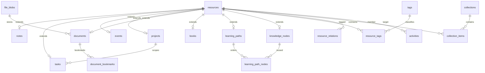

# Personal Hub 数据模型与迁移契约

> 当前 v0.12 物理模型见本文末尾0011/0012及[API_V012](API_V012.md)。音乐取消，AI使用API不部署模型；旧章节为历史设计，最新契约优先。

> **当前实现 v0.11.0 / P3-03**：食谱与食材、每周三餐、采购建议预览确认、独立可编辑购物清单、手工库存盘点及默认隐藏的今日三餐已实现；schema=0010_diet。见[ADR-0011](ADR_0011_DIET.md)、[饮食API](API_DIET.md)、[本版验收](releases/v0.11.0.md)与[HANDOFF](../HANDOFF.md)。347项自动检查及构建通过，活动升级/完整恢复证据见交接；本版真实浏览器专项待本人。以下旧版本章节为历史，当前以末尾v0.11契约为准，功能优先、外观包装后置。

版本 0.11.0｜2026-11-12｜活动0010_diet；0000～0009历史不可改，新增七表。

## 1. 全局约定

- 新主库 `hub.db`；旧 `intel.db` 不在本设计阶段改动。新库表名 snake_case，所有外键连接启用 `PRAGMA foreign_keys=ON`。
- `ID`=应用生成 UUID v4、SQLite `TEXT`，永久不随标题/路径变化；PK NOT NULL。旧库 INTEGER ID 不转换或复用为新 UUID，使用映射表。
- `TS`=UTC RFC3339 TEXT，统一 `YYYY-MM-DDTHH:MM:SS.ffffffZ`；历史时间原串另存/保留，不能批量改写旧表。`DATE`=本地日历日期 `YYYY-MM-DD` TEXT，不经 UTC 换日。`TZ`=IANA 时区名。
- `CT/UT`=每张可变实体默认含 `created_at TS NOT NULL`、`updated_at TS NOT NULL`；应用同一事务显式维护 UT，创建时两者相同。下面表中写“CT/UT”就表示这两列。不可变记录只有 CT 或自身发生时间。批处理重跑不伪造首次创建时间。
- `E`=资源扩展表，其主键 `resource_id ID PK FK resources(id) ON DELETE CASCADE`，与 Resource 1:1；CT/UT/版本/软删除以 Resource 为准，不重复另一套。每次改 E 字段须同步更新 Resource UT/version。
- `?` 可空；未标 `?` 均 NOT NULL；`bool`=INTEGER CHECK IN(0,1)；JSON=TEXT CHECK(json_valid(...))，集合默认 `[]`、对象默认 `{}`。结构化关联不能仅放 JSON。
- 表中省略类型的枚举字段均为 TEXT，外键字段均为 ID（除明确标注的旧INTEGER键），引用未写列名时指该表主键。字符串枚举使用 CHECK 与服务端枚举双重校验。金额最小币种单位 INTEGER，不用浮点；距离/时间用整数米/秒；比例 REAL 限 0..1；哈希小写 64 位十六进制 SHA-256。
- 所有会重复提交的创建操作采用 UUID/幂等键；用户编辑提交 expected_version，旧版本返回冲突不覆盖。日期、页码、关系环和枚举由 Service 校验，数据库补 CHECK/UNIQUE/FK；SQLite 不支持的跨表规则使用触发器/事务校验并写集成测试。
- 所有枚举将来增加值须版本化迁移；资源扩展需要校验 kind 与表匹配。Resource 与扩展同事务创建，禁止留下空壳；过渡期 intelligence_item 可由 legacy_repo_links 作为扩展，Phase4保持同UUID升级；迁移后用一致性检查定位孤儿/类型不匹配。

## 1.1 独立加密私密库：覆盖下文普通明文模型的规则

D-02已由用户选择“独立加密库与解锁密码”。下文resources/notes/tags/relations/revisions/FTS的明文字段契约仅适用于普通资料；不能为了共用表而让私密真实元数据明文进入hub.db。

- 私密Note沿用UUID与Note领域语义，逻辑实体含资源标题/摘要、note_kind/local_date、正文、标签/集合/关联、修订、CT/UT/version/软删除；这些字段全部在独立加密存储边界内。v0.5容器/算法/物理schema已在ADR-0005及§15确定，普通SQLite不创建私密DDL。
- 如确需普通资源引用，可在hub.db的resources存同UUID、kind=note、固定title=“私密资料”、summary=NULL、privacy_level=private及最少生命周期/版本；不得附真实标签、日记日期、正文路径/明文hash/字数、note_kind、摘要或普通FTS。普通界面过滤该占位，也不暴露计数。若不需跨范围引用，首版可完全不创建占位。
- 私密逻辑扩展保存在vault，普通notes表不插入该Note。因此Resource扩展一致性检查须将已登记vault身份视为专用扩展，不报为应修复的普通孤儿。跨存储不假设SQL FK或跨DB原子事务，使用幂等UUID与脱敏操作日志协调；故障保持锁定并提示修复，不丢弃加密原件。
- 私密→普通资源的关联保存于vault并在解锁时校验目标；普通库不得持久化含私密真实标题/标签的反向关系或Activity。删除普通资源不跨库CASCADE，解锁后提示失效引用。
- 正文、修订、索引、临时文件与操作日志都不得持久化明文；锁定时销毁密钥引用、清空私密查询缓存与内存索引。Python/浏览器不能承诺内存取证或强制零化，边界写入安全文档。锁定、错密码、损坏、中途保存、备份恢复、口令更换必须专项验收。
- 明文导出私密内容是本机单独的显式选择与确认动作；普通完整导出默认保留加密容器和中性清单，灾备包含加密原件但不混入密码。锁定态仍可校验密文hash，解锁态才验内容/关联。算法/恢复密钥策略未定不代表可以自动提供云恢复。

## 2. 公共资源与具体业务的平衡

Resource 只存身份、类型、标题、生命周期、隐私和版本。业务字段放 Task/Document/Project 等扩展。文件放磁盘；指标快照放独立表；不把所有业务塞 `resources.metadata_json`。标签/关系/集合跨模块共享，业务强约束引用明确 FK。

Collection 自身也是一种 Resource；图省略该 1:1 扩展连线。一个 KnowledgeNode 可在多个路线引用，节点父子树由路线成员表定义。

## 3. 十个核心实体（必须落实）

### 3.1 Resource / `resources`（Phase 1）

| 字段 | 类型/约束 | 含义 |
| --- | --- | --- |
| id | ID PK | 统一引用身份 |
| kind | TEXT CHECK 注册种类 | task/event/note/project/document/book/bookmark/collection/learning_path/learning_goal/knowledge_node/course/intelligence_item/recipe/exercise |
| title | TEXT，1..500 字符 | 资源显示名；可以敏感，普通查询必须先做隐私过滤 |
| summary | TEXT? | 人工短摘要，不代替正文 |
| privacy_level | TEXT DEFAULT personal CHECK personal/private | personal 也仅本地，不是公开；private 更严格隐藏 |
| created_at / updated_at | TS / TS | 本地资源生命周期，与来源发布时间分开 |
| deleted_at | TS? | 软删除；NULL 表示有效 |
| version | INTEGER DEFAULT 1 CHECK >0 | 乐观锁 |

索引：PK；`(kind,deleted_at,updated_at,id)`；`(privacy_level,deleted_at,updated_at,id)`。不建立标题唯一约束，重名合法。资料原始 URL、业务状态、正文不在这里。

删除：软删除为常态，普通 API 自动排除；恢复需检查扩展、文件和依赖；物理清理由显式确认的回收站维护流程执行。引用本资源的强业务 FK 默认 RESTRICT；只有同资源扩展或纯关系行可 CASCADE，不能因删项目而删任务。

### 3.2 Tag / `tags` 与 `resource_tags`（Phase 1）

v0.7实际表契约（覆盖早期目标草案）：

| tags字段 | SQLite类型/约束 | 含义 |
| --- | --- | --- |
| id | TEXT PK | UUID |
| name | TEXT NOT NULL，length1..64 | NFKC、空白折叠trim的显示名 |
| normalized_name | TEXT NOT NULL UNIQUE，length1..64 | 显示名casefold，服务校验，不靠SQLite NOCASE处理中文/Unicode |
| version | INTEGER NOT NULL CHECK>=1 | Tag乐观版本，与Resource独立 |
| created_at / updated_at | TEXT NOT NULL | UTC微秒Z |
| deleted_at | TEXT NULL | 未来软删占位，当前无删除接口 |

resource_tags：resource_id TEXT FK resources.id ON DELETE RESTRICT、tag_id TEXT FK tags.id ON DELETE RESTRICT、created_at UTC TEXT NOT NULL；复合PK(resource_id,tag_id)，反向索引ix_resource_tags_tag_resource(tag_id,resource_id)。本版无color字段；移除只删边，不物理删除Tag/Resource。保留规范名唯一占位，无自动合并/恢复。

每个普通Note最多20项；只有当前可见普通Note参与目录/计数。Tag改名CAS，集合写入校验Resource版本及当前完整Tag版本映射；标签集合改变增Resource版本但不写Markdown修订，全局改名仅增Tag版本。完整快照含两表；ZIP各Note含当前tags。0005只增表/索引，全部原行/文件保留；旧revision显式升级，禁止破坏性降级。详见[API_TAGS](API_TAGS.md)和[ADR-0007](ADR_0007_ORDINARY_TAGS.md)。Task复用、私密标签、Tag软删/合并尚未实施。

### 3.3 Collection / `collections`、`collection_items`（Phase 1 基础，Phase 2 页面）

`collections`（E）：`collection_kind TEXT CHECK inbox/favorites/read_later/category/custom`、`description TEXT?`、`sort_mode TEXT DEFAULT manual CHECK manual/updated/title`。系统集合用配置保存 UUID，不依赖中文标题识别。第一版单层集合，无树与智能查询 DSL。

`collection_items`：`collection_id FK collections(resource_id) CASCADE`、`resource_id FK resources CASCADE`、`position INTEGER CHECK >=0`、`added_at TS`、`updated_at TS`；复合 PK(collection_id,resource_id)，索引 `(collection_id,position,resource_id)`、`(resource_id,collection_id)`。不允许集合包含自身或另一个集合（首版）；同资源可进多个集合；删除集合只解除成员关系，不删成员。集合为 private 不自动改成员隐私，但从集合继承的标题/摘要不能越权显示；私密成员始终过滤。

### 3.4 Note / `notes`（Phase 1）

| 字段 | 类型/约束 | 说明 |
| --- | --- | --- |
| resource_id | E | kind=note |
| note_kind | TEXT CHECK quick/journal/private_journal/treehole/knowledge/experiment/project_log/review | Life/Library 共用 |
| body_path | TEXT UNIQUE | 当前采用不可覆盖修订 `notes/<note UUID>/<revision UUID>.md`（v0.4，见§14），不接受前端路径 |
| content_sha256 | TEXT? | 已持久化正文校验值；初始 pending 可空 |
| local_date | DATE? | 日记归属日，不作为唯一键 |
| format | TEXT DEFAULT markdown CHECK markdown | 可导出原格式 |
| storage_state | TEXT CHECK pending/ready/conflict/missing/error | 文件/数据库恢复状态 |
| word_count | INTEGER DEFAULT 0 CHECK >=0 | 派生，可重建 |

索引 `(note_kind,local_date,resource_id)`；资源表 UT 支持时间线。正文为文件权威、数据库为身份/元数据权威；文件 YAML frontmatter 仅保留 id/schema_version（可选），不复制可独立改动的标题/隐私事实。双向链接为 `resource_relations(type=links_to, origin=markdown)`，删链接后重建派生关系；人工关系不被覆盖。

`note_revisions`：`id ID PK`、`note_id FK notes CASCADE`、`version INTEGER`、`body_path TEXT UNIQUE`、`content_sha256 TEXT`、`created_at TS`，UNIQUE(note_id,version)。修订沿用原 Note 的隐私，不能出现在普通全局搜索。物理清理先确认保留策略。私密日记/树洞创建时强制 private，不因从 Library 打开绕过。

### 3.5 Task / `tasks`（Phase 1）

| 字段 | 类型/约束 | 说明 |
| --- | --- | --- |
| resource_id | E | kind=task |
| description | TEXT? | 简单 Markdown 描述，不产生另一份 Note |
| status | TEXT DEFAULT todo CHECK todo/doing/done/cancelled | 重开由服务处理 |
| priority | INTEGER DEFAULT 2 CHECK 0..3 | 0无/1低/2中/3高 |
| planned_date | DATE? | 今日计划引用，不复制 Task |
| due_date | DATE? | 仅日期截止，界面解释为该本地日结束前 |
| due_at | TS? | 精确截止；与 due_date 最多一个非空 |
| timezone | TZ | 创建时业务时区，日期语义保持 |
| completed_at | TS? | done 必须非空，重开清空并写 Activity |
| estimated_seconds | INTEGER? CHECK >=0 | 可选估时 |
| position | INTEGER DEFAULT 0 CHECK >=0 | 日计划排序 |
| project_id | ID? FK projects(resource_id) RESTRICT | Phase 3 才加列，项目归档不影响任务 |
| learning_node_id | ID? FK knowledge_nodes(resource_id) RESTRICT | Phase 2 才加列，一个主知识点，其余用关系 |
| parent_task_id | ID? FK tasks(resource_id) RESTRICT | Phase 3 可选，不做无限任务树；实现前防环 |

索引 `(status,planned_date,priority,position)`、`(status,due_at)`、`(status,due_date)`、后续 `(project_id,status)`、`(learning_node_id,status)`。分类用 Tag，收藏用 Collection，不另建 task_categories。提醒引用 `reminders`。任务时间与 Event 不强制相等；把任务加入日程是显式关联。

### 3.6 Event / `events`（Phase 1）

`resource_id E`；`description TEXT?`；`is_all_day bool DEFAULT 0`；`start_at TS?`、`end_at TS?`；`start_date DATE?`、`end_date DATE?`；`timezone TZ`；`location TEXT?`；`status TEXT DEFAULT scheduled CHECK scheduled/completed/cancelled`；`task_id ID? FK tasks(resource_id) RESTRICT`（v0.3已实现）。

互斥 CHECK：定时事件只有 start_at/end_at 且 end>start；全天事件只有 start_date/end_date 且 end_date>start_date。全部区间半开 `[start,end)`，单日全天 end_date 为次日；UTC 时间比较不以混合格式字符串排序。索引 `(start_at,end_at)`、`(start_date,end_date)`、`(status,start_at)`、`(task_id)`。暂不存 RRULE；重复系列后续独立设计实例/例外，不复制无限未来行。删除 Event 不删除关联 Task。

### 3.7 Project / `projects`（Phase 3）

`resource_id E`；`description TEXT?`；`status TEXT DEFAULT planned CHECK planned/active/paused/completed/archived`；`goal TEXT?`；`local_path TEXT?`（经用户授权的外部目录）`repository_url TEXT?`（http/https，来源验证）；`start_date DATE?`；`target_date DATE?`；`completed_at TS?`；`default_app_profile_id ID? FK external_app_profiles(id) SET NULL`。

索引 `(status,target_date)`；目录无需唯一，一个目录可有不同实验项目；不移动目录。Project.task 为强 FK；文献/笔记/日志用 typed resource_relations。里程碑单表见后；状态归档不删除任何关联，清理时需先解除或迁移 Tasks/里程碑。进度为派生计算，不直接存一个可失真的百分比。

### 3.8 Activity / `activities`（Phase 1）

| 字段 | 类型/约束 | 说明 |
| --- | --- | --- |
| id | ID PK | 活动身份，不是 Resource |
| resource_id | ID? FK resources(id) SET NULL | 物理删除可保留无内容审计；私密清理时可删其活动 |
| action | TEXT | created/updated/completed/opened/imported/assessed/archived 等注册动词 |
| actor | TEXT CHECK user/system/ai | 不是多人用户表 |
| occurred_at | TS | 不可变发生时间，等同该表 CT，无 UT |
| privacy_level | TEXT CHECK personal/private | 当时保护下限；展示还需检查当前资源隐私，取更严格者 |
| payload_json | JSON DEFAULT {} | 只含字段名、状态和关联 ID，不存正文/Token/完整路径 |

索引 `(occurred_at,id)`、`(resource_id,occurred_at)`、`(privacy_level,occurred_at)`。是业务活动摘要，不是全部敏感操作审计或无限事件溯源。与业务变更同事务写；导出活动不应泄露已清理正文。资源由 private 改 personal，旧 private 活动不自动公开。

### 3.9 Document / `documents`（Phase 2）

| 字段 | 类型/约束 | 说明 |
| --- | --- | --- |
| resource_id | E | kind=document；Resource.title 可人工修正 |
| blob_id | ID FK file_blobs(id) RESTRICT，UNIQUE | 一个托管 PDF 对应一个 Document；不同版本 PDF 是新资源 |
| original_filename | TEXT | 仅显示名，净化后不作为存储路径 |
| document_type | TEXT CHECK paper/book/manual/other | 业务分类 |
| authors_json | JSON DEFAULT [] | 有序作者名，不做作者权威库 |
| publication_year | INTEGER? CHECK 0..9999 | 未知 NULL |
| doi | TEXT? | 标识候选，非唯一；不同文件可能同 DOI |
| source_url | TEXT? | 下载/来源，仅允许安全 URL |
| page_count | INTEGER? CHECK >0 | 提取完成才有 |
| metadata_json | JSON DEFAULT {} | 原始提取元数据，人工修正字段另存不覆盖 |
| extraction_status | TEXT CHECK queued/running/ready/no_text/password_required/failed | 搜索索引状态与导入成功分开 |
| extracted_path | TEXT? | 派生文本相对路径，不是权威原件 |
| extraction_version | TEXT? | 引擎/算法版本，方便重建 |
| read_status | TEXT DEFAULT unread CHECK unread/reading/finished/abandoned | 人工状态，不由打开文件自动完成 |
| current_page | INTEGER? CHECK >=1 | 不能超过已知 page_count；未知页数暂不接受页码更新 |
| last_read_at | TS? | 用户记录阅读或经适配器确认 |

索引 `(read_status,last_read_at)`、`(extraction_status,resource_id)`、非唯一 `(doi)`；作者/标题搜索走投影。个人备注关联 Note；标签分类共享。去重 SHA 通过 Blob 唯一约束，上传重复不再次生成 Document；确认页面只能返回当前可见资源，私密命中不能向普通流程透露标题或路径，应进入隐私确认流程。

`document_bookmarks`：`id ID PK`、`document_id FK documents CASCADE`、`page INTEGER CHECK>=1`、`label TEXT?`、`CT/UT`；索引 `(document_id,page)`。高亮/批注暂不建复杂坐标模型，后续应保留页码+文本锚点+坐标系+源文件 hash/version，不能只存屏幕坐标。

### 3.10 LearningPath / `learning_paths`（Phase 2）

`resource_id E`；`objective TEXT`；`acceptance_criteria TEXT`；`status TEXT DEFAULT planned CHECK planned/active/paused/completed/archived`；`start_date DATE?`；`target_date DATE?`；`review_interval_days INTEGER? CHECK>0`。索引 `(status,target_date)`。路线由成员表连接 KnowledgeNode；完成率由节点验收聚合，不存只凭时间更新的总分。

`learning_path_nodes`：`path_id FK learning_paths RESTRICT`、`node_id FK knowledge_nodes RESTRICT`、`parent_node_id ID?`、`position INTEGER DEFAULT 0`、`required bool DEFAULT 1`、`CT/UT`；复合 PK(path_id,node_id)。复合 FK(path_id,parent_node_id)→learning_path_nodes(path_id,node_id) RESTRICT；索引 `(path_id,parent_node_id,position,node_id)`、`(node_id,path_id)`。禁止节点成为自己的祖先；同一路线一个节点仅出现一次，不把跨路线复用误判为循环。

## 4. 关联、文件、搜索和运行基础表

以下可变表均包含 CT/UT，特殊不可变表显式注明；Composite PK 的关联同样持有创建时间，有排序/备注变更时持有 UT。

| 表 / 阶段 | 完整业务字段（除通用列） | 索引与约束 |
| --- | --- | --- |
| resource_relations / 1 | id ID PK；source_id、target_id FK resources CASCADE；relation_type TEXT；origin TEXT CHECK manual/markdown/system；position INTEGER DEFAULT 0；CT/UT | UNIQUE(source_id,target_id,relation_type,origin)；target反查；source!=target；类型注册校验，例如 links_to/uses_material/evidence_for/related_to/same_target/has_note |
| file_blobs / 2 | id ID PK；sha256 TEXT UNIQUE；storage_path TEXT UNIQUE；mime_type TEXT；size_bytes INTEGER>=0；state CHECK pending/ready/missing/quarantined；CT/UT | 内容不可变；PDF校验签名与解析，扩展名不可信；不得通过删资源 CASCADE 直接删文件 |
| legacy_repo_links / 1 | legacy_instance_id ID；legacy_repo_id INTEGER；resource_id FK resources RESTRICT UNIQUE；CT/UT | PK(legacy_instance_id,legacy_repo_id)；跨库无 FK，诊断检查缺失；kind=intelligence_item，在Phase4补扩展 |
| reminders / 1 | id ID PK；resource_id FK resources RESTRICT；remind_at TS；status pending/delivered/missed/cancelled；delivered_at TS?；acknowledged_at TS?；delivery_key TEXT UNIQUE；version INTEGER>0；CT/UT | (status,remind_at)；绑定Task/Event，资源软删同事务取消待发提醒；不删除历史 |
| settings / 1 | key TEXT PK；value_json JSON；schema_version INTEGER>0；CT/UT | 不存Token，设置键白名单校验 |
| dashboard_widgets / 1 | id ID PK；widget_type TEXT；position INTEGER>=0；visible bool；config_json JSON；CT/UT | (visible,position,id)；布局schema版本在settings；不存业务事实 |
| shortcuts / 1/3 | id ID PK；label TEXT；target_type CHECK internal/url/app；target_value TEXT；app_profile_id ID? FK external_app_profiles SET NULL；position INTEGER；CT/UT | type与目标互斥校验；Phase1仅internal/url，app枚举和app_profile_id列Phase3加入 |
| external_app_profiles / 2/3 | id ID PK；name TEXT；executable_path TEXT；argument_template_json JSON数组；allowed_roots_json JSON；enabled bool；CT/UT | Phase2只允许批准的PDF阅读器，Phase3扩展其他程序；可执行绝对路径+参数白名单；不存拼接shell |
| launch_history / 2/3 | id ID PK；profile_id FK external_app_profiles RESTRICT；resource_id ID? FK resources SET NULL；status requested/confirmed/started/failed；started_at TS?；CT/UT | (resource_id,started_at)；不是播放完成记录；不存秘密命令 |
| background_jobs / 1 | id ID PK；kind TEXT；resource_id ID? FK resources RESTRICT；input_hash TEXT；payload_json JSON；status queued/running/success/partial/failed/cancelled；attempt INTEGER>=0；next_run_at TS；lease_owner TEXT?；lease_expires_at TS?；heartbeat_at TS?；error_code TEXT?；CT/UT | (status,next_run_at)；(kind,resource_id,input_hash)用于查重，去重键单独UNIQUE active_dedupe_key可空，终态清空 |
| schedule_rules / 1/4 | id ID PK；job_kind TEXT；expression TEXT；timezone TZ；enabled bool；misfire_policy TEXT；CT/UT | 频次/时区校验；Phase1提醒唤醒，Phase4采集；不能与旧cron重复 |
| operation_requests / 1 | id ID PK；idempotency_key TEXT UNIQUE；request_hash TEXT；operation_kind TEXT；status TEXT；result_json JSON?；expires_at TS；CT/UT | (expires_at)；敏感结果不存正文；过期重试须提示核对结果 |
| file_operations / 1 | id ID PK；resource_id ID? FK resources RESTRICT；operation_type TEXT；old_hash TEXT?；new_hash TEXT?；temp_path TEXT?；final_path TEXT；state prepared/moved/committed/reconcile_needed；CT/UT | (state,updated_at)；暂存/Note保存崩溃恢复日志；不可静默清理未知文件 |
| backup_runs / 0/1 | id ID PK；manifest_path TEXT；status running/success/failed/verified；started_at TS；finished_at TS?；error_code TEXT?；CT/UT | (status,started_at)；Phase0可先用独立JSON清单，不因此创建生产新库 |
| search_documents / 1/2 | resource_id FK resources CASCADE；scope TEXT CHECK personal/private；title TEXT；body TEXT；source_hash TEXT；indexed_at TS | PK(resource_id,scope)；(scope,indexed_at)；派生、可丢弃重建，private初期可不索引 |

`resource_relations` 类型只用于松散语义；Task.project_id/KnowledgeNode 树/Document.blob_id 等明确约束仍用强 FK，不重复存两套可写事实。对应通用关联视图可由强 FK 计算，不再写一条可能分歧的 relation。

FTS5 虚表不放 FK，使用 rowid 映射 `search_documents` 的内部整数 search_rowid（额外 `INTEGER UNIQUE`，不是资源 ID），并用明确索引任务维护。trigram 与 unicode61 可以各建投影，但按需实现；任何重建都以 Resource 当前可见性和文件当前 hash 为准，不直接信任旧投影。并发隐私变更在展示查询处立即过滤。

## 5. Library 与 Learning 扩展

| 表 | 字段 | 关系/索引 |
| --- | --- | --- |
| books（E，Phase2） | authors_json JSON；isbn TEXT?；publisher TEXT?；publication_year INTEGER?；read_status unread/reading/finished/abandoned；progress_mode pages/percent；current_page INTEGER?；total_pages INTEGER?；progress_ratio REAL?；rating INTEGER? CHECK1..5 | 模式互斥；页数正数且current<=total，比例0..1；ISBN非唯一；(read_status)；电子版用related_to关系引用Document |
| bookmarks（E，Phase2） | url TEXT；canonical_url TEXT；description TEXT?；saved_at TS；read_status unread/reading/finished/abandoned；content_snapshot_path TEXT?（后续才启用） | (canonical_url)非唯一，重复提示人工；笔记/收藏共享关联，不把情报原记录合并丢失 |
| courses（E，Phase2） | provider TEXT?；url TEXT?；instructor TEXT?；status planned/learning/completed/abandoned；progress_ratio REAL? | (status)；书目式管理，不开发课程播放平台 |
| learning_goals（E，Phase2） | objective TEXT；acceptance_criteria TEXT；target_date DATE?；status planned/active/achieved/paused | (status,target_date)；通过关系关联路线/成果 |
| knowledge_nodes（E，Phase2） | description TEXT?；acceptance_criteria TEXT；mastery_level unlearned/exposed/practiced/verified；last_assessed_at TS? | (mastery_level,last_assessed_at)；mastery为最新明确验收结果缓存，assessment是证据历史 |
| learning_assessments（Phase2） | id ID PK；node_id FK knowledge_nodes RESTRICT；level TEXT同掌握枚举；criteria_snapshot TEXT；conclusion TEXT；assessed_at TS；CT（无UT，改错新增更正记录）；supersedes_id ID? FK self RESTRICT | (node_id,assessed_at,id)；验证结论必须明确；旧证据不可静默覆盖 |
| assessment_evidence（Phase2） | assessment_id FK learning_assessments RESTRICT；resource_id FK resources RESTRICT；created_at TS | 复合PK；反向(resource_id)；已验收成果物理删除前须处理证据，不级联抹历史 |
| learning_sessions（Phase2） | id ID PK；node_id ID? FK knowledge_nodes RESTRICT；task_id ID? FK tasks RESTRICT；started_at TS；ended_at TS?；duration_seconds INTEGER? >=0；mode manual/timer；notes TEXT?；CT/UT | (started_at)；(node_id,started_at)；timer未结束duration为空；单人只有一个active timer，部分唯一常量键约束 |
| learning_reviews（Phase2） | resource_id ID PK FK notes(resource_id) CASCADE（继承Resource时间/版本）；path_id ID? FK learning_paths RESTRICT；goal_id ID? FK learning_goals RESTRICT；period_start DATE；period_end DATE | review正文复用Note；跨表Resource.kind=note且Note.note_kind=review校验；(path_id,period_end) |

知识材料/输出成果用 `resource_relations` 注册类型 `uses_material`、`produces`、`practices`；验收证据用 assessment_evidence 强 FK。明确区分“有关联材料”和“已完成学习”。Note 项目实验可同时关联知识点与项目。状态更新事务写 Resource.version、Assessment、Evidence、Activity，不让 AI 或累计时长绕过。

## 6. Projects 与 Life 后续实体（Phase 3）

下面是分阶段的最小模型，未进入该阶段不建表；饮食单位/财务已有工具等待决策会改变实现，变更须更新本表。

| 表 | 字段（另含CT/UT） | 约束和索引 |
| --- | --- | --- |
| project_milestones | id ID PK；project_id FK projects RESTRICT；title TEXT；acceptance_criteria TEXT；status todo/done；required bool；due_date DATE?；completed_at TS?；position INTEGER | (project_id,position)；进度按required统计；完成有验收描述 |
| recipes（E） | instructions TEXT Markdown；servings INTEGER>0；prep_minutes INTEGER? >=0；is_favorite bool | 食谱正文此时可存TEXT，增长后再拆本地Markdown，不在Resource大表 |
| ingredients | id ID PK；name TEXT；normalized_name TEXT UNIQUE；default_unit TEXT | 不同单位不隐式换算 |
| recipe_ingredients | recipe_id FK recipes RESTRICT；ingredient_id FK ingredients RESTRICT；quantity REAL>0；unit TEXT；CT/UT | PK(recipe_id,ingredient_id,unit) |
| meal_plans | id ID PK；local_date DATE；slot breakfast/lunch/dinner；recipe_id ID? FK recipes RESTRICT；free_text TEXT?；servings REAL>0 | UNIQUE(local_date,slot)；recipe/free_text至少一个；多菜用该餐关联集合后续升级，首版备注列出配菜 |
| pantry_items | id ID PK；ingredient_id FK ingredients RESTRICT；quantity REAL>=0；unit TEXT；expires_on DATE?；location TEXT? | (ingredient_id,unit)；(expires_on)；允许同食材多批次 |
| shopping_items | id ID PK；ingredient_id ID? FK ingredients RESTRICT；label TEXT；quantity REAL? >0；unit TEXT?；checked bool；source_meal_plan_id ID? FK meal_plans SET NULL | (checked,created_at)；清单是确认后的事实，不随菜单改动自动覆写 |
| finance_accounts | id ID PK；name TEXT；currency TEXT；CT/UT | D-05决定新建账本时才建，不保存银行卡凭据 |
| finance_categories | id ID PK；name TEXT；direction income/expense；CT/UT | UNIQUE(name,direction) |
| finance_transactions | id ID PK；account_id FK finance_accounts RESTRICT；category_id FK finance_categories RESTRICT；direction income/expense；amount_minor INTEGER>0；occurred_on DATE；memo TEXT?；external_key TEXT? UNIQUE；CT/UT | (occurred_on,direction)；(category_id,occurred_on)；货币由账户确定；不做跨币种隐式求和 |
| finance_budgets | id ID PK；month TEXT YYYY-MM；category_id FK finance_categories RESTRICT；currency TEXT；amount_minor INTEGER>=0；CT/UT | UNIQUE(month,category_id,currency)；月报派生 |
| exercises（E） | exercise_type TEXT；started_at TS；duration_seconds INTEGER>0；distance_meters INTEGER? >=0；intensity TEXT?；notes TEXT? | (exercise_type,started_at)；运动计划引用Task/Event，不复制日历 |

财务/树洞/健康类记录默认 private（财务独立表通过 Service 隐私范围整体保护，不能普通首页统计）；财务/库存等非 Resource 实体也必须在导出与安全策略登记。配速=时长/距离仅距离>0时计算。个人照片暂只使用目录快捷方式，不建媒体资产系统。

## 7. Intelligence 目标模型（Phase 4）

| 表 | 字段（CT/UT约定仍适用） | 约束与索引 |
| --- | --- | --- |
| intelligence_sources | id ID PK；platform TEXT UNIQUE；name TEXT；enabled bool；config_json JSON（无密钥）；credential_ref TEXT?；CT/UT | 平台+配置白名单，API权限未核实前禁用 |
| intelligence_items（E） | source_id FK intelligence_sources RESTRICT；external_id TEXT；canonical_url TEXT；original_url TEXT；item_type TEXT；author TEXT?；published_at TS?；source_updated_at TS?；description_original TEXT?；description_zh TEXT?；translation_source_hash TEXT?；first_seen_at TS；last_seen_at TS；raw_availability captured/unavailable_legacy；CT/UT由Resource | UNIQUE(source_id,external_id)；(source_id,published_at)；(canonical_url)非唯一；不是个人Project |
| github_item_details | item_id FK intelligence_items CASCADE PK；github_id INTEGER? UNIQUE；full_name TEXT；language TEXT?；topics_json JSON；legacy_category TEXT?；is_archived bool；github_created_at TS?；github_updated_at TS?；discovered_at_original TEXT?；description_zh_source_original TEXT? | 保存平台特有字段，不挤入Resource；旧值字段级对照；身份冲突不猜合并 |
| collector_runs | id ID PK；source_id FK intelligence_sources RESTRICT；status running/success/partial/failed/interrupted/legacy；phase TEXT；started_at TS；finished_at TS?；heartbeat_at TS?；progress_done/total INTEGER>=0；counters_json JSON；message_code TEXT?；CT/UT | (source_id,started_at)；保留旧计数原始JSON，不重算旧含义 |
| collector_errors | id ID PK；run_id FK collector_runs RESTRICT；phase TEXT；item_key TEXT；error_code TEXT；safe_message TEXT；occurred_at TS（无UT） | (run_id,occurred_at)；不存原始异常和Authorization |
| raw_payloads | id ID PK；item_id ID? FK intelligence_items RESTRICT；run_id FK collector_runs RESTRICT；capture_key TEXT；payload_path TEXT；sha256 TEXT；captured_at TS；schema_version TEXT（不可变） | UNIQUE(run_id,capture_key)；仅允许公开返回载荷，去headers/credentials；既有缺失不伪造 |
| intelligence_snapshots | id ID PK；item_id FK intelligence_items RESTRICT；run_id ID? FK collector_runs RESTRICT；captured_at TS；raw_payload_id ID? FK raw_payloads RESTRICT；original_time_text TEXT?；created_at TS | UNIQUE(run_id,item_id) WHERE run_id IS NOT NULL；(item_id,captured_at,id)；旧NULL run保留 |
| intelligence_metrics | snapshot_id FK intelligence_snapshots RESTRICT；metric_key TEXT；value_numeric REAL?；value_integer INTEGER?；unit TEXT；window TEXT；created_at TS | PK(snapshot_id,metric_key,window)；计数value_integer为权威，value_numeric用于连续值，两者恰一项非空（CHECK）；窗口如lifetime/last_30d，缺失不填0 |
| keyword_subscriptions | id ID PK；keyword TEXT；match_mode literal；source_ids_json JSON；domain_tag_ids_json JSON；enabled bool；CT/UT | 首版词项选择可JSON，实际资源关联不用JSON；不开放不受限正则 |
| subscription_matches | subscription_id FK subscriptions RESTRICT；item_id FK intelligence_items RESTRICT；matched_at TS；created_at TS | PK(subscription_id,item_id)；反向item索引 |
| legacy_id_map | instance_id ID；entity_type TEXT CHECK repo/snapshot/run/error；legacy_id INTEGER；new_id ID；original_fields_json JSON；created_at TS | PK(instance_id,entity_type,legacy_id)；UNIQUE(entity_type,new_id)；类型化迁移校验，通用new_id不能冒充DB外键 |

指标键由来源注册，例如 GitHub.stars/forks/open_issues、HN.score/comments、HF.downloads（含窗口）、arXiv 无天然热度。快照记录观察时间，来源发布时间不代替观察时间。趋势计算不跨 metric_key/unit/window；旧 GitHub 基线缺失、负增长等语义按原算法。旧 `legacy_repo_links.resource_id` 在迁移时升级同一 Resource，不重新生成 UUID 破坏个人关联。

旧表全部字段仍保存在最终旧库归档与映射 original_fields_json，额外字段按目标表映射；归档是不可破坏的数据，不因新映射完善就删除。原始载荷目录需进入完整备份清单，日志轮转不能删除原始快照事实。

## 8. AI 派生数据（Phase 4，按需建）

`ai_runs`：id PK、provider=ollama、model_name、model_digest?、scope_json（显式资源 ID）、status、started_at、finished_at?、safe_error_code?、CT/UT。默认不保存完整提示词和私密回复；用户选择保存的回答成为普通/私密 Note 并继承输入最高隐私。

`ai_citations`：run_id FK ai_runs RESTRICT、resource_id FK resources RESTRICT、source_hash、page?、chunk_key、created_at；复合 PK(run_id,resource_id,chunk_key)。过时源标明失效，不拿新文件页码冒充旧引用。

RAG `document_chunks`（如确有必要）：id PK、resource_id FK resources CASCADE、source_hash、extractor_version、chunk_index、page_start?/end?、text_path、privacy_level、CT/UT；UNIQUE(resource_id,source_hash,extractor_version,chunk_index)。嵌入存储介质待 D-07；必须带模型标识/维度/版本/资源hash、可删除和重建，不能提前假定向量数据库。资源删除/隐私升级后先撤销访问，再清理 chunk/embedding/cache。

## 9. 删除、隐私与完整性策略

1. Resource 软删后关联行仍保留用于恢复，查询先排除被删资源；提醒取消、搜索与AI撤权同步生效。Project 归档不会影响独立 Note/Task/Document。
2. 强依赖默认 RESTRICT：被验收证据引用的资料、被任务引用的 Project/KnowledgeNode、被 Document 使用的 Blob 不可直接物理清理。界面列依赖，用户先解除/迁移/归档；不能通过 CASCADE 消掉事实。
3. 纯关联如标签、集合成员、双向链接，以及专属于父资源的扩展/书签可以在明确物理清理时 CASCADE；这不是日常软删实现。
4. Blob 清理要在停写或安全锁下确认无任何有效、回收站、修订或在途导入引用，再移入隔离区，最终由独立确认删除；不要仅凭某个 Document 软删立即删原文件。
5. 普通Note/PDF默认明文不等于安全隔离；逻辑隐私要求搜索/活动/关联/标签统计/AI都过滤。私密日记/树洞必须遵守§1.1独立加密规则，不能使用普通文件路径或FTS。导出私密明文需显式选定与确认；完整灾备标示包含加密私密库，密码分开保管。
6. 更严格隐私传播到派生摘要、活动、索引和输出；更宽松只作用当前明确资源，不自动解密或公开旧衍生数据。
7. FK检查、孤儿资源、扩展kind不匹配、缺失文件、hash不一致、索引版本落后均要有只读诊断；自动修复只限可重建投影，不自动合并/删除用户事实。

## 10. 数据迁移与导出版本

- 新库每阶段 Alembic revision 只增加该阶段表/列/索引；不提前铺完所有未来表。迁移先副本验收，校验空间、完整性和外键，停写备份，事务升级，再检查数据和应用行为。
- SQLite 需要重建表的约束修改只能在演练副本验证并有完整行级对照后实施；默认采用新增可空列→回填→验证→增加约束的路线。不把 DROP/清空表当升级方式，不自动执行破坏性 downgrade。
- 每次发布记录应用版本、新库 alembic版本、旧库user_version、文件schema版本、导出schema版本。启动遇未知新版本拒绝写，不重建空库；DB_PATH不存在也需明确初始化确认，不能默认为丢失数据后新建。
- 完整导出建议 `manifest.json(schema_version, app_version, timestamps, counts, paths, sha256)`、`database/hub.sqlite3`、`legacy/intel.sqlite3`（适用阶段）、`resources.jsonl`/业务JSONL、`relations.jsonl`、Markdown、托管PDF与原始载荷、非密钥配置。结构保留 UUID 与相对路径；密钥单独安全导出，外部目录只列清单和缺失提示。
- 导入同一清单须幂等；同UUID不同内容进入冲突选择，不覆盖。恢复先在新目录验证完整性/哈希/关系/版本和应用只读打开，再在确认后切换活动路径；保留恢复前快照。

## 11. 分期物理化清单

Phase 0 仅建立审查/备份/恢复清单工具；Phase 1 才建 Resource/Tag/Collection、Note/Task/Event、关联/Activity/设置/提醒/任务/文件日志/搜索投影/兼容映射。Phase 2 加 Blob/Document/Book/Bookmark/Course、Learning与仅限PDF阅读器的启动配置/历史；Phase 3 加 Project/生活扩展和所需外键；Phase 4 加 Intelligence/AI。外键引用尚未存在的表不能提前写进Phase1迁移；所有“后续”列需独立后续 revision。此文完整模型用于目标契约，不授权一次建完。

## 12. v0.2.0已执行的最小物理模型

当前revision 0001_tasks，父revision 0000_foundation；空基线保留用于新部署init→upgrade。实际表：alembic_version、resources、tasks、activities、operation_requests。字段/类型与上述核心模型一致，具体差异/限制：

- resources.kind CHECK当前只允许task（不能提前插Note/Project）；privacy CHECK保留personal/private以便过滤验证，但API只创建personal。未来扩kind必须独立迁移并保护现有事实。
- Task已建resource_id、description、status、priority、planned_date、due_date、due_at、timezone、completed_at、estimated_seconds、position；没有后续project/learning/parent FK。estimated_seconds与position仅保留默认/空，尚未开放编辑。CHECK保证状态/完成时间一致、截止互斥、优先级整数0..3、非负估时/位置；日期/时区真实性由Pydantic/Service验证。
- activities只有脱敏字段名列表payload，不存真实标题/说明；operation_requests保存请求SHA-256、操作类型和中性resource_id结果。JSON由Service序列化，当前物理表未加json_valid CHECK，不对外提供任意JSON字段输入。
- operation_requests.expires_at当前可空且不自动清理；同UUID幂等键永久识别原创建，重复返回当前普通有效任务，已进回收站返回409，不复活。移除幂等历史必须未来单独制定保留/冲突规则。
- 索引按resources隐私/类型/软删/更新时间，Task状态/计划/截止，Activity时间/资源/隐私，operation_requests唯一key/expiry建立；扩展FK CASCADE仅限同一资源业务行，Activity资源FK SET NULL。当前所有删除均软删除，无永久删除入口。
- 编辑/完成/删除/恢复增加Resource version与updated_at，同事务写Activity；无变化PATCH不增加版本。API按UUID访问，私密与回收站默认过滤。普通Task本地明文，不能用于代替独立vault。

已实际在当前runtime新库执行备份→隔离副本演练→事务化升级并保持旧intel.db不变。完整接口/边界见[API_TASKS](API_TASKS.md)，升级流程见[ADR-0002](ADR_0002_TASK_LOOP.md)。

## 13. v0.3.0已执行增量（当前物理模型）

当前revision=0002_events_reminders，父0001_tasks；现有七表：alembic_version、resources、tasks、activities、operation_requests、events、reminders。§12描述第二版历史基线；本节覆盖当前差异，其他未来实体仍未建。

- Resource.kind CHECK拓宽为task/event，原字段/UUID/版本/隐私/行完整保留；普通API仍只创建personal，暂无Note/vault。
- events.resource_id为TEXT非空PK→resources.id CASCADE；description TEXT?、is_all_day INTEGER非空、start_at/end_at/start_date/end_date TEXT?、timezone TEXT非空、location TEXT?、status TEXT非空DEFAULT scheduled、task_id TEXT?→tasks.resource_id RESTRICT。无单独CT/UT/version，使用Resource。CHECK排除混用/缺结束/非正区间；Service验证真实日期、IANA时区、canonical UTC及kind。索引ix_events_time(start_at,end_at)、ix_events_dates(start_date,end_date)、ix_events_status(status,start_at)、ix_events_task(task_id)。
- reminders.id TEXT非空PK，resource_id TEXT非空FK→resources.id RESTRICT，remind_at TEXT非空，status TEXT非空DEFAULT pending，delivered_at/acknowledged_at TEXT?，delivery_key TEXT非空UNIQUE，created_at/updated_at TEXT非空，version INTEGER非空DEFAULT1 CHECK>0。CHECK限定pending/delivered/missed/cancelled；仅delivered有非空delivered_at，其他必须null。ack字段仅Service在delivered/missed写入；绑定类型和可见性亦由Service校验。索引ix_reminders_due(status,remind_at)、ix_reminders_resource(resource_id,status)。提醒不作为Resource，独立版本防状态竞争。
- Event/Task软删/改期/终态与pending取消同事务；已投递历史不抹除，恢复不重启。Worker不改Resource版本，提醒本身version递增；投递无标题/正文日志，用户排程/取消/已读Activity只记中性字段。
- operation_requests复用原表，新增operation_kind=event.create/reminder.create；result_json仅resource_id/reminder_id，key跨三类操作唯一；不自动过期。同键重试不重复，不公开内部delivery_key。
- Task/Event/Reminder JSON导出均format_version=1、schema_revision=0002_events_reminders；无JSON导入。当前SQLite备份覆盖本版全部业务，附件文件尚未引入。

升级仅在显式维护中完成：新库备份→副本演练→FK-safe父表copy→原表全类型全行指纹/完整性/FK/revision验证→提交。未知Resource trigger拒绝。普通连接不能关闭FK；维护临时关闭必须write=True且require_current=False。已验证非空0001迁移与真实DDL失败全回滚，不能直接alembic CLI绕开维护。详细契约见[API](API_EVENTS_REMINDERS.md)与[ADR](ADR_0003_EVENTS_REMINDERS.md)。

## 14. v0.4.0当前物理增量

当前revision=0003_notes，父0002_events_reminders。§12/13保留前版已执行历史；当前十表：alembic_version/resources/tasks/activities/operation_requests/events/reminders/notes/note_revisions/file_operations。Resource.kind拓宽task/event/note，其他已有表字段与原行不变，旧库完全不参与。

| 表 | 已实际字段/类型/约束 | 索引 / 删除 / 时间 |
| --- | --- | --- |
| notes | resource_id TEXT非空PK FK resources.id CASCADE；note_kind TEXT非空 CHECK quick/journal/knowledge/experiment；local_date TEXT?；body_path TEXT非空UNIQUE；content_sha256 TEXT非空；format TEXT非空DEFAULT markdown CHECK markdown | ix_notes_kind_date(note_kind,local_date,resource_id)；Resource提供created/updated/deleted/version；日常仅软删 |
| note_revisions | id TEXT非空PK；note_id TEXT非空FK notes.resource_id CASCADE；version INTEGER非空CHECK>0；body_path TEXT非空UNIQUE；content_sha256/title/note_kind TEXT非空；local_date TEXT?；created_at TEXT非空 | UNIQUE(note_id,version)；ix_note_revisions_history(note_id,created_at,id)；不可覆盖，CT无UT；版本可因软删/恢复跳号 |
| file_operations | id TEXT非空PK；resource_id TEXT非空；operation_type TEXT非空CHECK note_revision；temp_path/final_path/new_hash TEXT非空，final_path UNIQUE；state TEXT非空CHECK prepared/committed/orphaned/conflict；created_at/updated_at TEXT非空 | ix_file_operations_state(state,updated_at)；resource_id为预分配Note UUID，创建资源前需提交intent，故这里有意无FK；只由Notes Service写，不充当通用关联 |

日期真实性、hash格式/正文UTF-8、Note kind/隐私、文件路径注册由DTO/Service检查；Note与Revision仅成功保存时存在，不存正文TEXT。metadata中的storage_state不落库：读时验证ready/missing/conflict，避免派生状态过期；word_count暂不建。修订title/note_kind/local_date是不可变历史快照，当前值仍Resource/Note权威，不允许两套可写。file_operations不存正文或请求JSON，不作为用户笔记，不能自动补全未提交业务。

每次保存写新`.md`；先prepared，再文件fsync/无覆盖发布，最后Resource/Note/Revision/Activity/operation_requests/committed同事务。只有明确协调后的备份才覆盖跨DB与文件一致性。note.edit:<UUID>新增全局幂等操作（含原版本/hash），同key重放不重复修订；DELETE/RESTORE只增Resource版本，不删修订/正文。所有历史/附件/ZIP跟随当前Resource隐私，不给普通private旁路。

Note ZIP notes.json的format_version1/schema_revision0003_notes，包含普通回收站/全部成功修订Markdown及活动；单正文累计64MiB限额，无ZIP/JSON导入。Task/Event/Reminder JSON schema_revision同步0003_notes，原format_version均不变；它们的业务字段不变。

完整备份使用原manifest.json记录DB，再以hub-files.json version1列整个notes树相对路径→SHA-256/字节，包含孤儿/暂存以保全恢复材料。0003及后续恢复缺此manifest拒绝；全恢复新目录db/hub.db+notes，未完成marker拒写，旧0000..0002 SQLite-only继续兼容。这里没有已实现的vault/PDF/tag/link/FTS，不提前建未来实体。

## 15. v0.5.0私密物理模型（已实现）

普通SQLite仍0003_notes/十表，0迁移/新增表/占位；真实私密UUID也不写resources/activities/operation_requests。`VaultNoteStore`为Note专用存储适配器，普通日记继续Markdown adapter。

`vault/vault.phv`存PHV1容器，36字节已认证头+AEAD密文；解密后严格顶层`{schema_version:1,notes:{UUID:Note},operations:{UUID:{hash,rid}}}`。Note字段见API_VAULT，内含正文、私密类型/真实日期、完整修订、创建/更新时间/软删除/version；没有SQLite索引/FTS/明文内容hash/跨库FK。UUID为主键，内存按更新时间/UUID排序；幂等hash仅在密文。所有版本保留，软删不去除历史。当前不实现标签/集合/关系，后续若加入仍在密文，不可借用普通标签/反向链接表。

容器schema_version与Hub Alembic独立；仅支持1，未知版本拒解锁，不能猜字段升级或覆盖。将来容器升级须在加密原件备份、副本解密/升级/复验之后显式切换，本版无容器迁移命令。容量为16MiB整个容器/1000Note/4096幂等操作，达限拒绝保留旧事实，不静默裁剪修订。

Hub完整快照hub-files.json升级version2，统一files可含`notes/...`与严格两级`vault/<name>`；大小/SHA均为密文文件，无真实Note身份。包含失败.tmp，不含config锁/launch或密码。旧version1无vault时仍兼容，有vault却旧清单拒绝。新目录恢复后需对应密码才能内容校验；ciphertext hash一致不能冒称已解密验证。

## 16. v0.6 首页偏好物理增量（已实现）

新增迁移0004_dashboard_preferences，down_revision=0003_notes，纯加表，不改旧表/已发布迁移。单人配置不建Resource/用户/tenant。

| 字段 | SQLite类型 | 约束/语义 |
| --- | --- | --- |
| id | TEXT PK | CHECK id='dashboard'，仅一行 |
| schema_version | INTEGER NOT NULL | CHECK >=1；API当前只识别整数1，未知版本只读回退，不猜升级 |
| widgets_json | TEXT NOT NULL | 严格5项注册ID/enabled顺序数组，非通用业务metadata |
| shortcuts_json | TEXT NOT NULL | 最多12个UUID/普通label/kind/安全target；明文偏好，禁止私密摘要/凭据 |
| version | INTEGER NOT NULL | CHECK >=1；首次写为1，GET未创建时逻辑0；CAS避免丢写 |
| created_at | TEXT NOT NULL | UTC首次创建，后续不变 |
| updated_at | TEXT NOT NULL | UTC每次显式PUT时间 |

无FK、额外索引或关联表，PK已足单行查询；widgets/shortcuts不做全文索引。快捷UUID只标识配置数组项，不是Resource ID，删除仅移除配置项不删目标资料。无删除/自动清理接口。默认值由API投影，迁移/GET不插行，零行不是损坏。

PUT同事务写operation_requests：operation_kind=dashboard.preferences、规范化payload摘要、result_json仅applied_version；同key重试返回当前配置，配置与幂等原子；不写Activity。全部普通业务原表保持原行不变。损坏JSON/未知schema/组件/非法已存URL：state=invalid回默认布局与空快捷列表，原始行不写回，PUT拒绝；需停服保全/核对备份，没有自动删除重建。

完整快照不需增加文件格式：SQLite含新表/幂等，hub-files.json仍v2含notes/vault树。升级备份→副本演练→全部原表typed row/索引/触发器/integrity/FK校验→事务提交，现存正文/密文文件hash不变。旧0003历史备份可恢复后显式upgrade，v0.5程序不能写0004；不提供destructive downgrade。

## v0.8.0 当前物理模型：0006 / 0007（已实现）

本节为实际迁移结构，覆盖上文目标模型中本期已有实体的规划差异。现有 0000～0005 不改；Resource.kind CHECK 扩展至 task/event/note/collection/document/book/bookmark/course/learning_goal/learning_path/knowledge_node。所有这些实体共用 UUID TEXT 主键，扩展表 resource_id 是一对一 PK/FK；公共 title/privacy_level/created_at/updated_at/deleted_at/version 在 resources，不重复存。业务修改更新公共 UTC ISO8601 时间和 CAS version；历史/边记录独立 created_at，状态型作业另有 updated_at。普通业务连接 FK=ON；具体删除策略按下表 FK 的 ON DELETE，应用只软删，不因归档而执行这些物理级联。

时间 TEXT 使用明确 UTC offset；计划日、目标日和复盘周期为 YYYY-MM-DD，不当成 UTC 时刻。INTEGER 为有界计数/秒数/布尔值；SHA-256 为 64 字符十六进制。无通用大 JSON 业务字段。表字段中的 NOT NULL/默认值与 FK/索引直接据隔离迁移生成，未读取用户正文。

关系权威：related/material/output 唯一存 resource_relations；practice 仅 learning_node_tasks，通用上下文投影而不复制。Collection 不嵌套；Note UUID 反链是可重建 note_links，source_hash 必须匹配当前修订及磁盘。Task 不添加单值 learning_node_id：同一练习可关联多个知识点。LearningPath.goal_id 可选；KnowledgeNode.path_id 创建后固定，parent_id 同路线、无环，整个子树深度≤64。

索引：下表省略 SQLite 隐式 PK/UNIQUE 索引的内部名称，但列和唯一性全部列出。search_fts 是 FTS5 trigram 虚表（resource_id UNINDEXED,title,body），其 5 个 shadow 表不作业务实体；search_entries 与 FTS 由同一索引服务事务更新，没有自动业务写入触发器。所有查询同时检查当前隐私/删除/版本/祖先和文件 hash，索引不作为事实源。

### collections

| 字段 | SQLite 类型 | 非空 | 默认值 | 主键顺序 |
| --- | --- | --- | --- | --- |
| resource_id | TEXT | 是 | — | 1 |
| description | TEXT | 是 | '' | — |

外键：`resource_id → resources.id` ON DELETE CASCADE。

### collection_members

| 字段 | SQLite 类型 | 非空 | 默认值 | 主键顺序 |
| --- | --- | --- | --- | --- |
| collection_id | TEXT | 是 | — | 1 |
| resource_id | TEXT | 是 | — | 2 |
| position | INTEGER | 是 | — | — |
| created_at | TEXT | 是 | — | — |

外键：`resource_id → resources.id` ON DELETE RESTRICT；`collection_id → collections.resource_id` ON DELETE CASCADE。

索引：INDEX(resource_id, collection_id) `ix_collection_members_resource`。

### resource_relations

| 字段 | SQLite 类型 | 非空 | 默认值 | 主键顺序 |
| --- | --- | --- | --- | --- |
| id | TEXT | 是 | — | 1 |
| source_id | TEXT | 是 | — | — |
| target_id | TEXT | 是 | — | — |
| relation_type | TEXT | 是 | — | — |
| created_at | TEXT | 是 | — | — |

外键：`target_id → resources.id` ON DELETE RESTRICT；`source_id → resources.id` ON DELETE RESTRICT。

索引：INDEX(target_id, relation_type, source_id) `ix_relations_target`；UNIQUE(source_id, target_id, relation_type)。

### note_links

| 字段 | SQLite 类型 | 非空 | 默认值 | 主键顺序 |
| --- | --- | --- | --- | --- |
| source_id | TEXT | 是 | — | 1 |
| target_id | TEXT | 是 | — | 2 |
| source_hash | TEXT | 是 | — | — |
| created_at | TEXT | 是 | — | — |

外键：`target_id → resources.id` ON DELETE CASCADE；`source_id → notes.resource_id` ON DELETE CASCADE。

索引：INDEX(target_id, source_id) `ix_note_links_target`。

### search_entries

| 字段 | SQLite 类型 | 非空 | 默认值 | 主键顺序 |
| --- | --- | --- | --- | --- |
| resource_id | TEXT | 是 | — | 1 |
| resource_version | INTEGER | 是 | — | — |
| source_hash | TEXT | 是 | — | — |
| title | TEXT | 是 | — | — |
| body | TEXT | 是 | — | — |
| indexed_at | TEXT | 是 | — | — |

外键：`resource_id → resources.id` ON DELETE CASCADE。

### blobs

| 字段 | SQLite 类型 | 非空 | 默认值 | 主键顺序 |
| --- | --- | --- | --- | --- |
| id | TEXT | 是 | — | 1 |
| sha256 | TEXT | 是 | — | — |
| size | INTEGER | 是 | — | — |
| relative_path | TEXT | 是 | — | — |
| media_type | TEXT | 是 | — | — |
| created_at | TEXT | 是 | — | — |

索引：UNIQUE(relative_path)；UNIQUE(sha256)。

### document_imports

| 字段 | SQLite 类型 | 非空 | 默认值 | 主键顺序 |
| --- | --- | --- | --- | --- |
| id | TEXT | 是 | — | 1 |
| staging_path | TEXT | 是 | — | — |
| final_path | TEXT | 否 | — | — |
| content_sha256 | TEXT | 否 | — | — |
| size | INTEGER | 是 | 0 | — |
| status | TEXT | 是 | — | — |
| error_code | TEXT | 否 | — | — |
| document_id | TEXT | 否 | — | — |
| created_at | TEXT | 是 | — | — |
| updated_at | TEXT | 是 | — | — |

外键：`document_id → resources.id` ON DELETE RESTRICT。

索引：INDEX(status, updated_at) `ix_imports_status`；UNIQUE(staging_path)。

### documents

| 字段 | SQLite 类型 | 非空 | 默认值 | 主键顺序 |
| --- | --- | --- | --- | --- |
| resource_id | TEXT | 是 | — | 1 |
| blob_id | TEXT | 是 | — | — |
| original_name | TEXT | 是 | — | — |
| document_type | TEXT | 是 | 'paper' | — |
| authors | TEXT | 是 | '' | — |
| year | INTEGER | 否 | — | — |
| doi | TEXT | 是 | '' | — |
| source_url | TEXT | 是 | '' | — |
| abstract | TEXT | 是 | '' | — |
| category | TEXT | 是 | '' | — |
| page_count | INTEGER | 否 | — | — |
| read_state | TEXT | 是 | 'unread' | — |
| current_page | INTEGER | 是 | 0 | — |
| extraction_status | TEXT | 是 | 'queued' | — |
| extracted_text_path | TEXT | 否 | — | — |
| text_sha256 | TEXT | 否 | — | — |
| extractor | TEXT | 否 | — | — |
| metadata_title | TEXT | 否 | — | — |
| metadata_author | TEXT | 否 | — | — |
| metadata_subject | TEXT | 否 | — | — |
| metadata_created | TEXT | 否 | — | — |

外键：`blob_id → blobs.id` ON DELETE RESTRICT；`resource_id → resources.id` ON DELETE CASCADE。

索引：INDEX(read_state, resource_id) `ix_documents_read`；UNIQUE(blob_id)。

### extraction_jobs

| 字段 | SQLite 类型 | 非空 | 默认值 | 主键顺序 |
| --- | --- | --- | --- | --- |
| id | TEXT | 是 | — | 1 |
| document_id | TEXT | 是 | — | — |
| state | TEXT | 是 | — | — |
| attempts | INTEGER | 是 | 0 | — |
| error_code | TEXT | 否 | — | — |
| page_count | INTEGER | 否 | — | — |
| cancel_requested | INTEGER | 是 | 0 | — |
| created_at | TEXT | 是 | — | — |
| updated_at | TEXT | 是 | — | — |

外键：`document_id → documents.resource_id` ON DELETE RESTRICT。

索引：INDEX(state, created_at) `ix_extraction_queue`；UNIQUE(document_id)（仅 queued/running） `ux_extraction_active`。

### document_bookmarks

| 字段 | SQLite 类型 | 非空 | 默认值 | 主键顺序 |
| --- | --- | --- | --- | --- |
| id | TEXT | 是 | — | 1 |
| document_id | TEXT | 是 | — | — |
| page | INTEGER | 是 | — | — |
| label | TEXT | 是 | — | — |
| created_at | TEXT | 是 | — | — |

外键：`document_id → documents.resource_id` ON DELETE CASCADE。

索引：UNIQUE(document_id, page)。

### books

| 字段 | SQLite 类型 | 非空 | 默认值 | 主键顺序 |
| --- | --- | --- | --- | --- |
| resource_id | TEXT | 是 | — | 1 |
| authors | TEXT | 是 | '' | — |
| isbn | TEXT | 是 | '' | — |
| publisher | TEXT | 是 | '' | — |
| year | INTEGER | 否 | — | — |
| category | TEXT | 是 | '' | — |
| read_state | TEXT | 是 | 'unread' | — |
| total_pages | INTEGER | 否 | — | — |
| current_page | INTEGER | 是 | 0 | — |
| progress_percent | INTEGER | 是 | 0 | — |
| rating | INTEGER | 否 | — | — |
| description | TEXT | 是 | '' | — |

外键：`resource_id → resources.id` ON DELETE CASCADE。

索引：INDEX(read_state, resource_id) `ix_books_read`。

### web_bookmarks

| 字段 | SQLite 类型 | 非空 | 默认值 | 主键顺序 |
| --- | --- | --- | --- | --- |
| resource_id | TEXT | 是 | — | 1 |
| url | TEXT | 是 | — | — |
| summary | TEXT | 是 | '' | — |
| read_state | TEXT | 是 | 'unread' | — |
| category | TEXT | 是 | '' | — |

外键：`resource_id → resources.id` ON DELETE CASCADE。

### courses

| 字段 | SQLite 类型 | 非空 | 默认值 | 主键顺序 |
| --- | --- | --- | --- | --- |
| resource_id | TEXT | 是 | — | 1 |
| provider | TEXT | 是 | '' | — |
| url | TEXT | 是 | '' | — |
| description | TEXT | 是 | '' | — |
| status | TEXT | 是 | 'planned' | — |
| total_units | INTEGER | 是 | 1 | — |
| completed_units | INTEGER | 是 | 0 | — |

外键：`resource_id → resources.id` ON DELETE CASCADE。

### external_app_profiles

| 字段 | SQLite 类型 | 非空 | 默认值 | 主键顺序 |
| --- | --- | --- | --- | --- |
| id | TEXT | 是 | — | 1 |
| name | TEXT | 是 | — | — |
| executable | TEXT | 是 | — | — |
| enabled | INTEGER | 是 | 1 | — |
| version | INTEGER | 是 | 1 | — |
| created_at | TEXT | 是 | — | — |
| updated_at | TEXT | 是 | — | — |

### launch_previews

| 字段 | SQLite 类型 | 非空 | 默认值 | 主键顺序 |
| --- | --- | --- | --- | --- |
| id | TEXT | 是 | — | 1 |
| document_id | TEXT | 是 | — | — |
| profile_id | TEXT | 是 | — | — |
| profile_version | INTEGER | 是 | — | — |
| document_version | INTEGER | 是 | — | — |
| expires_at | TEXT | 是 | — | — |
| confirmed_at | TEXT | 否 | — | — |
| created_at | TEXT | 是 | — | — |

外键：`profile_id → external_app_profiles.id` ON DELETE RESTRICT；`document_id → documents.resource_id` ON DELETE RESTRICT。

### launch_history

| 字段 | SQLite 类型 | 非空 | 默认值 | 主键顺序 |
| --- | --- | --- | --- | --- |
| id | TEXT | 是 | — | 1 |
| preview_id | TEXT | 是 | — | — |
| document_id | TEXT | 是 | — | — |
| profile_id | TEXT | 是 | — | — |
| status | TEXT | 是 | — | — |
| error_code | TEXT | 否 | — | — |
| created_at | TEXT | 是 | — | — |

外键：`profile_id → external_app_profiles.id` ON DELETE RESTRICT；`document_id → documents.resource_id` ON DELETE RESTRICT；`preview_id → launch_previews.id` ON DELETE RESTRICT。

索引：UNIQUE(preview_id)。

### learning_goals

| 字段 | SQLite 类型 | 非空 | 默认值 | 主键顺序 |
| --- | --- | --- | --- | --- |
| resource_id | TEXT | 是 | — | 1 |
| description | TEXT | 是 | '' | — |
| target_date | TEXT | 否 | — | — |
| status | TEXT | 是 | 'active' | — |
| acceptance_criteria | TEXT | 是 | '' | — |

外键：`resource_id → resources.id` ON DELETE CASCADE。

### learning_paths

| 字段 | SQLite 类型 | 非空 | 默认值 | 主键顺序 |
| --- | --- | --- | --- | --- |
| resource_id | TEXT | 是 | — | 1 |
| goal_id | TEXT | 否 | — | — |
| description | TEXT | 是 | '' | — |
| status | TEXT | 是 | 'active' | — |

外键：`goal_id → learning_goals.resource_id` ON DELETE RESTRICT；`resource_id → resources.id` ON DELETE CASCADE。

### knowledge_nodes

| 字段 | SQLite 类型 | 非空 | 默认值 | 主键顺序 |
| --- | --- | --- | --- | --- |
| resource_id | TEXT | 是 | — | 1 |
| path_id | TEXT | 是 | — | — |
| parent_id | TEXT | 否 | — | — |
| position | INTEGER | 是 | 0 | — |
| description | TEXT | 是 | '' | — |
| acceptance_criteria | TEXT | 是 | '' | — |
| mastery | TEXT | 是 | 'unlearned' | — |

外键：`parent_id → knowledge_nodes.resource_id` ON DELETE RESTRICT；`path_id → learning_paths.resource_id` ON DELETE RESTRICT；`resource_id → resources.id` ON DELETE CASCADE。

索引：INDEX(path_id, parent_id, position, resource_id) `ix_nodes_tree`。

### learning_node_tasks

| 字段 | SQLite 类型 | 非空 | 默认值 | 主键顺序 |
| --- | --- | --- | --- | --- |
| id | TEXT | 是 | — | 1 |
| node_id | TEXT | 是 | — | — |
| task_id | TEXT | 是 | — | — |
| created_at | TEXT | 是 | — | — |

外键：`task_id → tasks.resource_id` ON DELETE RESTRICT；`node_id → knowledge_nodes.resource_id` ON DELETE RESTRICT。

索引：INDEX(task_id, node_id) `ix_node_tasks_task`；UNIQUE(node_id, task_id)。

### learning_sessions

| 字段 | SQLite 类型 | 非空 | 默认值 | 主键顺序 |
| --- | --- | --- | --- | --- |
| id | TEXT | 是 | — | 1 |
| node_id | TEXT | 是 | — | — |
| started_at | TEXT | 是 | — | — |
| ended_at | TEXT | 是 | — | — |
| duration_seconds | INTEGER | 是 | — | — |
| reflection_note_id | TEXT | 否 | — | — |
| created_at | TEXT | 是 | — | — |

外键：`reflection_note_id → notes.resource_id` ON DELETE RESTRICT；`node_id → knowledge_nodes.resource_id` ON DELETE RESTRICT。

索引：INDEX(node_id, started_at) `ix_learning_sessions_node`。

### learning_assessments

| 字段 | SQLite 类型 | 非空 | 默认值 | 主键顺序 |
| --- | --- | --- | --- | --- |
| id | TEXT | 是 | — | 1 |
| node_id | TEXT | 是 | — | — |
| mastery | TEXT | 是 | — | — |
| criteria_snapshot | TEXT | 是 | — | — |
| conclusion | TEXT | 是 | — | — |
| created_at | TEXT | 是 | — | — |

外键：`node_id → knowledge_nodes.resource_id` ON DELETE RESTRICT。

索引：INDEX(node_id, created_at, id) `ix_assessments_node`。

### assessment_evidence

| 字段 | SQLite 类型 | 非空 | 默认值 | 主键顺序 |
| --- | --- | --- | --- | --- |
| assessment_id | TEXT | 是 | — | 1 |
| resource_id | TEXT | 是 | — | 2 |
| resource_version | INTEGER | 是 | — | — |
| source_hash | TEXT | 是 | — | — |
| title_snapshot | TEXT | 是 | — | — |
| evidence_type | TEXT | 是 | — | — |
| created_at | TEXT | 是 | — | — |

外键：`resource_id → resources.id` ON DELETE RESTRICT；`assessment_id → learning_assessments.id` ON DELETE RESTRICT。

索引：INDEX(resource_id, assessment_id) `ix_evidence_resource`。

### learning_reviews

| 字段 | SQLite 类型 | 非空 | 默认值 | 主键顺序 |
| --- | --- | --- | --- | --- |
| id | TEXT | 是 | — | 1 |
| path_id | TEXT | 是 | — | — |
| note_id | TEXT | 是 | — | — |
| period_start | TEXT | 是 | — | — |
| period_end | TEXT | 是 | — | — |
| created_at | TEXT | 是 | — | — |

外键：`note_id → notes.resource_id` ON DELETE RESTRICT；`path_id → learning_paths.resource_id` ON DELETE RESTRICT。

### 状态约束、隐私与一致性

- documents/extraction_jobs：queued/running/ready/no_text/password_required/failed/cancelled。一个文献最多一个 queued/running 作业。page_count>0；current_page≥0，服务层保证不超过已知页数；未提取前不能伪造非零阅读页数。每页一个 document_bookmark（page>0）。原始 metadata_* 与人工 authors/title/year/doi/source_url/abstract/category 分离。
- blobs：SHA 唯一、路径唯一，0<size≤100 MiB，仅 application/pdf；documents.blob_id 唯一。文件在 library/blobs，提取在 library/text，导入在 library/staging。original_name 只是安全展示字段，不能决定存储路径。导入 receiving→prepared→committed，失败/中断保留材料。
- books：read_state 与文献相同，百分比0..100，rating可空1..5；已知总页数以页码计算百分比。web_bookmarks 只手动 HTTP(S) 元数据；courses.total_units>0、0≤completed_units≤total_units。
- learning_goals/paths.status=active/completed/paused；knowledge_nodes.mastery=unlearned/exposed/practiced/verified，不能经普通编辑 DTO 改写。learning_assessments 只追加；criteria_snapshot、conclusion、assessment_evidence 的标题/版本/hash均保留当时事实。verified 要求标准、结论、已完成 Task 或非空 Note；学习秒数不触发掌握状态。当前证据不可访问时，普通 API/导出隐藏验收，掌握投影 unavailable（该值是 DTO 投影，不写入 mastery CHECK）。普通搜索不索引掌握内部状态或关联 UUID。
- learning_sessions：时区明确、结束不在未来、1..86400秒；reviews.period_end≥period_start。Review 复用不可覆盖 Markdown 文件协议，跨文件与最终关联冲突可留下可恢复普通 Note，同 key 重试复用，不能伪称整段为单一事务。
- external_app_profiles：固定四个绝对阅读器路径；version>0，enabled=0/1。launch_preview 60秒绑定双方版本，确认后不重复消费；history starting/started/failed/uncertain，未知结果不自动重放。
- Tag/resource_tags 沿用 0005 两表和 CAS；扩至所有已注册普通类型，目录返回 counts_by_kind。private/vault 没有可被普通服务检索的身份；祖先不可见的知识点连 ID 也隐藏。普通软删除保留标签/关系/文件/证据，恢复按当前可见性校验；活跃子节点阻止父项软删除。

### 迁移与恢复

0005→0006→0007 在显式维护事务中运行，唯一父表 copy 是 resources.kind CHECK 扩容；原表全行/索引/触发器核对，未知结构拒绝。无启动自动迁移、无破坏性 downgrade。全量快照 manifest v3 包含 DB、notes/vault/library 全树及在途/孤儿，恢复只写新根，提交完整标记前业务拒写。FTS/反链可重建，不纳入可移植 ZIP 的权威数据；ZIP 含普通回收站/修订/原件/提取/关系/证据/提醒/合法首页配置，过滤私密引用，不是合并导入协议。

## v0.9 / 0008_projects 实际物理模型

本节覆盖早期Project目标表的差异：不重建Task增加project_id；单归属存专用边。SQL中TEXT ID为UUID，时间为UTC ISO8601 TEXT，业务日期为YYYY-MM-DD TEXT。项目公共id/title/privacy_level/version/created_at/updated_at/deleted_at在resources；Resource.kind新增project。所有正常业务连接开启FK，CAS和Activity在同事务；无物理删除API。

### projects

| 字段 | SQLite类型/空值/默认 | 约束 |
| --- | --- | --- |
| resource_id | TEXT NOT NULL | PK，FK resources.id ON DELETE CASCADE，仅理论父表清理；API只软删 |
| description / objective | 各TEXT NOT NULL DEFAULT '' | DTO各≤10000，说明/验收目标 |
| status | TEXT NOT NULL DEFAULT 'planned' | CHECK planned/active/paused/completed/archived |
| local_directory / repository_url | 各TEXT NOT NULL DEFAULT '' | DTO≤2048；绝对安全POSIX目录/HTTP(S)URL |
| start_date / target_date | 各TEXT NULL | CHECK均存在时target_date≥start_date；DTO验证真实日期 |
| last_opened_at | TEXT NULL | 显式导航POST更新的派生使用元数据，不递增Resource版本 |

索引ix_projects_status(status,resource_id)，ix_projects_recent(last_opened_at,resource_id)。项目业务创建/编辑/归属变化递增Resource版本及updated_at，独立Task状态变化实时投影进度，不改项目版本。

### project_milestones

| 字段 | 类型/空值/默认 | 约束 |
| --- | --- | --- |
| id | TEXT NOT NULL | PK UUID |
| project_id | TEXT NOT NULL | FK projects.resource_id ON DELETE RESTRICT |
| title | TEXT NOT NULL | DTO1～500 |
| description | TEXT NOT NULL DEFAULT '' | DTO≤10000 |
| target_date | TEXT NULL | DTO日期 |
| status | TEXT NOT NULL DEFAULT 'todo' | CHECK todo/doing/done，人工验收 |
| position | INTEGER NOT NULL DEFAULT 0 | CHECK≥0，DTO≤1000000 |
| version | INTEGER NOT NULL DEFAULT 1 | CHECK>0，独立CAS |
| created_at / updated_at | 各TEXT NOT NULL | 创建相同；修改/软删/恢复更新updated_at及version |
| deleted_at | TEXT NULL | 软删/恢复，原归属边保留 |

UNIQUE(id,project_id)供复合FK引用；ix_project_milestones(project_id,deleted_at,position,id)。每项目含回收站最多1000项，由服务拒写超限。里程碑不占Resource；移除其可见性不暴露任务视图中的里程碑ID/名称，任务保留。

### project_tasks

| 字段 | 类型/空值 | 约束 |
| --- | --- | --- |
| id | TEXT NOT NULL | PK UUID，稳定关联身份 |
| project_id | TEXT NOT NULL | FK projects.resource_id ON DELETE RESTRICT |
| task_id | TEXT NOT NULL | UNIQUE；FK tasks.resource_id ON DELETE RESTRICT，一个Task最多一个项目 |
| milestone_id | TEXT NULL | 复合FK(milestone_id,project_id)→project_milestones(id,project_id) ON DELETE RESTRICT，同项目约束 |
| created_at | TEXT NOT NULL | 关联创建时刻；重新分配里程碑保留原关联身份/时间 |

索引ix_project_tasks(project_id,milestone_id,task_id)。边的编辑CAS由Project版本承担，无独立updated_at/version；事务同时bump父Resource、写Activity。移除只删边、不删Task；跨项目转移先显式解除，再加入，不隐式挪动。Task可独立修改/回收；项目归档/回收不改其状态。学习练习仍单独多对多权威，不混用。

### project_entries

| 字段 | 类型/空值 | 约束 |
| --- | --- | --- |
| id | TEXT NOT NULL | PK UUID |
| project_id | TEXT NOT NULL | FK projects.resource_id ON DELETE RESTRICT |
| note_id | TEXT NOT NULL | FK notes.resource_id ON DELETE RESTRICT |
| entry_kind | TEXT NOT NULL | CHECK log/experiment/summary |
| created_at | TEXT NOT NULL | 关联创建时刻；重新分类不改创建时间 |

UNIQUE(project_id,note_id)，ix_project_entries(project_id,entry_kind,created_at,id)，ix_project_entries_note(note_id,project_id)。分类修改/解除由Project CAS、updated_at和Activity承担；一篇共享Note可关联多个项目，正文/标题/修订仍归NoteService，绝不复制进项目表。

### 生命周期、隐私与迁移

Project归档只改status，回收只改公共deleted_at；恢复不复活Task/Note，也不取消归档。独立Task/Note隐私变化即时从项目列表/进度/双向上下文中移除。隐藏项目的归属边/里程碑不出普通投影，独立Task/Note仍可访问。普通ZIP含当前可见项目和端点均可见的专用边，包含普通回收站；完整snapshot v3覆盖全表与受管文件，且不含外部源码目录。

0008父表copy只在现有显式维护通道关闭FK、开启事务，先备份/副本演练，提交前全行/FK及所有旧索引/触发器比对；原始索引定义原样重建，未知触发器拒绝，不删触发器强迁。失败回滚，禁止改revision假成功、启动时升级或破坏性downgrade。恢复匹配版本完整快照到新根，保留升级后新资料供核对。已发布0000～0007原字节不变。

## v0.10 / 0009_project_tools 实际物理模型

只增三表及索引，旧表/FK/已发布迁移不修改。所有ID为TEXT UUID，时间TEXT UTC ISO8601。正常连接FK开启；无删除profile/preview/history的API，引用均RESTRICT。配置是本机设置而非Resource，不加入普通知识标签/搜索；预览和历史是执行审计事实，不建伪知识资源。

### project_tool_profiles

| 字段 | 类型/约束 |
| --- | --- |
| id | TEXT PK NOT NULL |
| name | TEXT NOT NULL，DTO1～100 |
| adapter | TEXT NOT NULL UNIQUE，CHECK terminal/vscode/codex，每类型一份 |
| installation_id | TEXT NOT NULL，DTO64小写hex，服务端固定候选身份指纹 |
| identity_json | TEXT NOT NULL，内部已知schema：adapter/programs，后者为source/resolved/dev/ino/size/mtime_ns/ctime_ns/mode/uid/gid；用户不能自填命令或扩展任意键 |
| enabled | INTEGER NOT NULL DEFAULT 1，CHECK 0/1 |
| version | INTEGER NOT NULL DEFAULT 1，CHECK>0，配置更新/启停CAS递增 |
| created_at / updated_at | 各TEXT NOT NULL；创建相同，编辑/启停更新updated_at |

### project_tool_previews

| 字段 | 类型/约束 |
| --- | --- |
| id | TEXT PK NOT NULL，一次性确认身份 |
| project_id | TEXT NOT NULL FK projects.resource_id ON DELETE RESTRICT |
| profile_id | TEXT NOT NULL FK project_tool_profiles.id ON DELETE RESTRICT |
| project_version / profile_version | 各INTEGER NOT NULL CHECK>0 |
| plan_json | TEXT NOT NULL，内部固定schema arguments:string[]/directory:string/directory_chain:[dev,ino][]/installation；无任意用户命令JSON |
| expires_at / created_at | 各TEXT NOT NULL；创建时固定60秒，不因重试延长 |
| confirmed_at | TEXT NULL，事务预约启动时设置，之后不清空重用 |

ix_project_tool_previews(project_id,created_at,id)。预览不可覆盖，无updated_at/version，变更新建新预览；共享operation_requests确保相同key/body只创建一次。

### project_tool_history

| 字段 | 类型/约束 |
| --- | --- |
| id | TEXT PK NOT NULL |
| preview_id | TEXT NOT NULL UNIQUE FK project_tool_previews.id ON DELETE RESTRICT，一次执行约束 |
| project_id | TEXT NOT NULL FK projects.resource_id ON DELETE RESTRICT |
| profile_id | TEXT NOT NULL FK project_tool_profiles.id ON DELETE RESTRICT |
| status | TEXT NOT NULL CHECK starting/started/failed/uncertain |
| error_code | TEXT NULL，只保存受控TOOL_START_FAILED/TOOL_EXITED，不存异常/输出 |
| created_at / updated_at | 各TEXT NOT NULL；预约创建相同，结果记录更新updated_at |

ix_project_tool_history(project_id,created_at,id)。执行审计无CAS编辑API，服务内部starting→结果单向更新；API把遗留starting显示uncertain，绝不自动重复执行。外键与服务保证所属project/profile来源于对应预览，列表按当前项目可见性过滤；归档保留可查，私密/软删隐藏身份及总数，项目回收不删除记录。

完整snapshot v3包含三表与原受管文件，0009拒绝低版本文件清单；普通ZIP不含机器配置/执行表或相关幂等记录，不影响普通Project导出。恢复原状态不会执行，原starting仍不确定。迁移只在既有排他维护通道先备份/副本演练、事务核对全部旧行/索引/触发器；失败回滚，不改revision/旧迁移或破坏性downgrade。

## v0.11 / 0010_diet 物理模型（覆盖早期饮食草案）

命名、UUID、CT/UT（UTC TEXT）、DATE（本地TEXT）和Resource版本约定沿用。未标?均NOT NULL。所有数量为INTEGER千分单位，绝不REAL；API是十进制字符串。

| 表 | 字段及约束 | 索引 / 删除 |
| --- | --- | --- |
| diet_ingredients | id TEXT PK、name TEXT、normalized_name TEXT UNIQUE（NFKC+空白规范+casefold）、version INTEGER默认1 CHECK>0、CT/UT | 规范名唯一索引；最多10000项，当前无删除/合并；引用RESTRICT |
| recipes | resource_id TEXT PK FK resources.id CASCADE、instructions TEXT默认空、base_servings INTEGER CHECK1..100、favorite INTEGER CHECK0/1 | Resource kind=recipe；生命周期/版本/标题/CT/UT沿Resource；软回收不删除菜单/食材/清单 |
| recipe_ingredients | id TEXT PK、recipe_id FK recipes.resource_id RESTRICT、ingredient_id FK diet_ingredients.id RESTRICT、quantity_milli INTEGER CHECK1..1000000000、unit TEXT CHECK g/kg/ml/l/piece/portion、position INTEGER CHECK≥0、created_at TEXT | UNIQUE(recipe_id,position)，ix_recipe_ingredient(ingredient_id,recipe_id)；编辑配方同事务替换本配方行，不修改独立食材/已确认清单 |
| meal_plans | id TEXT PK、local_date TEXT、slot TEXT CHECK breakfast/lunch/dinner、recipe_id FK recipes.resource_id RESTRICT、servings INTEGER CHECK1..100、note TEXT默认空、version INTEGER默认1 CHECK>0、CT/UT、deleted_at TEXT? | ix_meal_date(local_date,deleted_at,slot,id)、ix_meal_recipe(recipe_id,local_date)；同日同餐可多道，日≤30道；移除仅软删，原食谱独立 |
| shopping_lists | id TEXT PK、week_start TEXT UNIQUE、version INTEGER默认1 CHECK>0、CT/UT | 周一由服务校验；无行GET投影version0，不创建记录；创建后整清单CAS |
| shopping_items | id TEXT PK、list_id FK shopping_lists.id RESTRICT、ingredient_id FK diet_ingredients.id RESTRICT、quantity_milli INTEGER CHECK1..1000000000000、unit TEXT CHECK g/kg/ml/l/piece/portion、note TEXT默认空、purchased INTEGER CHECK0/1默认0、origin TEXT CHECK manual/menu、source_digest TEXT?、CT/UT、removed_at TEXT? | ix_shopping_items(list_id,removed_at,created_at,id)；整周≤2000行，全部写入增加父清单version；移除/恢复保留行，不随菜单级联更新 |
| inventory_balances | id TEXT PK、ingredient_id FK diet_ingredients.id RESTRICT、unit TEXT CHECK g/ml/piece/portion、quantity_milli INTEGER CHECK0..1000000000、version INTEGER默认1 CHECK>0、CT/UT | UNIQUE(ingredient_id,unit)；无行视未盘点，已有0是明确事实；只有手工绝对余额盘点，CAS+幂等，无自动扣减 |

resource_kind扩为含recipe；旧CHECK扩展使用既有受控维护父表重建，全部原行及原索引/触发器核对。迁移在0009之后，禁止修改旧revision或启动自动升级；新版本完整快照必须manifest v3。资源扩展/食材行/脱敏Activity/幂等同事务；非Resource记录复用operation_requests，无独立私密Activity身份。

食谱同一食材与规范维度不能重复行（服务验证），但克/毫升/个/份不合并。数量先kg→g、l→ml，再按份数向上取整至千分单位。单位转换及跨表日容量、周一、摘要/CAS由服务事务保证，不伪装成SQLite FK能力。普通ZIP增加七表，其中食谱/行/菜单过滤当前可见Resource（含普通回收记录），食材/确认清单/库存是独立普通事实，保留其引用。无菜单/采购历史快照表、无库存自动流水；source_digest仅存预览摘要，不反向绑定会漂移的配方内容。

全量灾备包含全部原行，schema0010只能由匹配程序读写，回退匹配旧源码+升级前快照到新根。本期迁移失败、非空数据图、索引保留和完整恢复专项在test_diet.py，活动证据在本机对应的验收记录。

## 需求变更：本地音乐已取消

用户明确取消本地音乐及所有相关开发。旧草案中的MusicTrack、Playlist、播放历史及其Resource类型已移出模型，不创建音乐表、索引、关系或迁移。现有0010_diet没有音乐业务表，本次仅修改设计文档，不执行数据库迁移。已发布0000～0010与历史快照保持不变；下一实际数据库变化仍须使用新revision。

## v0.12 实际物理模型（0011 / 0012）

以下均为SQLite：ID为应用UUID TEXT NOT NULL PRIMARY KEY；除特例外时间为UTC TEXT，业务local_date/月month为TEXT；version为INTEGER NOT NULL >0。创建/编辑写入created_at/updated_at，新表不重建resources；默认不物理删除。所有FK启用，RESTRICT保护被引用事实；无新增CASCADE。不把这些领域塞到Resource大表，旧通用模型与既有ID保持。

### 0011_finance_exercise（down=0010_diet）

| 表 | 字段（除显式可空外均NOT NULL） | 索引/约束/删除 |
| --- | --- | --- |
| finance_categories | id TEXT PK；name TEXT；direction TEXT income/expense；version INTEGER；created_at/updated_at TEXT | UNIQUE(name,direction)；方向不可改；引用时不删，无分类物理删除API |
| finance_entries | id TEXT PK；local_date TEXT；category_id TEXT FK finance_categories.id RESTRICT；currency TEXT CNY/USD/EUR/JPY；amount_minor INTEGER 1..10^12；memo TEXT；version INTEGER；created_at/updated_at TEXT；deleted_at TEXT NULL | ix_finance_month(local_date,deleted_at,currency,category_id)；软删/恢复CAS；正金额由分类决定方向 |
| finance_budgets | id TEXT PK；month TEXT YYYY-MM；category_id TEXT FK RESTRICT；currency TEXT；amount_minor INTEGER 0..10^12；version INTEGER；created_at/updated_at TEXT | UNIQUE(month,category_id,currency)；仅支出类（服务层校验）；0不等于无预算；预算覆盖需CAS，没有永久删除 |
| exercise_plans | id TEXT PK；title TEXT；local_date TEXT；kind TEXT run/walk/strength/cycle/other；duration_seconds INTEGER 0..604800；distance_meters INTEGER 0..1000000；task_id TEXT NULL FK tasks.resource_id RESTRICT；event_id TEXT NULL FK events.resource_id RESTRICT；cancelled INTEGER 0/1；version INTEGER；created_at/updated_at TEXT；deleted_at TEXT NULL | ix_exercise_plan_date(local_date,deleted_at,id)；软删；引用可见性服务端重验，原任务/日程唯一权威；取消不是实际运动 |
| exercise_records | id TEXT PK；local_date TEXT；kind TEXT同上；duration_seconds INTEGER 1..604800；distance_meters INTEGER 0..1000000；memo TEXT；plan_id TEXT NULL FK exercise_plans.id RESTRICT；version INTEGER；created_at/updated_at TEXT；deleted_at TEXT NULL | ix_exercise_record_date(local_date,deleted_at,id)、ix_exercise_record_plan(plan_id,deleted_at)；统计排除软删实际，计划删除不删除记录 |

金额：API十进制字符串，存INTEGER最小币值，CNY/USD/EUR scale2、JPY scale0；不使用float/自动汇率。导出把amount_minor转换为amount字符串，包含deleted_at；追加导入只活动收支、不覆盖已有ID，旧时间/版本历史恢复用完整快照。

Finance不建立Resource身份，不进入普通活动/标签/全文检索/AI。它与加密vault无关系，是权限保护的本机明文。全部写入幂等记录仅hash与结果ID，无交易memo等内容；完整DB备份仍含财务正文。运动独立导出与普通ZIP都过滤不可见Task/Event引用，完整备份保留全部真实FK。

### 0012_intelligence_assistant（down=0011_finance_exercise）

| 表 | 字段（除NULL标记外NOT NULL） | 索引/约束/生命周期 |
| --- | --- | --- |
| intel_sources | id TEXT PK；kind TEXT rss/hn/arxiv/huggingface；name/endpoint TEXT；enabled INTEGER 0/1；version INTEGER；created_at/updated_at TEXT | 默认由API关闭；kind不可改；停用不删历史 |
| intel_runs | id TEXT PK；source_id TEXT NULL FK intel_sources.id RESTRICT；status TEXT running/success/partial/failed/interrupted；started_at TEXT；finished_at TEXT NULL；payload_text TEXT NULL；received/saved INTEGER DEFAULT0；error_code TEXT NULL；operation_key TEXT UNIQUE | 原始完整载荷与状态；显式采集预约，重启running→interrupted不重跑；旧导入批次在独立表，非假造run |
| intel_items | id TEXT PK（UUID5稳定）；source_key/remote_id/title/url/target_key/summary TEXT；domain TEXT DEFAULT空；favorite INTEGER0/1 DEFAULT0；read_state TEXT new/later/read DEFAULTnew；version INTEGER；created_at/updated_at TEXT | UNIQUE(source_key,remote_id)；ix_intel_target(target_key)、ix_intel_source(source_key,updated_at,id)；人工字段不被采集覆盖，不删同目标其他来源 |
| intel_snapshots | id TEXT PK；item_id TEXT FK intel_items.id RESTRICT；run_id TEXT NULL FK intel_runs.id RESTRICT；captured_at TEXT；raw_json/metrics_json TEXT；raw_available INTEGER0/1；dedup_key TEXT NULL UNIQUE | ix_intel_snapshot_time(item_id,captured_at,id)；只追加。指标保留原字段/窗口语义，不跨源求和；旧未知raw_json='null'且raw_available=0 |
| intel_subscriptions | id TEXT PK；keyword TEXT UNIQUE；enabled INTEGER0/1；version INTEGER；created_at/updated_at TEXT | 仅本地标题/摘要字面命中，无上传订阅到平台；停用保留 |
| intel_legacy_batches | id TEXT PK；digest TEXT UNIQUE；created_at TEXT；counts_json TEXT | 对原四表一致快照内容求hash，重复批次不重复导入；原库不写 |
| intel_legacy_rows | batch_id TEXT FK intel_legacy_batches.id RESTRICT；table_name/row_id/stable_id/row_json TEXT | 复合PK(batch_id,table_name,row_id)；保留每字段、NULL、旧run_id/原status，不把旧未知raw伪造出来；来源表名为固定白名单 |
| assistant_config | id INTEGER PK CHECK(id=1)；endpoint/model TEXT；enabled INTEGER0/1；credential_ref TEXT NULL；version INTEGER；updated_at TEXT | 单机配置非Resource，无created_at（单行设置例外）；token不入DB；恢复缺本机凭据时effective enabled=false |
| assistant_runs | id TEXT PK；operation_key TEXT UNIQUE；owner_hash TEXT；preview_id TEXT UNIQUE；status TEXT starting/success/failed/cancelled/unknown；created_at/updated_at TEXT；error_code TEXT NULL | 仅一次性预约和审计，不含问题/回答/资料正文/token；重启starting→unknown、不可自动再调用；owner_hash绑定原会话 |

所有业务原始JSON须由对应适配器验证，JSON字段只用于不可预测外部原始载荷/指标/行级归档，不代替结构化业务实体。item稳定ID为固定命名空间UUID5(source_key/remote_id)，非Resource，现阶段与知识库通过AI显式选择或人工笔记连接。目标归一化保留query/path大小写语义、去fragment/default port，仅关联不跨源合并。旧行stable_id与新item映射命名空间有明确来源区分，不把旧仓库变成个人Project。

AI发送预览/临时结果只在进程内：绑定会话、配置版本、来源version/hash、五分钟expiry；来源只读、每项截断标记。密钥文件在config/assistant-secrets/UUID（0600/目录0700），DB保存引用；孤儿/旧密钥不自动删。新根恢复不复制该目录，缺凭据停用并要求重新绑定。正文引用当前有效性重验后返回，不将过期上下文/引用UUID继续展示。

### 迁移/备份规则

0000～0010保持字节；本版发布后0011/0012不可改，下一DDL使用0013_*。无启动create_all或自动迁移。升级仍需排他维护锁→完整v3快照→副本演练→事务DDL/旧行与索引触发器核验→完整备份→新根恢复核对。v3要求扩至本版revision，所有新表随DB备份；notes/vault/library完整保留，不解密私密库。普通ZIP仅加入安全运动事实，不含账本/情报全库/密钥/模型请求；不能当成灾备。
