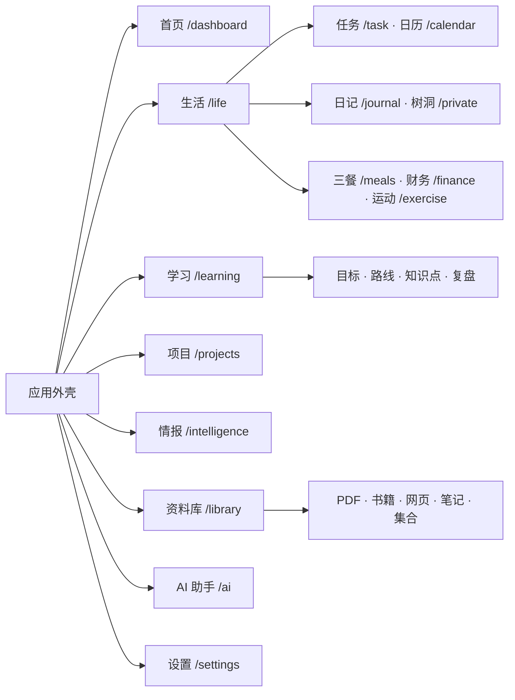

# Personal Hub 页面与交互规范

> **当前以本段为准（评审修订，v0.14.2 之后）。** 下文各版本章节是历史，其中“八个一级模块”“Ctrl+K 聚焦搜索框”等已不再成立。

**导航**：左侧四组共 13 个入口（今天：首页/任务/日程；生活：笔记/饮食/财务/运动/私密库；知识：学习/资料库/项目；洞察：情报/AI 助手），设置在侧栏底部。页面标题与一句说明由外壳统一提供（`App.vue` 的 `headings`），面板自身不再重复。

**键盘**：`Ctrl/⌘ K` 打开命令面板（页面跳转 + 资料搜索，方向键选择，Enter 打开，`Ctrl+Enter` 进入完整搜索页）；`/` 聚焦顶部搜索框；`Ctrl/⌘ Shift N` 记录想法；编辑对话框与内嵌编辑器中 `Ctrl/⌘ S`（或 `Ctrl/⌘ Enter`）保存；`?` 打开快捷键帮助；`Esc` 关闭最上层。输入法合成期间不拦截。真正的标签页支持左右方向键、Home、End；筛选按钮组使用 `aria-pressed`，不冒充标签页。

**确认**：不使用浏览器原生 `confirm`。放弃草稿用 `confirmDiscard`，其余用 `confirmAction`，正文必须写明具体后果，危险操作用危险按钮。可撤销的操作仍用撤销提示而不是确认。私密库的确认在对话框期间若库被锁定或清空，则答复作废。

**主题**：暗色类设在 `<html>`，使挂到 `body` 的对话框、命令面板同样继承；`main.ts` 在挂载前初始化，避免亮屏闪烁。所有颜色走 `tokens.css`，次要文字在各背景上不低于 4.5:1（有测试守护）。

**首页**：问候 + 今日状态条（待办数 / 下一个日程 / 逾期数，数据与下方列表同源，读取失败时不显示而不是显示 0）+ 组件网格。“今日任务”是精简版：没有范围页签、标签筛选、回收站与分页。快捷入口只接受当前存在的页面；旧版保存的 `/life…` 目标仍可读并重定向。

**任务**：列表顶部一行快速添加（回车保存；`明天 `/`后天 `/`今天 ` 前缀设定计划日，`! ` 前缀为高优先级）；详细表单保留为次级入口。快速添加失败时保留输入并用同一幂等键重试。

**笔记**：编辑器为宽屏对话框，左写右预览（窄屏只显示编辑区）。预览与阅读页使用同一个纯文本 Markdown 渲染，不加载 HTML 或图片。

**会话**：滑动有效期，连续 8 小时无操作过期，最长 7 天；启动时可用 `serve --open` 自动打开入口。

---

> 当前版本 v0.12.0（2026-11-12）：财务、运动、多源情报与可选 API 助手已实现，功能验收后才进入页面美化。音乐取消；本地模型部署取消；社区/自修改Agent冻结。最新契约见 [ADR-0012](ADR_0012_FUNCTIONAL_COMPLETION.md) 与 [API_V012](API_V012.md)，优先于下文历史规划。API真实服务未配置/未联网验收，向量RAG门禁未通过，不标为已完成。


> **当前实现 v0.11.0 / P3-03**：食谱与食材、每周三餐、采购建议预览确认、独立可编辑购物清单、手工库存盘点及默认隐藏的今日三餐已实现；schema=0010_diet。见[ADR-0011](ADR_0011_DIET.md)、[饮食API](API_DIET.md)、[本版验收](releases/v0.11.0.md)与[HANDOFF](../HANDOFF.md)。347项自动检查及构建通过，活动升级/完整恢复证据见交接；本版真实浏览器专项待本人。以下旧版本章节为历史，当前以末尾v0.11契约为准，功能优先、外观包装后置。

版本 0.11.0｜2026-11-12｜生活饮食四视图；先功能后统一视觉包装。

## 1. 信息架构与视觉基础

左侧导航固定八个一级模块：Dashboard、Life、Learning、Projects、Intelligence、Library、AI Assistant、Settings；中文界面分别为“首页、生活、学习、项目、情报、资料库、AI 助手、设置”，保留英文模块名作为文档和代码语义。未上线入口显示“规划中”和阶段说明，不渲染空白业务页面或虚假计数。已上线的旧情报工具可用明确“打开现有情报工具”入口访问，不让用户误认为新页面已接管。



默认 1440×900 设计，最小验证视口 1280×720；左栏 208～224px，中间弹性主区，右栏 288～320px 默认按需开启。≤1100px 收起右栏为抽屉；≤900px 导航折叠，表格允许横向滚动。移动端先保证数据不丢和可读，不在当前阶段实现完整手势交互。

视觉：系统字体/Noto Sans CJK 回退，正文14～16px，行高1.5，间距8px倍数；中性灰背景、低对比分隔线、一种克制强调色；无大面积渐变和装饰。除首页组件/少量概览外优先列表、表格、分组标题，不把每行包一张卡片。暗/亮主题遵随系统或手选；文本对比度至少 WCAG AA 4.5:1，控件至少3:1；状态不只靠颜色。

## 2. 全局外壳

```text
┌────────────────────────────────────────────────────────────────────┐
│ Personal Hub       [全局搜索 Ctrl+K]        [快速记录] [任务状态] [设置]│
├─────────────┬─────────────────────────────────────┬────────────────┤
│ 首页        │ 面包屑 / 页面标题          [主要操作]│ 相关信息（可收起）│
│ 生活        │ 筛选/视图切换                         │ 标签 / 关联资源  │
│ 学习        │                                     │ 反向链接         │
│ 项目        │           主内容区                    │ 最近活动         │
│ 情报        │                                     │                 │
│ 资料库      │                                     │                 │
│ AI 助手     │                                     │                 │
│ 设置        │                                     │                 │
├─────────────┴─────────────────────────────────────┴────────────────┤
│ 本地模式 · 保存状态 / 后台任务（仅有异常或长任务时强调）                  │
└────────────────────────────────────────────────────────────────────┘
```

当前模块和二级导航高亮；浏览器前进/后退保留筛选与滚动，非敏感筛选可放 URL，私密正文与关键词不放 URL。右栏是当前资源上下文，切换资源跟随刷新，关闭不改变业务数据。API/Worker/AI 状态分开呈现，不把“模型离线”显示成“系统不可用”。

键盘：`Ctrl+K` 全局搜索/命令入口，`Ctrl+Shift+N` 快速记录，`Ctrl+S` 在编辑器保存，`Esc` 关闭最上层弹层，`?` 在非输入状态打开快捷键帮助。快捷键支持禁用/重设，避免与用户工具冲突；输入框/IME 合成期间不劫持普通字符。Tab 逻辑顺序、可见焦点、弹窗焦点圈定和关闭后回到触发按钮；拖动排序同时提供“上移/下移”。破坏性快捷操作必须进入确认流程，不能一键永久删除。

## 3. 首页（DASH）

```text
首页       2026-11-11 周三                     [快速记录] [编辑布局]
今天：待办3 · 下一日程14:00 · 已逾期1            （不显示私密摘要）
┌───────────────────────────┬────────────────────────────┐
│ 今日任务                  │ 日程与重要提醒              │
│ □ 解析PE导入表   高 18:00  │ 14:00 实验课               │
│ □ 论文阅读      [改计划]   │ 昨日错过提醒 [查看]         │
│ [添加任务] [查看全部]      │ [新建日程]                 │
├───────────────────────────┼────────────────────────────┤
│ 快速记录                  │ 最近活动                   │
│ [记录想法…              ] │ 已完成任务 / 新建笔记       │
│ [普通本地 ▾] [保存到收件箱]│ 仅显示当前可见资源          │
└───────────────────────────┴────────────────────────────┘
用户后续添加：今日学习 / 每周目标 / 在读资料 / 最近项目 /
             技术情报 / 快捷启动 / 今日三餐
```

默认不超过两列主组件，首屏让用户看见今天和一个主要动作。组件按Phase开放、支持显隐/排序；无数据给一个创建入口，不用占大面积插画；某组件加载失败不阻塞全页。编辑布局时才出现拖拽把手与配置面板；保存/取消/恢复默认独立，恢复默认只改布局。

今日学习同时显示计划任务和知识节点，完成任务不等于通过知识验收；每周目标分别显示“成果2/3”“知识点验收1/4”，时长为附属。情报最多3条，显示来源/更新时间/历史不足等质量；不是无限信息流。今日三餐未安排时直接进入菜单；快捷启动先打开预览确认，不能自动执行。最近项目为用户访问记录，不被后台扫描改变。

## 4. Life 页面

### 4.1 任务与日历

```text
生活 > 计划          [任务 | 周历 | 月历]     [+任务] [+日程]
[今日] [本周] [逾期] [全部]     标签▾ 优先级▾     [日期范围]
任务：□ 标题               关联学习/项目     计划日    截止/提醒
      □ …                  …                 …          …
右侧详情：标题、描述、状态、优先级、计划日、截止、时区、提醒、关联
```

定时截止和仅日期截止互斥；全天日历清楚显示跨日范围，结束日期界面按用户理解显示“至某日（含）”，API 转为半开区间。逾期只统计未完成且已过截止的任务，不把未安排任务标逾期。勾选即时更新但失败时回滚并提示“未保存”；删除到回收站可撤销。日历先提供点击编辑，拖改时间后确认，不把拖动当唯一入口。提醒显示“仅服务运行时可提醒”；错过提醒汇总而非反复弹窗。

### 4.2 日记、快速记录与树洞

```text
生活 > 日记            [普通日记 | 私密日记 | 树洞] [+新记录]
日期/标签过滤     时间线列表     │ Markdown编辑 / 预览 │ 标签/关联
2026-11-11       今日记录       │ 正文…               │ 本地保存状态
2026-11-10       随手记         │ [保存] [历史版本]    │ 隐私：私密
```

进入私密范围需明显本地提示；D-02已选独立加密库，必须先输入解锁密码；加密验收前不开放私密录入，不能用隐藏入口冒充加密。private 页面切换离开/锁定后清空搜索建议和可见草稿，草稿本地保存仍按相同安全等级。手动保存提供确定性；自动保存防抖建议800ms，显示“正在保存/已保存/保存失败/存在冲突”。浏览器卸载时提示未保存变更。冲突并排查看“本次草稿/磁盘版本”，提供另存和人工合并，不默认选最后写入。

### 4.3 后续生活页面

| 页面 | 文字线框 | 主要动作与边界 |
| --- | --- | --- |
| 饮食 | 左：本周7天×早午晚；右：常用食谱/食材库存；下：购物清单 | 选菜→份量→对照库存→确认购物草稿；不自动扣库存 |
| 财务 | 现有工具入口或本月收支/预算；交易列表；月报 | 先显示适配策略说明，D-05未决不做空壳账本；货币分别统计 |
| 运动 | 周训练日历；记录列表；距离/时长统计 | 计划与实际分区，可记录跑步；无效距离不计算配速 |

## 5. Learning 页面

```text
学习中心     [目标] [路线] [材料] [记录] [阶段复盘]       [+目标/路线]
目标：能够独立解释和复现PE导入表解析        目标日…    [编辑验收标准]
┌────────────────┬──────────────────────────────┬───────────────────┐
│ 路线知识树     │ 知识点：PE导入表              │ 材料与关联         │
│ 基础           │ 当前：练习中                  │ PDF / 书籍章节    │
│ ├ PE结构       │ 验收标准：解释结构并复现解析   │ 笔记 / 课程        │
│ └ 导入表 ●     │ 今日任务  □ 编写解析器        │ 项目 / 实验成果    │
│ 节点可复用     │ 实践记录 / 输出成果 / 验收历史 │ [关联已有资源]     │
│                │ [记录学习] [提交验收]         │                   │
└────────────────┴──────────────────────────────┴───────────────────┘
```

“提交验收”表单要求标准、结论和证据选择；明确人工验收可写结论，进入 verified 必须有证据或充分人工验收说明，具体校验以数据模型为准。不能只点一次打卡完成节点。时长、任务完成率、知识验收率分别呈现；未设必修节点显示“尚未定义验收范围”。课程/书籍/论文选择器复用资料库，未有材料可跳转导入后返回当前节点。

阶段复盘显示“原目标→完成成果→知识验收→困难→下一步”，默认人工填写；AI按钮是可选辅助，不能阻塞保存。计时切页不中断，关闭服务或休眠后提示核对实际时长，不自动将长离线区间计入。

## 6. Projects 页面

```text
项目          状态▾ 标签▾          [+项目]
Malware Analysis Lab     进行中     任务3/8  里程碑1/3  最近打开…

项目详情：Malware Analysis Lab          [打开目录] [外部工具 ▾]
[概览] [任务] [里程碑] [文献] [实验] [日志] [阶段总结]
目标/状态/目录/GitHub链接 │ 主要内容                │ 关联知识点/资料
```

项目进度用可解释分母；删除项目时先展示未完成任务和关联清单，优先归档；不会删除本地代码目录。“外部工具”→预览配置名、可执行程序、目标目录/文件、参数→用户二次确认→结果；失败显示程序缺失/路径不可访问等可操作提示，不能显示 Token 或原始敏感命令。无论按钮名称如何，启动终端不自动运行分析代码。

## 7. Intelligence 页面

```text
技术情报       [综合] [GitHub] [HN] [arXiv] […]   [收藏] [订阅] [周报]
来源/领域/关键词/观察窗口/数据质量                  [刷新列表] [采集状态]
标题              来源     原始指标/窗口      趋势质量       [稍后读 ☆]
…
详情：原文 / 中文简介 / 原始链接 / 观察时间 / 各平台关联
      历史曲线（每个指标单独轴或分图） / 收藏 / 关联学习或项目
```

“刷新列表”读取本地库；“开始采集”在独立状态页显式触发。显示覆盖关键词、抓取局限、限流状态、最近成功/部分成功和错误计数。综合流按相关性或时间，不显示跨平台加总热度；切平台才展示其可比较榜单。来源不可用时保留历史，显示过期而非清空。

收藏仓库是收藏 Intelligence 资源；“创建个人项目”打开预填表单并明确是否引用目录，不能自动克隆。周报在预览里标注统计周期与观测间隔，AI草稿未保存前不能当成正式报告，不提供默认外发按钮。

## 8. Library 页面

```text
资料库     [全部] [PDF] [书籍] [网页] [笔记] [集合]      [+新建] [导入PDF]
标签/分类/阅读状态/排序             [仅当前范围搜索]
类型  标题/作者           阅读状态   页码/比例     更新时间
PDF   …                  阅读中     25/180       …

文献详情：标题 [修改元数据] [外部打开] [关联笔记]
[信息] [提取文本] [书签] [关联]        右栏：标签 / 集合 / 阅读进度
来源、SHA-256（展开）、页数、提取状态   个人备注（关联Note）
```

上传弹窗显示每文件“待验证/重复/导入完成/提取中/无可检索文字/需密码/失败”。导入成功与提取成功分开；失败允许单文件重试。重复项提示查看已有资源/补标签/取消；private 重复先进入授权流程，不能从普通弹窗暴露原文献标题。拖放上传有文件选择按钮替代。

进度手动输入当前页并验证范围；未知总页数不画百分比，不假定外部阅读器已回传。扫描版提示“OCR 尚未支持，可打开原件”；加密PDF提示本次输入密码且不持久化。书籍可无电子文件；进度按页或百分比模式，不混用。网页第一版只保存元数据，明确正文未离线保存。

笔记编辑器分屏/单栏可切，双向链接选择器优先用稳定ID而非裸标题；目标私密或已删时显示“不可见/已移入回收站”，不展示被隐藏标题。全文搜索与关联列表严格按当前范围过滤。

## 9. AI Assistant 页面

```text
AI 助手      模型：未配置 / 本机Ollama · 模型名         [模型设置]
[选择资料范围：本次选定3项]   默认排除私密资料
问题输入…                        [发送到本机模型]
回答正文 + 引用[文献p.12][笔记…]    [保存为笔记] [重新生成]
建议操作草稿：目标/修改前后         [预览并确认]（模型不直接写入）
```

未配置模型提供“选择资料/普通搜索”和设置入口。先检索后回答显示阶段和取消；超时可返回已有检索结果。选入私密资料要求本次明确授权并展示范围，输出默认同等级保护。回答引用可点击检查原片段、页码和版本；来源过期提示重新检索。模型结论不作既成事实，不自动标记学习掌握。

## 10. Settings 页面

左侧二级目录：基础/主题/首页布局/目录/数据库/备份与恢复/导出/外部应用/Token/定时任务/本地模型/日志/隐私。

```text
设置 > 备份与恢复
当前数据根（本地查看）  数据库版本/文件数/最近成功备份/最近恢复演练
[立即备份] [验证备份] [完整导出] [选择备份恢复]
恢复预览：来源时间/版本/哈希验证/包含私密内容/缺失外部目录/影响范围
          [取消] [确认停写并恢复]  →进度→验证→完成/回退说明
```

Token管理只显示配置状态和更新时间，“替换/移除”需要确认，不提供读取明文API；编辑时不以掩码作为真实提交值。定时任务显示本地时区、下次触发、最后结果及是否由旧cron管理，避免重复调度。日志默认脱敏，导出前再次预览。目录变更以迁移向导实现，不是一个无校验输入框。

## 11. 全局搜索、空状态和错误规范

搜索弹层默认个人普通范围，可按类型/标签/模块过滤；结果展示标题、片段、类型、位置；键盘上下/Enter打开。private 需进入专用范围（按D-02必须解锁独立加密库），不出现在普通联想词、历史或数量里。普通搜索历史可清除；private 查询默认不保存。搜索与命令动作区分图标/区域；命令不能绕过确认。

| 状态 | 用户看到 | 可采取动作 |
| --- | --- | --- |
| 首次空数据 | “还没有任务/文献”等具体说明 | 一个主要创建/导入入口 |
| 筛选无结果 | 当前筛选与“没有符合条件的内容” | 清除筛选；不提示重建数据库 |
| 无权限/私密锁定 | “当前范围不可访问” | 回到普通范围/解锁，不泄露标题 |
| 保存失败 | 未保存标志、可理解原因、草稿仍在 | 重试/另存；不能提前关窗 |
| 409冲突 | 修改来源和版本不一致 | 对比/另存/重新加载，加载前保护草稿 |
| 外部工具缺失 | 配置名与缺失路径（仅本地授权界面） | 更换程序路径/取消 |
| 数据损坏/版本过新 | 只读保护、错误编号 | 查看诊断/恢复向导；禁止“清空后重试” |
| AI/来源离线 | 该服务不可用，已有数据仍可用 | 本地搜索/稍后重试 |
| 长任务 | 可取消、已提交项数量、逐项失败状态 | 查看任务详情/仅重试失败项 |

Toast仅用于短暂成功提示，重要错误保留在页面；批处理不刷几十条Toast。高风险确认应具体列出“将永久清理哪些资料/覆盖哪个版本/启动哪个程序”，而不是泛泛“确定吗”。

## 12. UI验收清单

按每阶段已交付页面在1280×720和1440×900、明暗两主题检查；中文长标题、无数据、错误、加载、断网、模型关闭、键盘/输入法、未保存退出与隐私隐藏都要覆盖。首页可通过键盘排序、设置重启保留；普通搜索/关联/活动不泄露private；新增控件沿用同一术语、日期和保存反馈。性能测试与非功能目标按PRD执行，不拿截图美观代替业务验收。

## v0.2.0已实现的任务交互

首页显示“今日任务”：按本机计划日读取、分页8条、快速新建/完成/重开，链接Life；不显示假计数或演示任务。Life列表20条一页，范围为全部/今日/未来计划/逾期/已完成/回收站；显式加入今日、编辑标题/说明/优先级/日期/状态、移入回收站与撤销/恢复、JSON导出。说明为纯文本；精确截止API可用，UI仅编辑日期，保留现有精确时间并明确禁用冲突字段。

保存时禁用重复操作；网络失败保留编辑草稿和创建key/payload，安全重试；422可改输入；版本冲突保持草稿、禁用覆盖保存，允许刷新列表后手工核对并重新编辑。不提前勾选成功，提交失败保留原未完成状态。快速切换筛选用请求序号忽略过期响应，窗口重新获得焦点时刷新（编辑中除外）。软删除从普通列表移出，可在回收站恢复；不提供永久删除。

设置对空基线显示显式升级指引；首页尚未可自定义布局/快捷键/快速记录。Naive表单按钮配合原生日期/选择控件；当前组件交互与构建通过，两主题/两个桌面尺寸/浏览器控件与键盘仍需本机试用验收。


## 15. v0.3.0实际页面与交互

```text
首页：今日任务 → 今日日程（浏览器时区）→ 提醒收件箱
生活：[任务] [日程]
日程：导出 / 回收站 / 刷新 / 新建
      ← YYYY-MM → 今天
      一 二 三 四 五 六 日   （固定六周，周一开始）
      选择日期 → 日期/时区 → 分页当日议程
      行：名称 / 起止 / 状态 / 地点 / 可见关联任务 [提醒] [回收站]
日程表单：名称/说明/全天/开始/结束（全天含结束日）/地点/状态/分页任务选择
提醒表单：具体本地时刻 [添加] → 待发/已到期/已错过/已取消 [取消或已读]
首页收件箱：未读 ↔ 历史 / 导出 / 刷新，20条分页
```

月格当前只负责选日期，不声称显示所有事件密度；议程按日期分页，跨日按区间重叠出现在多天。月切换选择该月第一天，今天按钮回当日；回收站列全部普通已删除日程。月格button提供日期aria-label/选中aria-pressed和键盘Tab/Enter；尚无方向键网格与拖拽改期。原生日期/时间控件需用户浏览器验证。

时间输入/显示为浏览器时区，原事件时区另标。API存UTC，全天纯日期不变。输入遇DST空洞/重复拒绝并说明；编辑未改变时间保留原秒/微秒。全天结束显示含当天，API自动次日；具体时间结束必须严格更晚。关联目标不可见不泄漏ID/标题，原关联在无变更时保留。

所有保存失败保留草稿；创建保留相同key/payload安全重试；结果未确认时改变内容要先核对，版本冲突禁用覆盖保存。没有乐观假成功/静默合并。已删除只可恢复，无永久清理。完成/改期取消待提醒，表单提前说明；恢复需明确重设。

提醒为持久站内记录，页面每15秒GET刷新（不写DB），失败保留既有列表和错误，不自动标已读。未读按钮只有成功后移除；超24h标“已错过”，显示原定时间。模型/网络关闭不影响本机业务；服务停机无系统通知。设置显示处理器running/standby/degraded/disabled，degraded提示检查数据库/升级与本地服务状态。

v0.2浏览器验收用户已确认；本版9项组件/日期测试与构建通过，真实浏览器两主题/两尺寸、键盘、原生时间、断网和重启需按ROADMAP §9验收，不把内存renderer当浏览器结果。


## 16. v0.4.0普通笔记页面

```text
首页：[快速记录] [＋记录想法] → 最近5条普通笔记 / 管理全部
资料库：普通笔记 [刷新] [＋记录想法] [导出ZIP]
       全部 / 随手记录 / 普通日记 / 知识笔记 / 实验记录 / 回收站
       名称 · 类型 · 日期 · 修改时间 · 版本 · 文件异常（若有）
生活：任务 / 日程 / 普通记录（复用同一Note服务与页面）
编辑：名称 / 类型 / 归属日 / Markdown原文（字符计数）
     [下载已保存Markdown] [历史修订] [关闭] [保存笔记]
历史：分页版本/标题/时间 → 只读原文 → [放入编辑草稿] → 明确保存新修订
```

表单为手动保存、纯文本Markdown，不解析HTML/外部图片；普通日记清楚标明未加密，私密仍关闭。保存失败保留原草稿和创建/编辑key+完整请求；结果未知时变内容会阻止再次写入，提示先重试/核对。版本或文件冲突禁覆盖，可明确另存新笔记；不自动合并。无未保存草稿持久化到localStorage。

有未保存更改时，关闭/刷新/离开路由/生活视图切换均提示，取消离开仍保留草稿。切换旧修订同样确认替换当前未存草稿，历史读取不会写入；只有保存后生成新版本。下载Markdown是已保存内容，按钮不冒称导出当前草稿。回收站不永久删文件。

单项文件缺失/外部变更不从列表隐藏，显示“文件缺失/冲突，请核对”；不把错误变空正文覆盖。设置说明备份已涵盖DB+笔记/历史/未提交文件，但没有异盘备份与自动全量导出UI。PDF/书籍/标签/搜索/双链仍后续能力。

本版前端15项自动组件/算法交互验证和构建完成，真实浏览器v0.4尚待ROADMAP §9记录；v0.3用户已确认验收，不编造具体浏览器/分辨率。

## v0.5私密库页面（已实现，真实浏览器待验收）

```
生活 [任务] [日程] [普通记录] [私密库]
私密日记与树洞                         [立即锁定]
独立加密边界 / 遗忘不可恢复说明
  未初始化：密码 + 重复密码 + 无恢复确认 → 创建
  锁定：密码 → 解锁（错误/损坏统一说明，错误后退避）
  解锁：空闲剩余秒数 / 最长30分钟 / 隐藏即清草稿说明
    [私密记录] [私密回收站] [新建] [更换密码]
    分页列表：标题 / 私密日期 / 版本
    编辑：标题 / 类型(日记、树洞) / 日期 / Markdown原文
      [保存私密笔记] [移入回收站/恢复]
      历史修订 → 放入草稿 → 明确保存为新版本
    改密：旧密码 / 新密码 / 重复 / 旧备份说明 / 确认并锁定
    完整密文备份与隔离恢复入口说明
```

Settings提供进入同一私密库的链接，不复制领域数据。普通首页不显示私密最近条目/数量。所有密码框autocomplete=current-password/new-password，密码提交立即清框；无localStorage/IndexedDB持久草稿。Markdown纯文本不渲染外部HTML/图片。新挂载私密面板撤销旧解锁，不静默显示另一标签内容；手动锁/未存导航确认，隐藏/自动超时立即清空且不等保存。清空后异步迟到响应不得恢复编辑器/历史。保存不确定保留原key/payload，不允许悄悄换key；版本冲突禁覆盖并可明确另存私密笔记。失败fsync强制锁定可能清草稿，提示重新解锁核对真实记录，不能显示假成功。

本版依然没有完整Tag/全局搜索/自定义首页布局。两主题、桌面尺寸、长文本/键盘/浏览器后台行为按ROADMAP §9实测，组件测试不能代替。

## v0.6 首页布局与快捷入口（已实现）

```text
首页标题                          [重新读取布局] [调整首页]
按已保存顺序显示五种组件：快速记录 / 今日任务 / 今日日程 / 提醒收件箱 / 快捷入口
隐藏组件不挂载；全部隐藏 → 空状态 + 调整入口；左导航始终保留

调整首页（首页或Settings复用）
  □ 快速记录             [上移] [下移]
  □ 今日任务             [上移] [下移]
  … 五项，稳定ID与显隐/顺序
  快捷入口：名称 / Hub页面或网页 / 目标选择或URL / [移除]
  [添加快捷入口（最多12个）]
  ▸ 保存前预览：可见顺序、所有快捷名称/目标（不可点击）
  [将默认设置放入草稿] [取消调整] [保存首页设置]

外部快捷按钮 → 展示名称/完整目标/离开提示 → [确认打开网页 ↗] [取消打开]
```

排序按钮以Tab+Enter操作，aria-label含组件名；边界按钮禁用，移动后保持可用按钮焦点，live区域宣告位置。无仅拖拽操作。内部快捷是router-link，网页快捷先按钮预览，不自动请求远程资源；确认anchor `_blank`、noopener/noreferrer，预览移动焦点并可取消回原按钮。快捷没有自动图标加载。长URL换行、两列编辑器在较窄桌面重排。

编辑草稿期间隐藏正文组件；若有普通Note未存先确认丢弃，取消则保留笔记。重读布局遇Note草稿直接提示先保存/关闭，不卸载编辑器。显隐/顺序只在明确保存成功后应用；默认重置只进草稿，预览后保存，取消保持原布局。设置未存时离开/刷新提示。409保护草稿并禁写，确认重新读取后核对；网络失败保留相同key/payload重试，变内容不能悄悄发新写。重试返回更新的当前配置时同步所有字段/版本，不以旧草稿覆盖新版本。

损坏配置显示警告、默认组件和空快捷列表，调整按钮禁用；仍可访问生活/资料库，原配置不自动写回。首次GET未存也不建行；正常默认可编辑。加载完成前不挂业务组件以免隐藏项先查数据；失败回默认且说明未取得已存布局。首页与Settings都保留重读/调整入口。完整快捷键面板/复杂拖拽/全局搜索尚未实现。

## v0.7 普通笔记标签界面

```text
普通笔记   [记录想法] [导出ZIP]
查找标签 [名称输入] [查找]    #AI(2) #逆向(1) [标签分页]
当前标签：AI [清除]   [全部/四种类型/回收站]
笔记标题 · 日期 · 版本 · #标签       [标签] [回收站]
  → 标签弹窗：每行一个名称 / 保存笔记标签 / 重新读取 / 关闭
              已有标签 → 修改共享名称 → 影响提示 → 保存
```

目录每页20，字面查名称不等于全文搜索，选择单Tag与类型/回收站取交集；空目录提示从已保存Note添加，空筛选显示无匹配。首页快速记录不加载目录。标签入口不能与正文编辑同时打开，新笔记先保存再分类。所有控件原生按钮/textarea/input可键盘，名称只文本渲染。分类修改成功刷新列表/目录；移除保留笔记和标签身份，改名提示影响共享引用且不能自动合并。版本冲突保留草稿/禁覆盖，确认重读，失败读仍保留；未知保存结果守护关闭/导航/刷新。真实两主题两尺寸/键盘尚待本机验收，不以组件测试代替。

## v0.8 已实现页面与交互

主导航保留八模块。学习/资料库已开放；项目、AI仍显示后续阶段。顶部搜索入口与 Ctrl/⌘ K 打开搜索，Ctrl/⌘ Shift N 打开普通快速记录（私密内容仍须明确进入加密库）。路由/刷新保护任务、普通Note、标签、集合、元数据编辑和学习草稿；存储不使用localStorage持久化正文，失败不清空草稿。

```text
左导航       顶部：搜索 [Ctrl K]                  日期 / 主题
            资料库：PDF | 书籍 | 网页 | 课程 | Markdown | 集合
            ├─ PDF选择文件 → 每文件上传结果 → 提取队列状态
            ├─ 标题查询 / 阅读状态 / 标签 / 分类 / 回收站 / 分页
            ├─ 文献列表：名称、阅读页码、提取状态
            └─ 详情：人工元数据与原始提取值、手动页码、书签
                     下载 / 阅读器预览→确认 / 标签 / 关联 / 反链

            学习中心
            ├─ 左列：目标、路线、新建与回收站
            └─ 主区：路线进度（已验收/所有可见节点，明示分母）
                     有序知识树（缩进、上级、顺序）
                     知识点说明与验收标准
                     材料/成果关联 → 共享练习任务 → 学习时长记录
                     验收选择证据 → 结论 → 不可覆盖历史
                     路线阶段复盘 → 普通Markdown笔记

            搜索：普通资料全文 / 类型 / 分页 / 索引重建
            资源详情 /resource/UUID：当前名称与实际业务面板
            设置：主题 / 首页布局 / 普通ZIP导出 / 完整备份恢复命令
                  PDF阅读器登记（仅已安装白名单）/ 启停 / 启动记录
```

新资料以列表、分隔线与工作表单呈现，无复杂商业SaaS卡片/装饰。主业务表单用原生label/input/select，保持Tab/Enter及可见焦点。右侧详情本期在主区下方展示，降低窄桌面挤压；在1280×720与1440×900/两主题仍须本人验收。

空列表、查询无结果、未提取页数、扫描版无文本、密码文件、失败重试、草稿冲突分别有文案；搜索片段纯文本，Markdown不渲染不可信HTML/远程图片。UUID链接可复制进Markdown，在资源详情显示可点击的正向/反向链接，标题变化和数据根目录迁移不改变链接。批量上传每文件一个请求/幂等键，失败可以只重试失败项；取消剩余上传和提取取消分别处理。

阅读器预览列出实际参数并要求用户确认，打开专业软件不自动标在读/已读。导出按钮不上传，备份/恢复入口提供需停服命令，不在运行服务内部绕开维护锁在线迁移。未保存多个表单时保护整页；需要切换对象则先明确放弃草稿。

## v0.9 / P3-01 当前页面与交互

项目导航正式开放`/projects`，UUID入口`/resource/{project_id}`显示同一组件，不是另一套详情。沿用现有组件，本期不开展大规模视觉重构，也不把产品边界说明包装成伪功能按钮。

```text
左导航           个人项目                          [新建项目]
首页             状态下拉 · 标签 · 刷新 · 回收站
生活             项目名称 | 状态 | 完成/总数 | 编辑/回收
学习             分页
项目             ──────────────────────────────────
资料库           项目标题           [基本信息/状态]
……               说明 · 目标标准 · 起止日期 · 可解释进度
                 仓库链接 · 本地目录 [检查目录]
                 [任务] [里程碑] [日志与总结] [文献与关联]
                 当前分页列表 + 显式展开的新建/关联表单
```

任务可新建或选择已有，共享Life Task，可完成/重开、调整同项目里程碑、只解除归属。两种表单互斥，切换有未保存确认；已取消任务显示原状态，进度文字明确排除它。无任务百分比显示“尚无可统计任务”，不伪装100%。里程碑排序为整数position，编辑/验收/软删/恢复分别校验项目和里程碑版本，状态由用户手动设定。

日志与总结按项目日志/实验记录/阶段总结分类，正文使用现有Markdown Note编辑与固定链接；新建与已有笔记关联互斥。失败保留草稿、409保留用户文本、未知结果只原key/body重试；明确提供“放弃草稿并重新读取”，操作前提示Note可能已保存到资料库。页面聚合自有、编辑器与资源上下文dirty，保存一个子表单不放开其他未保存表单的导航保护；迟到响应不能向新页面发事件。

归档页保留全部内容和基本信息编辑入口，禁用任务归属/里程碑/记录创建/关联修改，关联标签可独立分类；重启状态后继续。项目回收只影响项目本身，不让用户误以为删除源码。目录检查由明确点击触发，显示存在/不存在/未配置/不可访问或符号链接，不自动扫描或启动工具。首页“最近项目”默认隐藏，在布局设置显式启用，只有实际打开过的项目出现。

### 后续统一包装（已提出，尚未实施）

用户目标：系统应提升原有生活/工作效率，风格优雅或极客，细节舒适，不能停留在聚合CRUD。当前先完善功能，再安排独立体验迭代：①全局搜索在右上日期左侧，范围下拉及Ctrl/⌘K；②资料库统一检索入口，保留上下文必要的标签/状态筛选，选择关联对象的局部检索仍按任务需要设计；③笔记博客式文章索引、舒适阅读和成果浏览，与Obsidian的写作/链接能力互补；④减少重复表单/装饰卡片、统一留白密度、键盘路径/焦点/状态反馈。尚未选择具体皮肤与编辑器，不提前替换现有存储协议。

专项验收见[本版说明](releases/v0.9.0.md)。自动组件测试为内存渲染，不是浏览器E2E；用户仅反馈Phase2基本完成，不记为本版所有主题/尺寸/桌面程序已通过。

## v0.10 / P3-02 当前交互

设置页新增“项目专业工具”：展示已登记配置、可用性、启停与“编辑/重新绑定”；登记表只选择本机固定候选，不出现命令行自由输入框。未安装应用说明不可用，不自动下载；程序更新后提示重新绑定。配置草稿/未知保存/CAS冲突保护导航和刷新；重试原key/body，明确放弃后读取当前事实。

项目详情新增“专业工具”页签：选择配置→“预览工具启动”→显示应用、目录、有效期和可信项目提示，启动参数折叠可查→“确认打开工具”。关闭预览不会执行。预览/请求在途加入父页面dirty，保存或刷新其他子表单不能丢它；路由/关闭保护，迟到响应不向新页面emit。未配目录/工具/归档状态给对应引导；启动后按应用结果查桌面，不展示假“已成功打开”。

网络丢失后保留原preview_id，按钮“查询/重试原确认”只处理同一次启动；可刷新历史核对，显示结果不确定时先看桌面，不能自动另建预览重试。取消关闭不终止外部程序。本项目历史分页显示当前配置名、发起/失败/不确定及时间，刷新只读不启动。更改项目/profile或过期则关闭旧预览重新读取后再预览。

```text
设置 → 项目专业工具                  项目 → 专业工具
已登记：名称 / 可用性 / 编辑 / 启停   应用下拉 [预览工具启动]
登记：名称 + 固定安装下拉             应用 → 项目目录 · 60秒有效
[保存工具配置]                       可信项目提示 · [查看参数]
                                     [确认打开工具] [关闭预览]
                                     本项目启动记录 / 刷新 / 分页
```

本期不改整体视觉、不做桌面窗口自动检测/内嵌终端；统一右上查找/博客式笔记等包装继续后置。本版真实浏览器/GUI专项见[v0.10](releases/v0.10.0.md)，用户对v0.9的验收不代替新功能逐项确认。

## v0.11 / P3-03 页面与交互

```text
生活 [任务] [日程] [普通记录] [私密库] [饮食]
  饮食 [每周三餐] [食谱] [购物清单] [冰箱库存]   [重新读取]
  每周三餐: [上周] 日期范围 [下周]   [添加安排]
    周一…周日: 早餐 / 午餐 / 晚餐 → 多道食谱 + 份数 + 备注 + 编辑/移除
  食谱: 查询 / 常用 / 回收站 → 列表分页 → 编辑名称/基准份数/步骤/食材行
    食材目录: 查询分页 → 登记 / 重命名
  购物清单: 周范围 [菜单采购预览] [手动添加]
    食材/单位 | 总需求 | 当前库存 | 本周已确认 | 建议追加 | 选择
    [明确确认追加] [关闭预览] → 独立项目列表（每20项）/已买/编辑/移除/恢复
  冰箱库存: 食材+规范单位 → 当前余额 → [盘点余额] → 明确保存绝对数
首页: 可选今日三餐（默认隐藏）→ 读取实际菜单 → 跳转饮食管理
```

固定单位显示中文，发API仍固定枚举；quantity用文本十进制，inputmode仅辅助，不转JS浮点。份数用整数。选择器有查询/分页，已有引用不因离开当前选项页丢失；当前编辑库存食材与单位锁定，避免把原版本误用于另一余额。食谱UUID资源页复用公共上下文，标签与编辑各自dirty由父级聚合。

新建食谱可无食材（外食），有食材时先登记目录；无库存不伪装为已盘点0。预览只显示/勾选，关闭无写入；确认失效保留原预览并提示重新核对，不能自动重算替用户确认。购入标记与库存录入分离且给出口径提示。周读取失败保留旧周及旧结果，不能挂新日期展示旧事实。

编辑、网络未知结果和进行中请求守护页签/导航/刷新；未知只原key/body/path重试；4xx保留草稿，明确放弃/重读。迟到响应不修改新页面，查询选择器也有代际检查。本版只做必要列表/表单/周分组，继续后置右上聚合搜索、博客式笔记/Obsidian协作与统一外观包装；真实两主题/两尺寸/键盘验收见v0.11清单。

## 需求变更：音乐界面已取消

不设计音乐导航、曲目列表、歌单、播放入口或首页音乐组件。用户已取消全部音乐开发；本次没有新增页面，也不将原音乐阶段改为其他媒体功能。

## v0.12 功能页面（视觉专项尚未开始）

```text
生活
├─ 任务 / 日程 / 普通记录 / 私密库 / 饮食（原功能）
├─ 财务：月份、分类 → 记一笔 → 月报、分类预算、记录分页、回收站
│        私密明文导出；选择Hub JSON → 数量预览 → 明确追加导入
└─ 运动：月份、计划/实际区分 → 手工记录 → 按日计划列表/月统计
         编辑计划可关联既有Task/Event UUID；取消计划/记录回收独立
情报
├─ 关键词 / 来源 / 领域 / 阅读状态 / 收藏 / 订阅命中 → 分页列表
├─ 快照与趋势 → 原始数据、未知载荷状态、同目标的其他来源
├─ 来源配置 → 显式启用 → 手动单批采集 / 最近100次运行
├─ 旧GitHub只读导入 / 原工具入口
└─ 关键词订阅 / 周报模板（复制到笔记保存）
AI助手
├─ API设置（默认关闭）：完整HTTPS endpoint / model / 密钥密码框
├─ 问题、学习复盘/资料总结预设
├─ 本机查找普通资料 / 已采集情报 → 最多8项
├─ 实际问题/标题/正文发送预览 → 明确确认API发送
└─ 运行状态 / 取消 / 临时纯文本回答 / 版本化来源引用
设置
└─ AI API配置 + 原布局/应用/备份设置；独立草稿所有者聚合
首页
└─ 技术情报组件默认隐藏，只读最多5项，不触发联网采集
```

文件/密钥输入只在本机处理；AI明示发送目标和内容，不能用“所有资料永远留在设备”误导。模型结果用Vue转义的纯文本，不渲染不可信HTML。普通写入失败保留原幂等key/payload，编辑CAS冲突提示；网络付费请求不自动重试。功能表单复用LocalEditor，日期/金额/整数单位标注清楚。已有样式沿用，不把构建或内存组件测试称为浏览器验收。

待本人功能验收后再决定统一搜索放日期左、资料库单一分类检索、博客式笔记、Obsidian协作、排版/密度/主题/键盘等包装。本版不实施这些视觉重构。

## v0.13：Paper & Graphite 视觉与阅读体验（2026-11-12）

用户明确授权开始美化，覆盖v0.12“美化前暂停”。设计从密集表单转向个人工作台：暖纸背景/石墨侧栏/青绿重点/少量陶土色点缀；暗色采用同组低亮度颜色。无远程字体、图片或新增依赖。基础导航图标为本地SVG，品牌为CSS书脊形状，不加载外部资产。

- 外壳：左侧中英双层导航，当前项清楚标识，底部快速记录和本地状态；右上搜索在日期左，支持范围下拉。Ctrl/Cmd K聚焦搜索，Enter提交到唯一SearchPanel，路由携带关键词/范围并自动查询。Ctrl/Cmd Shift N仍快速记录。
- 首页：真实本机日期/时段问候、两项明确动作；不伪造任务数、进度或占位业务记录。组件用12列网格，两栏主次布局；按原保存顺序正常流排，不用CSS order打乱键盘顺序；组件开关/排序仍原服务权威，页面GET不保存布局。窄屏自然单列，隐藏装饰日历。
- Library：统一类型切换带；标题搜索由顶部接管，PDF/书籍/网页/课程与固定资源页保留状态/标签/分类/回收筛选。PDF导入与笔记标签工具默认折叠，减少初次进入噪音；集合编辑“查找待加入成员”是局部编辑操作，保留。
- 笔记：文章列表用清晰日期/类型/标签与阅读标题；点击普通标题先只读阅读，编辑为明确动作；首页compact仍快捷编辑。固定链接进入阅读。阅读页有返回/编辑/版本/日期与正文，不新增第二份正文存储。所有保存、冲突、历史、幂等与文件hash保护沿用。
- Markdown阅读仅本地文本渲染：标题/段落/有序无序列表/引用/围栏代码/分隔线、基础强调与链接；没有v-html/innerHTML，原始HTML作为文本，远程图片不加载；链接只允许无凭据HTTP(S)和有效hub资源链接，外链noopener/noreferrer。表格、嵌套格式、图片和完整CommonMark扩展不是本期承诺；原文随时可编辑下载。
- 公共表单：统一按钮层级、输入边框、间距、状态提示、空状态、列表、分页、折叠高级操作、模态框圆角；财务/AI发送/私密安全提示与确认保留。重建搜索索引作为次级维护操作，不与查询同权重。
- 可访问性：焦点可见、键盘原生控件、减少动画偏好、深浅主题、响应式640/980/1200断点；不以低对比装饰隐藏关键操作。敏感内容、加密库与账本不进入全局检索。

本版91项前端交互/安全渲染检查与类型构建；浏览器工具无可用surface，IAB提示不可用，未完成真实截图、明暗主题/各尺寸/实际点击验收，不把组件测试当视觉验收。本人清单见releases/v0.13.0.md。


## v0.13.1 当前日常交互约定

以[本版问题清单](releases/v0.13.1.md)为准。优先可读正文和可发现动作，减少装饰占用首屏。侧栏可滚动，图标有名称，保留键盘跳至主要内容入口；真实视觉和缩放仍待浏览器验收。

- Life/Library分类写入URL view；再次点击当前分类不重置，浏览器后退恢复类型。首页任务入口使用today范围，笔记管理直达note分类。
- 每个表单独立上报draft，再由页面聚合。关闭某一表单不得解除其他草稿保护；日程、周报也适用。提交结果未知保留原请求/内容，不能通过美化降低安全确认。
- 右上顶部为App唯一主搜索框；结果区展示条件与状态，错误不充当空数据，分页使用已提交条件。组件独立使用可提供自己的表单。业务关系/证据/AI资料选择内的查找属于局部动作，Enter只执行该查找。
- 文献/目录详情替换列表占位，返回保留列表筛选；笔记阅读上下文在编辑打开期间保留。无更多结果时不展示无用分页。
- 通用ResourcePicker按标题和类型分页，只提交稳定ID；当前不可见关联不得自动解除或回显不可见标题。运动展示分钟/公里，字段输入仍显式标秒/米。
- AI快捷问题覆盖要确认，运行中禁止替换/清空，已选项独立显示且可移除；不会因此省略真实外发预览确认。
